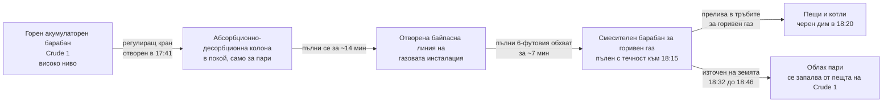

*Снимка: Chris LeBoutillier, Unsplash.*

В 18:16 на 20 септември 2022 г. по радиостанциите на инсталация Crude 1 в рафинерията BP-Husky в Орегон, Охайо, точно източно от Толидо, минава следният разговор. Американският Съвет по химическа безопасност (CSB, федералната агенция, която разследва химически аварии) го е отпечатал дума по дума:

> [Пулт] Ей, нивото в смесителния барабан. Проверете го веднага.
> [Терен] Прието.
> [Терен] Нивото е над нивомерното стъкло на смесителния барабан.
> [Пулт] Казваш, че нивото в барабана е над стъклото?
> [Терен] Точно така.
> [Пулт] Прието, просто го източете колкото може по-бързо.
> [Терен] Това правим.

Тридесет минути по-късно, в 18:46, облак пари достига пещта на Crude 1 и се запалва. Двамата оператори на терен, които източваха барабана, двама братя, единият от тях стажант, започнал работа през март, попадат в пламъка и умират от изгарянията си.

[Окончателният доклад](https://www.csb.gov/assets/1/6/final_report_-_20241.pdf) на CSB, № 2022-01-I-OH, излезе през юни 2024 г. На 30 септември 2026 г. агенцията публикува [видео по безопасност](https://www.csb.gov/csb-releases-bp-husky-safety-video/) по същия случай, „Alarming Mistakes, Deadly Decisions“ („Тревожни грешки, смъртоносни решения“), и затова темата отново е на бюрото ни тази седмица. Докладът е 164 страници. Почти нищо в него не е за двамата загинали. Почти всичко е за 24-те часа, преди да се качат при онзи барабан, и за това защо течността, която източваха, не беше това, за което я мислеха.

Ако работите по ремонти (turnaround), има два детайла в тази история, които трябва да ви вледенят. Нивомерът, който задейства цялата верига, беше сменен по време на ремонт шест седмици по-рано. А кранът, който накрая изля нафта на земята, беше връзка за пропарване преди ремонт, точно от типа кранове, които екип като нашия оставя след себе си с болтиран сляп фланец, когато работата приключи.

## Какво казва докладът на CSB

По онова време рафинерията в Толидо беше съвместно предприятие BP-Husky, управлявано от BP. Днес е собственост на Ohio Refining Company, дъщерно дружество на Cenovus, към което са адресирани препоръките на CSB. CSB нарича пожара „най-големия смъртоносен инцидент в рафинерия, управлявана от BP, след фаталната авария в рафинерията на BP в Тексас Сити през 2005 г.“, и докладът посвещава цял раздел на сравнението между двата.

Твърдите числа:

| | |
|---|---|
| Номер на доклада | CSB 2022-01-I-OH, публикуван юни 2024 г. |
| Дата и час на запалването | 20 септември 2022 г., 18:46 |
| Загинали | 2 (оператор на терен и оператор стажант) |
| Материални щети вкл. пропуснати ползи | около 597 млн. долара |
| Изпусната нафта | около 23 500 lb (10,7 t) |
| Изпуснат горивен газ | около 66 900 lb (30,3 t) |
| Аларми на един пулт, 6:50 до 18:49 | 3712 |
| Предложена глоба от OSHA (март 2023 г.) | 156 250 долара |

Формулировката на CSB за причината е без заобикалки: „оператори, които отварят кранове и свалят фланец на смесителния барабан за горивен газ под налягане, за да изпуснат запалима течност, нафта, директно на земята.“ След това изброява пет допринасящи фактора и там е истинската история: липса на инженерна защита срещу преливане на съдове един в друг, липса на решение за спиране или за гореща циркулация, когато денят тръгна зле, липса на процедури за извънредни ситуации, алармена система, която затрупа операторите си, и почти идентично събитие от 2019 г., което беше разследвано и после забравено.

Да вземем деня подред, защото редът е същината.

## Двадесет и четири часа „нормално смущение“

Смесителният барабан за горивен газ е съд, който събира собствения отпадъчен газ на рафинерията от различни инсталации, отделя капките течност и подава чист горивен газ към пещите и котлите. Той трябва да съдържа пари. Малко течност на дъното, източвана от време на време към факелния сепаратор или към нефтосъдържащата канализация, е нормално. Барабан, пълен с течна нафта, не е.

Ето как се стигна дотам според възстановката на CSB.

**Понеделник вечер, 19 септември, около 19:10.** Пултов оператор в контролната зала частично затваря регулиращия кран за водата на горния акумулаторен барабан на Crude 1 (барабанът, който улавя кондензираните горни пари от атмосферната колона и разделя водата от нафтата). Кранът е на ръчен режим. Нивото на водата се покачва през нощта и спира на 69 процента на екрана около 23:45.

Ето го ремонтния детайл. По време на ремонта на рафинерията от април до август 2022 г. нивомерът за водната фаза на този барабан беше сменен от буйков с радарен с направляваща вълна (радарна сонда, която измерва нивото, като отчита времето на импулс по прът). Същите щуцери на съда, различно калибриране. Със стария уред водата стигаше до върха на вътрешната тръба за нафта при показани 100 процента. С новия стигаше дотам при 69 процента. CSB установи, че документацията по управление на промяната е била изготвена и съобщена преди пуска, но съобщението „не включваше, че това ниво ще се отчита различно отпреди“. Уредът беше в експлоатация около шест седмици. Така при 69 процента водата вече преливаше през тръбата в линията за нафта, а никой пред екрана нямаше причина да го подозира.

**Вторник сутрин, малко след 7:00.** Водата е стигнала надолу по веригата, преляла е кондензатен барабан в газовата инсталация на коксовата установка, увеличила е потока от дъното на абсорбционно-десорбционната колона и е вдигнала налягането в топлообменниците за предварително подгряване на хидроочистката на нафта (NHT, инсталация, която отстранява сярата от нафтата върху слой катализатор; подгряването е редицата от седем топлообменника пред нея). Два предпазни клапана се отварят. Единият от тях „тракa“. Тръбопроводът започва да вибрира.

Оператор на терен излиза по радиото. Докладът цитира четири съобщения в рамките на две минути:

> „Не знам колко още можем да оставим това така… ще разкъса нещо… Някой трябва да вземе решение тук, веднага.“
> „Сериозно ще потрошим нещо, ако оставим това да продължи още.“
> „Наистина ми трябва някой да ми разреши да изолирам този предпазен клапан.“
> „Не знам колко още ще издържи тази тръба. Бие я много лошо.“

Около 25 минути след тези повиквания дренажна линия ¾ инча се откъсва от шестинчовата тръба за нафта. Течна нафта изтича навън. Не се запалва. NHT е спряна аварийно, газовата инсталация на коксовата установка е байпасирана и атмосферната колона продължава да работи, без да има къде да изпраща нафтата си освен в резервоарите за лека първична нафта.

**Вторник, целия ден.** С NHT спряна и газовата инсталация байпасирана, колоната Crude 1 прекарва цялата дневна смяна в борба със себе си: многократна загуба на охлаждащите циркулационни потоци, ниво в акумулаторния барабан, което не може да се овладее, и 11 превишения на налягането в колоната с многократно отваряне на предпазните клапани. Операторите сменят суровинния микс (съотношението на суровите нефти, подавани към колоната) отново и отново в опит да я успокоят.

**Вторник, 15:00 до 16:00.** Ръководството на рафинерията и технолозите се събират заради колоната. Обсъжда се спиране на Crude 1 или превключване на гореща циркулация (без суровина, нефтът циркулира, пещта е намалена). Нито едното не се прави. Един от участниците пише имейл с изводите от срещата. CSB установи, че „имейлът така и не беше изпратен“. Нищо от тази среща не стига до нощния координатор или до пултовите оператори, нито устно, нито в бележките по предаване на смяната.

**Вторник, 16:50.** Нощната смяна влиза в тази обстановка. Редовният пултов оператор е квалифициран да управлява този пулт сам от по-малко от месец. Втори пултов оператор с шест години опит е извикан да помага. Нощният координатор на рафинерията по-късно казва пред CSB, че с „работеща атмосферна колона, спрени газова инсталация, газова инсталация на коксовата установка и NHT“ той „никога не я беше виждал да работи така“ и „нямаше техническо ръководство как да я управлява“.

**16:56.** Нощната смяна прави нова смяна на суровинния микс, този път премахва целия лек нефт от суровината. Идеята е да се произвежда по-малко нафта. Ефектът до 17:30 е ново смущение в колоната: температурите се покачват, циркулационните потоци губят дебит един след друг (долният в 17:41, средният в 17:47, горният в 18:13), леките фракции се изпаряват нагоре по колоната, кондензират в акумулаторния барабан и нивото в него излита.

**17:41.** За да свали нивото, пултов оператор отваря регулиращия кран от акумулаторния барабан към абсорбционно-десорбционната колона на газовата инсталация на коксовата установка. Тази колона стои в покой в режим само за пари, с отворена байпасна линия към смесителния барабан за горивен газ. Нафта потича с повече от 18 700 барела на ден към колона, която няма къде да я дене.

За около 14 минути абсорбционно-десорбционната колона е на 100 процента. За още около седем нивомерите на смесителния барабан стигат тавана си. Пултов оператор по-късно описва момента пред разследващите: „гледахме на това просто като на „нормално смущение““, а тогава си мислел, че „ще се справим“.

## Тридесетте минути при барабана

Сега частта, която има най-голямо значение, ако някога застанете до съд, който някой ви е казал да източите.

**18:09.** Нафта започва да влиза в смесителния барабан. **18:10.** Алармата за високо ниво се задейства на пулта. Тя е с висок приоритет и е оцветена като такава. Пултовият оператор не вика терена по радиото до **18:17**, точно след алармата за много високо ниво. В тези седем минути пултът регистрира 55 аларми, по една на всеки девет секунди.

Четирима оператори на терен пристигат при барабана. Единият отваря докрай двуинчовата линия към факелния сепаратор (затворена система). Друг отваря двуинчовия дренаж към нефтосъдържащата канализация, за което този дренаж е предназначен. Тези два пътя могат да поемат съответно около 9800 и 15 600 барела на ден. Нафтата продължава да пристига по-бързо от това, защото никой при барабана не знае, че регулиращият кран нагоре по веригата е отворен, а никой в контролната зала не го е свързал с барабана.

**18:20.** Коминът на пещта на Crude 1 започва да изпуска черен дим. **18:22.** Комин на котел става зелен. **18:24.** Докладван е пожар под пещта на Coker 2. В системата за горивен газ има течност и всяка пещ и котел в завода вече са опасност. Нощният координатор излиза по радиото: „Имаме течност в системата за горивен газ. Стойте далеч от тези пещи.“ В **18:27** той нарежда спиране на рафинерията, горивото да се спре към всяка пещ и котел. Пред CSB той казва, че е било „много лесно решение“, защото „пещите ставаха богати“. Според сметките на CSB то вече е било и твърде късно за това, което беше в барабана.

Ето детайла, който трябва да накара всеки рафинерийски работник да потръпне. Нощният началник-смяна и други оператори казват пред разследващите, че са смятали течността, която източват, за **аминово-воден разтвор**, не за нафта. Това е, което обикновено се събира в смесителен барабан за горивен газ. Началникът казва на двамата при барабана да си вземат дихателни апарати (SCBA, апарат със сгъстен въздух и маска, който бихте носили при риск от сероводород), защото аминово-водният разтвор може да съдържа H2S. Те ги слагат. Носят и детектори за H2S. Екипирани са за грешната опасност. Никой не е казал на терена, че пултов оператор е насочил нафтата от атмосферната колона в техния барабан.

Двама от четиримата тръгват да проверят сепаратор в газовата инсталация. Двамата братя остават да довършат работата.

**18:32.** Те отварят два продухвателни крана ¾ инча към земята: един на нивомерното стъкло и един на диференциалния нивомер по налягане. Отварянето на продухването на дП нивомера променя налягането върху него и показанието за ниво на пулта пада до нула. Бележката под линия в доклада: „Това създаде погрешното впечатление, че смесителният барабан се изпразва, докато в действителност той все още беше пълен.“

**Малко преди 18:39.** Те свалят слепия фланец от двуинчов шибърен кран отстрани на барабана, на около седем фута от земята, и го отварят. CSB отбелязва, че този кран „беше предназначен само за достъп от поддръжката като част от ремонтни дейности“. Това е връзка за пропарване. Нафта се излива на земята и моментално се изпарява.

**18:39.** Детектор за запалим газ до барабана отчита 100 процента от долната граница на запалимост (най-ниската концентрация на пари във въздуха, която може да се запали). Сирената и светлините му се задействат на място. Той не алармира в контролната зала. CSB установи, че алармата на DCS за този детектор е била „деактивирана“ заради грешка в принудителната конфигурация на алармите. Сирената се чува на заден фон в радиовръзка в 18:40. Никой вътре не знае какво означава.

Работник, стоящ наблизо, описва какво е видял:

> „Изглежда някой източва продукт от смесителния барабан. И видях, че го пръскат с вода. […] Бяха сложили нещо… за да отклонят струята, така че да отива […] в канализацията, вместо да пръска навсякъде. […] И силна, силна миризма. И видях този облак пари да излиза оттам […] Реших да се отдръпна и […] отстъпих около 20 фута и тогава избухна.“

Приближаваща дъждовна буря обръща вятъра към пещта на Crude 1. **18:46.** Запалване.

В 19:04 пултов оператор осъзнава, че нафта тече към газовата инсталация от акумулаторния барабан, и затваря регулиращия кран, отворен в 17:41. След това аварийният екип трябва да изпрати три отделни групи, за да затворят всеки кран, който двамата бяха отворили, с огън, излизащ от всеки един. Пожарът е потушен в 22:10.

*Снимка: Jahhid Fitrah Alamsyah, Unsplash.*

## Уредите, които лъжеха

Смесителният барабан беше 7 фута и 11 инча в диаметър и почти 14 фута и 9 инча висок. Нивомерното му стъкло, дП нивомерът и радарът с направляваща вълна измерваха само долните шест фута. Това е нормална проектна практика за барабан, който никога не трябва да съдържа много течност. Означава, че щом барабанът е малко над една трета пълен, всеки уред на него е закован на 100 процента и не може да ви каже нищо повече.

По-лошо: дП нивомерът дори не беше закован. Той спря на около 67 процента. Диференциалният нивомер по налягане извежда нивото от тежестта на течния стълб, затова трябва да му се каже колко тежи течността. Този беше калибриран за аминово-воден разтвор с относителна плътност 0,998. Нафтата е около 0,72. Така барабан, препълнен с нафта, се отчиташе като две трети пълен с вода. CSB: дП измерването „никога не достигна точката на алармата за много високо ниво на смесителния барабан, нито показа, че течност прелива в тръбите за горивен газ“.

Радарът казваше 100. Стъклото казваше над стъклото. дП казваше 67, а след отваряне на продухването нула. Три уреда, три истории, а този, който захранваше алармата за много високо ниво, разказваше най-успокоителната.

## 3712 аларми

CSB посвещава цял раздел на алармения потоп и това е частта от доклада, на която новото видео набляга най-силно.

Браншовият праг за алармен потоп (от ръководствата EEMUA 191 и ISA-18.2, които собствената алармена философия на BP беше възприела) е 10 аларми за 10 минути за един оператор. Над това човекът пред екрана вече не управлява завода. Той сортира опашка. На 20 септември пултът на Crude 1 беше над тази граница от около 7:00 до след пожара, с две десетминутни изключения. Между 16:50, когато нощната смяна застъпва, и 18:46 пултът получава между 24 и 281 аларми на всеки десет минути: 2,4 до 28 пъти над прага за потоп. Средното за деня беше 254,5 аларми на час.

Един пултов оператор го описва така:

> „Междувременно [смесителният барабан] е на високо ниво. Алармите идват. И в този момент, помня, се чувствах много претоварен. […] В този момент почти всичко е на ръчен режим, а алармите продължават просто да се сипят.“

Заключението на CSB е, че потопът „допринесе за инцидента, като претовари и разсея пултовите оператори, причинявайки забавяния и грешки в реакцията на критични аларми“. Ако пултът беше имал възможност да мисли, можеше да проследи течността назад до крана, отворен в 17:41, и да го затвори. Само това действие щеше да спре пълненето на барабана.

Това, което CSB също отбелязва, и това е частта, която ръководител на екип може да използва, е, че BP измерваше представянето на алармите като месечна средна стойност. Януари и февруари 2022 г. изглеждаха добре по този показател. Месечната средна стойност не казва нищо за един-единствен дванадесетчасов ден, в който заводът се разпада. Препоръка R4 към рафинерията и R7 към ISA искат представянето при алармен потоп да се измерва на събитие: колко потопа, колко е продължил всеки, колко аларми и какъв е пиковият темп.

## Бяха го виждали и преди

През 2019 г., по време на смущение в цялата рафинерия, предизвикано от студен фронт и изключване на котел, същият регулиращ кран беше отворен на 80 до 100 процента, за да се разтовари високо ниво в акумулаторния барабан към газовата инсталация на коксовата установка. Нафта напълни абсорбционно-десорбционната колона, върна се през байпаса и вдигна високо ниво в смесителния барабан за горивен газ. Беше източен към факела и канализацията. Никой не пострада. Радарът показваше 100 процента, а дП замръзна на около 65 процента, същото несъответствие като през 2022 г.

BP разследва случая с анализ „Пет защо“. Двете коригиращи действия, които излязоха от него, засягаха запушване с хидрати в горната система на десорбционна колона, конкретното оборудване, причинило налягането през онзи ден. Нищо не засягаше преливането на нафта в системата за горивен газ. Нищо не засягаше несъответствието между уредите. CSB цитира изследователката по системна безопасност Нанси Левесън защо: „Пет защо“ „може да накара разследващия екип да пропусне важни системни причини“.

Докладът нарича това христоматиен пример за предупредителен знак за катастрофален инцидент, който организацията „не възприема или не разпознава“. Имаше репетиция без жертви и я третира като проблем със студеното време.

## Защо това има значение от гледната точка на изпълнителя

Нашите екипи не управляват атмосферни колони. Ние сме хората, които влизат в реакторите и съдовете по време на ремонта, изваждат катализатора, правят инспекционните влизания и връщат завода обратно. Тогава защо да посвещаваме цяла основна статия на експлоатационен инцидент?

Защото три нишки в този доклад минават право през един ремонт.

**Уредът, сменен по време на ремонта.** Нивомерът за водната фаза беше сменен по време на спирането през 2022 г. Новият показваше 69 там, където старият показваше 100 при същото физическо ниво. Процесът по управление на промяната (MOC, документацията и прегледът, които трябва да се случат преди всяка модификация в завода) беше завършен. Просто не казваше единственото изречение, което операторът имаше нужда да чуе: „това вече ще се отчита различно“. Шест седмици по-късно тази празнина задейства веригата. Ако сте изпълнител, който прави промени по КИП или тръбопроводи по време на ремонт, бележката при предаването, която гласи „същият таг, същите щуцери, различно калибриране, точката на преливане вече се отчита като X“, не е администрация. Тя е работата. Ако сте ръководител на ремонт, прегледайте приключените си MOC и попитайте кои от тях са променили това, което операторът вижда, без да го кажат.

**Кранът със слепия фланец.** Двуинчовият шибърен кран отстрани на барабана съществуваше, за да може ремонтен екип да пропари съда преди влизане. Имаше сляп фланец с причина: при нормална работа никога не трябва да се отваря. Под напрежение, без процедура, с погрешна представа какво има вътре, двама души развиха този фланец, защото беше най-големият отвор, който можеха да намерят. Всеки съд, който връщаме, има такива връзки. Болтиран и маркиран сляп фланец е послание към следващия: това не е дренаж. Уверете се, че посланието е на него. Уверете се, че обходът преди пуска го потвърждава.

**Правото да спреш работата важи и за вас.** Процедурата на BP Toledo гласеше: „Всички служители на рафинерията на BP и всички служители на изпълнители имат правото и отговорността да СПРАТ всяка работа, която може да е ОПАСНА.“ CSB установи, че никой не го е използвал през онзи ден, нито по време на тракането на предпазния клапан в 7:00, когато оператор на терен молеше по радиото някой да вземе решение, нито на следобедната среща, нито в нощната смяна, когато съвсем нов пултов оператор гледаше 48 аларми на всеки десет минути. Ключовата поука на CSB си струва да се цитира, защото реже и в двете посоки: компаниите трябва да гарантират, че служителите „не само са ясно оправомощени да упражняват правото да спрат работата, но и ясно разбират, че се очаква да го правят“. И на един дъх: то „не е заместител на ефективни системи за управление на технологичната безопасност“, защото изисква от един стресиран човек да „отстоява несъгласие срещу група“.

За ръководител на изпълнителски екип практическата страна на това е следната. Ако заводът, в който сте, е по средата на лош ден, ще го чуете. Предпазни клапани, които се отварят многократно. Димящи комини. „Стойте далеч от тези пещи“ по радиото. На вашето разрешително не му пука за нищо от това, но на вас трябва да ви пука. Екипите с обучение по SCC/VCA отработват всяка година реакцията „събиране и оттегляне“ при обща аларма в завода. Това, което обучението не покрива, е завод, който е в извънредно състояние дванадесет часа и никога не е подал обща аларма, защото всички вътре още си мислят „ще се справим“. Втората препоръка на CSB към рафинерията иска определение кога една извънредна ситуация е станала твърде тежка и какво да се прави тогава. Докато един завод няма такова, собственият праг на вашия екип за оттегляне трябва да е по-нисък от този на завода.

И още едно, специално за младия техник. Двамата загинали бяха с дихателни апарати. Носеха детектори за H2S. Началникът, който им каза да се екипират, беше внимателен. Бяха защитени срещу аминово-воден разтвор, а им беше дадена нафта. Когато някой ви каже какво има в една линия или съд, въпросът не е „какви ЛПС ми трябват за това?“. Въпросът е „откъде знаем, че е това?“. Ако отговорът включва нивомерно стъкло извън обхват и нивомер, калибриран за нещо друго, не знаете. Източването на неизвестна запалима течност на земята до запалена пещ не е работа, която става по-безопасна, ако се върши по-бързо.

## Поуката

Заглавието на видеото на CSB е точно: смъртоносното решение беше при барабана, но тревожните грешки бяха навсякъде другаде. Нивомер, сменен по време на ремонт без бележка какво ще показва. Предпазен клапан, оставен да трака 25 минути, докато някой по радиото моли за решение. Среща, чиито изводи останаха в неизпратен имейл. Смяна на суровинния микс, която накара колоната да заври. Кран, отворен, за да се оправи ниво, без никой да проследи къде ще се озове течността. Уреди, които се заковаха, излъгаха и после показаха нула. Аларма за запалим газ, деактивирана от грешка в конфигурацията. И двама души, правилно екипирани за грешната опасност, на които беше казано да източват колкото могат по-бързо.

За ръководителя на ремонт: предаването е продуктът. Промяна в завода, която никой не е обяснил, е капан, който залагате за следващата смяна или за следващата година.

За ръководителя на екип: когато заводът е в смущение, експозицията на вашия екип не се покрива от разрешителното ви. Оттеглете се по-рано, отколкото го прави заводът.

За младия техник: никога не източвайте това, което не можете да идентифицирате, никога не източвайте на земята близо до пещи и никога не позволявайте „колкото може по-бързо“ да замести „накъде и от какво“.

## Източници и допълнително четене

- U.S. Chemical Safety and Hazard Investigation Board, *Fatal Naphtha Release and Fire at BP-Husky Toledo Refinery*, доклад от разследване № 2022-01-I-OH, юни 2024 г. [Пълен доклад (PDF)](https://www.csb.gov/assets/1/6/final_report_-_20241.pdf). [Съобщение на CSB за видеото по безопасност, 30 септември 2026 г.](https://www.csb.gov/csb-releases-bp-husky-safety-video/) и самото видео, [*Alarming Mistakes, Deadly Decisions: Fatal Fire at BP-Husky*](https://www.youtube.com/watch?v=HmiQFYGc6C4).
- EEMUA Publication 191, *Alarm Systems: A Guide to Design, Management and Procurement*, и ANSI/ISA-18.2-2016, *Management of Alarm Systems for the Process Industries*. Определенията за алармен потоп, спрямо които CSB оценява рафинерията.
- CCPS, *Guidelines for Managing Abnormal Situations* (2022) и *Recognizing Catastrophic Incident Warning Signs in the Process Industries* (2012). И двете цитирани обширно в доклада.
- Нашите по-ранни статии за [експлозията на пещ в Shell Monaca](/bg/blog/shell-monaca-furnace-backflow-explosion-csb), където потисната аларма и грешен кран се срещнаха със запалени пилотни горелки, и за [изпускането на H2S в Pemex Deer Park](/bg/blog/pemex-deer-park-flange-misidentification), друг рафинериен случай, в който хора отвориха нещо, което не беше това, за което го мислеха.
