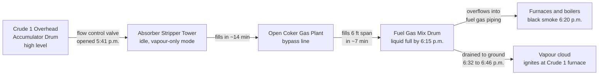

*Image: Chris LeBoutillier on Unsplash.*

At 6:16 in the evening on 20 September 2022, a radio exchange went out across the Crude 1 unit of the BP-Husky refinery in Oregon, Ohio, just east of Toledo. The U.S. Chemical Safety Board (the CSB, the federal agency that investigates chemical accidents) printed it word for word:

> [Board] Hey, level in the Mix Drum. You're going to want to check that ASAP.
> [Outside] Got it.
> [Outside] I'm not even in the sight glass on the Mix Drum.
> [Board] Did you say the Mix Drum level is above the sight glass?
> [Outside] That is correct.
> [Board] Copy that, just drain it as fast as you guys can.
> [Outside] We are.

Thirty minutes later, at 6:46 p.m., a vapour cloud reached the Crude 1 furnace and lit. Two outside operators who had been draining that drum, two brothers, one of them a trainee who had started in March, were caught in the flash fire and died of their burns.

The CSB's [final report](https://www.csb.gov/assets/1/6/final_report_-_20241.pdf), No. 2022-01-I-OH, came out in June 2024. On 30 September 2026 the agency released a [safety video](https://www.csb.gov/csb-releases-bp-husky-safety-video/) on the same case, "Alarming Mistakes, Deadly Decisions", which is why it's back on our desk this week. The report runs 164 pages. Almost none of it is about the two men who died. Nearly all of it is about the 24 hours before they walked up to that drum, and why the liquid they were draining wasn't what they thought it was.

If you work turnarounds, there are two details in this story that should stop you cold. The level instrument that started the whole chain had been swapped during a turnaround six weeks earlier. And the valve that finally put naphtha on the ground was a maintenance steam-out connection, the kind of valve a crew like ours leaves behind with a blind flange bolted on when the job's done.

## What the CSB Report Says

The Toledo refinery was a BP-Husky joint venture at the time, operated by BP. It's now owned and run by Ohio Refining Company, a Cenovus subsidiary, which is who the CSB's recommendations go to. The CSB called the fire "the largest fatal incident at a BP operated petroleum refinery since the fatal accident at the BP Texas City Refinery in 2005", and the report spends a whole section comparing the two.

The hard numbers:

| | |
|---|---|
| Report number | CSB 2022-01-I-OH, published June 2024 |
| Date and time of ignition | 20 September 2022, 6:46 p.m. |
| Fatalities | 2 (an outside operator and an operator trainee) |
| Property damage incl. loss of use | about $597 million |
| Naphtha released | about 23,500 lb (10.7 t) |
| Fuel gas released | about 66,900 lb (30.3 t) |
| Alarms on one console, 6:50 a.m. to 6:49 p.m. | 3,712 |
| OSHA proposed penalty (March 2023) | $156,250 |

The CSB's cause statement is blunt: "operators opening valves and removing a flange on the pressurized Fuel Gas Mix Drum to release a flammable liquid, naphtha, directly to the ground." Then it lists five contributing factors, and that's where the real story is: no engineered protection against vessels overflowing into each other, no decision to shut down or go to hot circulation when the day went bad, no procedures for abnormal situations, an alarm system that buried its operators, and a 2019 near-identical event that was investigated and then forgotten.

Let's take the day in order, because the order is the point.

## Twenty-Four Hours of "Normal Upset"

A fuel gas mix drum is a vessel that collects the refinery's own off-gas from various units, knocks out any liquid droplets, and sends clean fuel gas on to the furnaces and boilers. It is supposed to hold vapour. A bit of liquid in the bottom, drained now and then to the flare knockout drum or the oily water sewer, is normal. A drum full of liquid naphtha is not.

Here is how it got there, in the CSB's reconstruction.

**Monday evening, 19 September, about 7:10 p.m.** A board operator in the control room partially closes a water level control valve on the Crude 1 overhead accumulator drum (the drum that catches the condensed overhead from the crude tower and separates water from naphtha). The valve is in manual. The water level climbs through the night and plateaus at 69 percent on the screen at about 11:45 p.m.

Here's the turnaround detail. During the refinery's April-to-August 2022 turnaround, the water-phase level instrument on that drum had been changed from a displacer to a guided wave radar (a radar probe that measures level by timing a pulse down a rod). Same vessel nozzles, different calibration. With the old device, water reached the top of the internal naphtha standpipe at an indicated 100 percent. With the new one, it reached it at 69 percent. The CSB found the management-of-change paperwork was done and communicated before start-up, but the communication "did not include that this level would read differently than it did before." The instrument had been in service about six weeks. So at 69 percent, water was already pouring over the standpipe into the naphtha line, and nobody watching the screen had any reason to think so.

**Tuesday morning, shortly after 7:00 a.m.** The water has worked its way downstream, overflowed a condensate drum in the Coker Gas Plant, pushed up the bottoms flow out of the Absorber Stripper Tower, and raised the pressure in the naphtha hydrotreater preheat exchangers (the NHT, a unit that strips sulphur from naphtha over a catalyst bed; the preheat is the train of seven exchangers in front of it). Two relief valves lift. One of them chatters. The piping starts to shake.

An outside operator gets on the radio. The report quotes four transmissions in a two-minute window:

> "I don't know how much longer we can let this go…it's going to tear something up…Somebody needs to make a call out here ASAP."
> "We're going to hose some stuff up for real here if we let this go much longer."
> "I really need somebody to ok me to block that PSV in."
> "I don't know how much longer this pipe can take this. It's getting beat up really bad."

About 25 minutes after those calls, a ¾-inch drain line snaps off the six-inch naphtha pipe. Liquid naphtha loses containment. It doesn't ignite. The NHT is emergency-shut-down, the Coker Gas Plant is bypassed, and the crude unit keeps running with nowhere to send its naphtha except light virgin naphtha storage.

**Tuesday, all day.** With the NHT down and the gas plant bypassed, the Crude 1 tower spends the whole day shift fighting itself: repeated loss of pumparound cooling, an accumulator drum level it can't control, and the tower overpressuring 11 times, with its relief valves lifting repeatedly. Operators change the crude slate (the mix of crude oils fed to the tower) over and over, trying to settle it.

**Tuesday, 3:00 to 4:00 p.m.** Refinery leadership and process engineers meet about the tower. Shutting Crude 1 down or putting it on hot circulation (feed off, oil recirculating, furnace turned down) is discussed. Neither is done. One attendee drafts an email summarising the outcome. The CSB found "the email was never sent." Nothing from that meeting reaches the night shift coordinator or board operators, verbally or in the turnover notes.

**Tuesday, 4:50 p.m.** Night shift arrives into this. The regular board operator has been qualified to run that console alone for less than a month. A second board operator with six years' experience has been called in to help. The night refinery coordinator later told the CSB that with "the crude tower on, sat gas plant, coker gas plant, NHT down," he had "never seen it operate like that" and "had no technical guidance on how to operate it."

**4:56 p.m.** The night shift makes another crude slate change, this time removing all the light crude from the feed. The idea is to make less naphtha. The effect, by 5:30 p.m., is a new tower upset: temperatures climb, the pumparounds lose flow one after another (bottom at 5:41, middle at 5:47, top at 6:13), the light material flashes up the tower and condenses into the accumulator drum, and the drum level takes off.

**5:41 p.m.** To get the level down, a board operator opens the flow control valve from the accumulator drum to the Coker Gas Plant's Absorber Stripper Tower. That tower is sitting idle in vapour-only mode with its bypass line to the fuel gas mix drum open. Naphtha flows at more than 18,700 barrels a day into a tower that has nowhere to put it.

In about 14 minutes the Absorber Stripper Tower is at 100 percent. In about seven more, the fuel gas mix drum's level instruments max out. A board operator later described the moment to investigators: "it was viewed as just a 'normal upset'," and he thought at the time that "we can get this."

## The Thirty Minutes at the Drum

Now the part that matters most if you ever stand next to a vessel someone has asked you to drain.

**6:09 p.m.** Naphtha starts entering the mix drum. **6:10 p.m.** The high level alarm fires on the console. It's a high-priority alarm, colour-coded as such. The board operator doesn't radio outside until **6:17 p.m.**, just after the high-high alarm. In those seven minutes the console logged 55 alarms, one every nine seconds.

Four outside operations personnel arrive at the drum. One opens the two-inch line to the flare knockout drum (a closed system) fully. Another opens the two-inch drain to the oily water sewer, which is what that drain is for. Those two paths can take roughly 9,800 and 15,600 barrels a day. Naphtha is still arriving faster than that, because nobody at the drum knows the flow control valve upstream is open, and nobody in the control room has connected it to the drum either.

**6:20 p.m.** The Crude 1 furnace stack starts putting out black smoke. **6:22 p.m.** A boiler stack goes green. **6:24 p.m.** A fire is reported under the Coker 2 furnace. Liquid is in the fuel gas system and every fired heater and boiler on site is now a hazard. The night coordinator gets on the radio: "We got liquid in the fuel gas system. Keep away from those furnaces." At **6:27 p.m.** he calls for the refinery to be shut down, fuel pulled from every furnace and boiler. He told the CSB it was "a very easy decision" because "the furnaces were getting rich." It was also, by the CSB's reckoning, already too late for what was in the drum.

Here's the detail that should make every refinery hand wince. The night shift supervisor and other operators told investigators they believed the liquid they were draining was **amine-water solution**, not naphtha. That's what normally collects in a fuel gas mix drum. The supervisor told the two men at the drum to get SCBAs nearby (self-contained breathing apparatus, the air tank and mask you'd wear for a hydrogen sulphide risk) because amine-water can carry H2S. They put them on. They were wearing H2S monitors. They were kitted out for the wrong hazard. Nobody had told the field that a board operator had routed the crude tower's naphtha into their drum.

Two of the four leave to check a knockout pot in the gas plant. The two brothers stay to finish the job.

**6:32 p.m.** They open two ¾-inch bleed valves to the ground: one on the sight glass, one on the differential-pressure level transmitter. Opening the bleed on the dP transmitter changes the pressure across it, and the level reading on the console drops to zero. The report's footnote: "This gave the false impression that the Fuel Gas Mix Drum was emptying, when in fact it was still full."

**Just before 6:39 p.m.** They remove the blind flange from a two-inch gate valve on the side of the drum, about seven feet off the ground, and open it. The CSB notes this valve "was only intended for access by maintenance as part of turnaround or maintenance activities." It's a steam-out connection. Naphtha pours onto the ground and flashes to vapour.

**6:39 p.m.** A flammable gas detector by the drum reads 100 percent of the lower flammability limit (the lowest concentration of vapour in air that can ignite). Its horn and lights go off locally. It does not alarm in the control room. The CSB found the DCS alarm for that detector had been set to "disabled" by an alarm configuration enforcement error. The horn is audible in the background of a radio call at 6:40 p.m. Nobody inside knows what it means.

A worker standing nearby described what he saw:

> "It looks like someone is draining product from the mix drum. And I seen water being sprayed on it. […] They laid something on…to kind of deflect the stuff spraying out, so it'll stay […] going into the sewer, instead of spraying everywhere. […] And strong, strong smell. And I saw that vapor cloud coming from it […] I decided to back up and I […] stepped back about 20 feet and then it went boom."

An approaching rainstorm shifted the wind toward the Crude 1 furnace. **6:46 p.m.** Ignition.

At 7:04 p.m. a board operator realised naphtha was flowing to the gas plant from the accumulator drum and closed the flow control valve that had been opened at 5:41. The emergency response team then had to send three separate teams in to close every valve the two men had opened, with fire coming out of each one. The fire was out at 10:10 p.m.

*Image: Jahhid Fitrah Alamsyah on Unsplash.*

## The Instruments That Lied

The mix drum was 7 feet 11 inches across and nearly 14 feet 9 inches tall. Its sight glass, dP transmitter and guided wave radar all measured only the bottom six feet. That's normal design practice for a drum that should never hold much liquid. It means that once the drum is a little over a third full, every instrument on it is pinned at 100 percent and can tell you nothing more.

Worse, the dP transmitter wasn't even pinned. It plateaued at about 67 percent. A differential-pressure level instrument infers level from the weight of the liquid column, so it has to be told what the liquid weighs. This one was calibrated for amine-water at a relative density of 0.998. Naphtha is about 0.72. So a drum brimming with naphtha read as two-thirds full of water. The CSB: the dP measurement "never reached the Fuel Gas Mix Drum high-high level alarm point or indicated liquid was overflowing to the fuel gas piping."

The radar said 100. The glass said above the glass. The dP said 67 and then, after a bleed was cracked, zero. Three instruments, three stories, and the one feeding the high-high alarm was telling the most comforting one.

## 3,712 Alarms

The CSB devotes a full section to the alarm flood, and it's the part of the report the new video leans on hardest.

The industry threshold for an alarm flood (from the EEMUA 191 and ISA-18.2 guidance that BP's own alarm philosophy adopted) is 10 alarms in 10 minutes for one operator. Past that, the person at the screen is no longer managing the plant. They're triaging a queue. On 20 September the Crude 1 console was over that line from about 7:00 a.m. until after the fire, with two ten-minute exceptions. Between 4:50 p.m., when night shift came on, and 6:46 p.m., the console was getting between 24 and 281 alarms every ten minutes: 2.4 to 28 times the flood threshold. The daily average was 254.5 alarms an hour.

One board operator put it this way:

> "Meanwhile, the [Fuel Gas Mix Drum] is high level. The alarms are coming in. And at this time, feeling very overwhelmed, I can remember. […] At this point, almost everything's in manual and alarms are still just pouring in."

The CSB's conclusion is that the flood "contributed to the incident by overwhelming and distracting the board operators, causing delays and errors in responding to critical alarms." Had the board been able to think, they might have traced the liquid back to the valve opened at 5:41 and closed it. That one action would have stopped the drum filling.

What the CSB also points out, and this is the bit a crew lead can use, is that BP measured alarm performance as a monthly average. January and February 2022 looked fine on that metric. A monthly average tells you nothing about a single twelve-hour day when the plant is coming apart. Recommendation R4 to the refinery and R7 to the ISA both ask for alarm flood performance to be measured per event: how many floods, how long each lasted, how many alarms, and the peak rate.

## They Had Seen This Before

In 2019, during a refinery-wide upset triggered by a cold front and a boiler trip, the exact same flow control valve was opened 80 to 100 percent to unload a high accumulator drum level into the Coker Gas Plant. Naphtha filled the Absorber Stripper Tower, backed through the bypass, and put a high level in the fuel gas mix drum. It was drained to the flare and the sewer. Nobody was hurt. The radar read 100 percent and the dP flatlined at about 65 percent, the same mismatch as in 2022.

BP investigated it with a Five Whys analysis. The two corrective actions that came out addressed hydrate plugging in a stripper overhead system, the specific equipment that had caused the pressure on the day. Nothing addressed naphtha overflowing into the fuel gas system. Nothing addressed the instrument discrepancy. The CSB quotes system safety researcher Nancy Leveson on why: Five Whys "can lead an investigation team to omit important systemic causes."

The report calls this a textbook example of a catastrophic incident warning sign that an organisation "does not perceive or recognize." It had a rehearsal with no casualties and treated it as a cold-weather problem.

## Why This Matters From a Contractor's Chair

Our crews don't run crude towers. We're the people who go into reactors and vessels during the turnaround, pull catalyst, do the inspection entries, and hand the plant back. So why spend a pillar post on an operations incident?

Because three threads in this report run straight through a turnaround.

**The instrument that was changed during the turnaround.** The water-phase level device was swapped during the 2022 outage. The new one read 69 where the old one read 100 at the same physical level. The management-of-change process (the MOC, the paperwork and review that's supposed to happen before any plant modification) was completed. It just didn't say the one sentence an operator needed: "this will now read differently." Six weeks later that gap started the chain. If you're a contractor doing instrument or piping changes on a turnaround, the handover note that says "same tag, same nozzles, different calibration, overflow point now reads X" is not admin. It is the job. If you're a turnaround manager, go through your MOC close-outs and ask which ones changed what the operator sees without saying so.

**The valve with the blind flange.** The two-inch gate valve on the side of the drum existed so a maintenance crew could steam out the vessel before entry. It had a blind on it for a reason: in normal operation it should never be opened. Under pressure, with no procedure, with the wrong idea of what was inside, two men unbolted that blind because it was the biggest hole they could find. Every vessel we hand back has connections like this. A blind that's bolted and tagged is a message to whoever comes next: this is not a drain. Make sure the message is on it. Make sure the pre-start-up walk-down confirms it.

**Stop work authority applies to you too.** BP Toledo's procedure said: "All BP refinery employees and all contractor employees have the right and the responsibility to STOP any work that may be UNSAFE." The CSB found nobody used it on the day, not during the relief valve chatter at 7:00 a.m. when an outside operator was begging on the radio for someone to make a call, not in the afternoon meeting, not on the night shift when a brand-new board operator was watching 48 alarms every ten minutes. The CSB's key lesson is worth quoting because it cuts both ways: companies must make sure employees "not only are clearly empowered to exercise Stop Work Authority, but that employees also clearly understand they are expected to do so." And in the same breath: it "is not a substitute for effective process safety management systems," because it asks one stressed person to "assert a dissenting viewpoint against a group."

For a contractor crew lead, the practical side of that is this. If the site you're on is in the middle of a bad day, you will hear it. Relief valves lifting repeatedly. Stacks smoking. "Keep away from those furnaces" on the radio. Your permit doesn't care about any of that, but you should. Crews with SCC/VCA training drill the muster-and-withdraw response to a plant alarm every year. What the training card doesn't cover is a plant that has been in an abnormal state for twelve hours and never sounded the general alarm, because everyone inside still thinks "we can get this." The CSB's second recommendation to the refinery asks for a definition of when an abnormal situation has become too much and what to do about it. Until a site has that, your crew's own trigger for pulling back needs to be lower than the site's.

And one more for the young tech in particular. The two men who died were in SCBA. They were wearing H2S monitors. The supervisor who told them to suit up was being careful. They were protected against amine-water and had been handed naphtha. When someone tells you what's in a line or a vessel, the question is not "what PPE do I need for that?" It's "how do we know that's what it is?" If the answer involves a sight glass that's over-range and a transmitter calibrated for something else, you don't know. Draining an unknown flammable to grade next to a lit furnace is not a job that gets safer by doing it faster.

## The Lesson

The CSB's video title has it right: the deadly decision was at the drum, but the alarming mistakes were everywhere else. A level device changed on a turnaround with no note about what it would read. A relief valve left chattering for 25 minutes while someone on the radio asked for a call. A meeting whose conclusions sat in an unsent email. A crude slate change that made a tower boil. A valve opened to fix a level without anyone tracing where the liquid would end up. Instruments that pinned, lied, and then read zero. A flammable gas alarm disabled by a configuration error. And two men, properly dressed for the wrong hazard, told to drain it as fast as they could.

For a turnaround manager: the handover is the product. A plant change that nobody explained is a trap you set for the next shift, or the next year.

For a crew lead: when the site is in upset, your crew's exposure is not covered by your permit. Pull back earlier than the site does.

For the young tech: never drain what you can't identify, never drain to grade near fired equipment, and never let "as fast as you can" replace "to where, and from what."

## Credit and Further Reading

- U.S. Chemical Safety and Hazard Investigation Board, *Fatal Naphtha Release and Fire at BP-Husky Toledo Refinery*, Investigation Report No. 2022-01-I-OH, June 2024. [Full report (PDF)](https://www.csb.gov/assets/1/6/final_report_-_20241.pdf). [CSB news release on the safety video, 30 September 2026](https://www.csb.gov/csb-releases-bp-husky-safety-video/), and the video itself, [*Alarming Mistakes, Deadly Decisions: Fatal Fire at BP-Husky*](https://www.youtube.com/watch?v=HmiQFYGc6C4).
- EEMUA Publication 191, *Alarm Systems: A Guide to Design, Management and Procurement*, and ANSI/ISA-18.2-2016, *Management of Alarm Systems for the Process Industries*. The alarm flood definitions the CSB measured the refinery against.
- CCPS, *Guidelines for Managing Abnormal Situations* (2022) and *Recognizing Catastrophic Incident Warning Signs in the Process Industries* (2012). Both quoted at length in the report.
- Our earlier posts on the [Shell Monaca furnace explosion](/en/blog/shell-monaca-furnace-backflow-explosion-csb), where a suppressed alarm and a wrong valve met lit pilots, and on the [Pemex Deer Park H2S release](/en/blog/pemex-deer-park-flange-misidentification), another refinery case where people opened something that wasn't what they thought.
