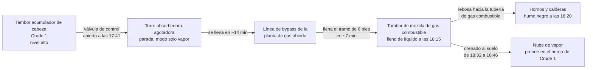

*Imagen: Chris LeBoutillier en Unsplash.*

A las 18:16 del 20 de septiembre de 2022, este intercambio por radio recorrió la unidad Crude 1 de la refinería BP-Husky en Oregon, Ohio, justo al este de Toledo. La Junta de Seguridad Química de Estados Unidos (la CSB, la agencia federal que investiga accidentes químicos) lo transcribió palabra por palabra:

> [Panel] Oye, el nivel del tambor de mezcla. Vais a querer comprobarlo ya.
> [Campo] Recibido.
> [Campo] Ni siquiera estoy dentro del visor de nivel del tambor de mezcla.
> [Panel] ¿Dices que el nivel del tambor está por encima del visor?
> [Campo] Correcto.
> [Panel] Recibido, drenadlo tan rápido como podáis.
> [Campo] En ello estamos.

Treinta minutos después, a las 18:46, una nube de vapor alcanzó el horno de Crude 1 y prendió. Los dos operadores de campo que habían estado drenando ese tambor, dos hermanos, uno de ellos un aprendiz que había empezado en marzo, quedaron atrapados en la llamarada y murieron por las quemaduras.

El [informe final](https://www.csb.gov/assets/1/6/final_report_-_20241.pdf) de la CSB, n.º 2022-01-I-OH, salió en junio de 2024. El 30 de septiembre de 2026 la agencia publicó un [vídeo de seguridad](https://www.csb.gov/csb-releases-bp-husky-safety-video/) sobre el mismo caso, "Alarming Mistakes, Deadly Decisions" ("Errores alarmantes, decisiones mortales"), y por eso vuelve a estar sobre nuestra mesa esta semana. El informe tiene 164 páginas. Casi nada de él trata de los dos hombres que murieron. Casi todo trata de las 24 horas anteriores a que se acercaran a ese tambor, y de por qué el líquido que estaban drenando no era lo que creían.

Si trabajas en paradas de planta, hay dos detalles en esta historia que deberían helarte. El instrumento de nivel que arrancó toda la cadena se había cambiado durante una parada seis semanas antes. Y la válvula que finalmente puso nafta en el suelo era una conexión de vaporizado para mantenimiento, el tipo de válvula que una cuadrilla como la nuestra deja atrás con una brida ciega atornillada cuando termina el trabajo.

## Lo que dice el informe de la CSB

La refinería de Toledo era en aquel momento una empresa conjunta BP-Husky, operada por BP. Hoy es propiedad de Ohio Refining Company, filial de Cenovus, que es a quien van dirigidas las recomendaciones de la CSB. La CSB llamó al incendio "el mayor incidente mortal en una refinería operada por BP desde el accidente fatal de la refinería de BP en Texas City en 2005", y el informe dedica una sección entera a comparar ambos.

Los números duros:

| | |
|---|---|
| Número de informe | CSB 2022-01-I-OH, publicado en junio de 2024 |
| Fecha y hora de la ignición | 20 de septiembre de 2022, 18:46 |
| Fallecidos | 2 (un operador de campo y un operador aprendiz) |
| Daños materiales incl. lucro cesante | unos 597 millones de dólares |
| Nafta liberada | unas 23.500 lb (10,7 t) |
| Gas combustible liberado | unas 66.900 lb (30,3 t) |
| Alarmas en una sola consola, de 6:50 a 18:49 | 3.712 |
| Sanción propuesta por OSHA (marzo de 2023) | 156.250 dólares |

La declaración de causa de la CSB es directa: "operadores que abrieron válvulas y retiraron una brida del tambor de mezcla de gas combustible presurizado para liberar un líquido inflamable, nafta, directamente al suelo". Después enumera cinco factores contribuyentes, y ahí está la historia de verdad: ninguna protección de ingeniería contra el desbordamiento de unos recipientes en otros, ninguna decisión de parar o pasar a circulación caliente cuando el día se torció, ninguna instrucción para situaciones anormales, un sistema de alarmas que enterró a sus operadores, y un suceso casi idéntico en 2019 que se investigó y luego se olvidó.

Vamos a tomar el día en orden, porque el orden es la clave.

## Veinticuatro horas de "perturbación normal"

Un tambor de mezcla de gas combustible es un recipiente que recoge el gas residual de la propia refinería procedente de varias unidades, separa las gotas de líquido y envía gas combustible limpio a los hornos y calderas. Está pensado para contener vapor. Un poco de líquido en el fondo, drenado de vez en cuando al tambor separador de antorcha o al alcantarillado de aguas aceitosas, es normal. Un tambor lleno de nafta líquida, no.

Así es como llegó a estarlo, según la reconstrucción de la CSB.

**Lunes por la tarde, 19 de septiembre, hacia las 19:10.** Un operador de panel en la sala de control cierra parcialmente una válvula de control de nivel de agua del tambor acumulador de cabeza de Crude 1 (el tambor que recoge los vapores de cabeza condensados de la torre de crudo y separa el agua de la nafta). La válvula está en manual. El nivel de agua sube durante la noche y se estabiliza en el 69 por ciento en pantalla hacia las 23:45.

Aquí está el detalle de la parada. Durante la parada de la refinería de abril a agosto de 2022, el instrumento de nivel de la fase acuosa de ese tambor se había cambiado de un desplazador a un radar de onda guiada (una sonda de radar que mide el nivel cronometrando un pulso a lo largo de una varilla). Las mismas tubuladuras del recipiente, distinta calibración. Con el equipo antiguo, el agua alcanzaba la parte superior del tubo vertical interno de nafta a un 100 por ciento indicado. Con el nuevo, lo alcanzaba al 69 por ciento. La CSB comprobó que la documentación de gestión del cambio se había completado y comunicado antes del arranque, pero la comunicación "no incluía que este nivel se leería de forma distinta a como lo hacía antes". El instrumento llevaba unas seis semanas en servicio. Así que al 69 por ciento el agua ya estaba rebosando por el tubo vertical hacia la línea de nafta, y nadie que mirara la pantalla tenía motivo para sospecharlo.

**Martes por la mañana, poco después de las 7:00.** El agua ha avanzado aguas abajo, ha desbordado un tambor de condensado en la planta de gas de la coquizadora, ha aumentado el caudal de fondo de la torre absorbedora-agotadora y ha elevado la presión en los intercambiadores de precalentamiento de la hidrotratadora de nafta (la NHT, una unidad que elimina el azufre de la nafta sobre un lecho de catalizador; el precalentamiento es el tren de siete intercambiadores situado delante). Dos válvulas de alivio abren. Una de ellas "castañetea". La tubería empieza a vibrar.

Un operador de campo sale por la radio. El informe cita cuatro transmisiones en una ventana de dos minutos:

> "No sé cuánto más podemos dejar esto así… va a reventar algo… Alguien tiene que tomar una decisión aquí fuera, ya."
> "Vamos a destrozar algo de verdad si dejamos que esto siga mucho más."
> "Necesito de verdad que alguien me autorice a bloquear esa PSV."
> "No sé cuánto más va a aguantar esta tubería. Le está dando una paliza."

Unos 25 minutos después de esas llamadas, una línea de drenaje de ¾ de pulgada se parte de la tubería principal de nafta de seis pulgadas. La nafta líquida pierde el confinamiento. No prende. La NHT se para de emergencia, la planta de gas de la coquizadora se pone en bypass y la unidad de crudo sigue operando sin otro destino para su nafta que el almacenamiento de nafta virgen ligera.

**Martes, todo el día.** Con la NHT parada y la planta de gas en bypass, la torre Crude 1 se pasa todo el turno de día peleando consigo misma: pérdidas repetidas de refrigeración por reflujos circulantes, un nivel en el tambor acumulador que no logra controlar, y 11 sobrepresiones de la torre con sus válvulas de alivio abriendo una y otra vez. Los operadores cambian la dieta de crudo (la mezcla de crudos alimentada a la torre) una y otra vez intentando estabilizarla.

**Martes, de 15:00 a 16:00.** La dirección de la refinería y los ingenieros de proceso se reúnen por la torre. Se habla de parar Crude 1 o ponerla en circulación caliente (sin alimentación, el aceite recirculando, el horno bajado). No se hace ninguna de las dos cosas. Un asistente redacta un correo resumiendo las conclusiones. La CSB comprobó que "el correo nunca se envió". Nada de esa reunión llega al coordinador ni a los operadores de panel del turno de noche, ni de palabra ni en las notas de relevo.

**Martes, 16:50.** El turno de noche entra en esta situación. El operador de panel titular lleva menos de un mes cualificado para llevar esa consola solo. Se ha llamado a un segundo operador de panel con seis años de experiencia para ayudar. El coordinador nocturno de la refinería contó después a la CSB que con "la torre de crudo en marcha, planta de gas saturado, planta de gas de la coquizadora y NHT paradas" él "nunca la había visto operar así" y "no tenía orientación técnica sobre cómo operarla".

**16:56.** El turno de noche hace otro cambio de dieta de crudo, esta vez retirando todo el crudo ligero de la alimentación. La idea es producir menos nafta. El efecto, a las 17:30, es una nueva perturbación de la torre: las temperaturas suben, los reflujos circulantes pierden caudal uno tras otro (el inferior a las 17:41, el medio a las 17:47, el superior a las 18:13), el material ligero se vaporiza torre arriba, condensa en el tambor acumulador y el nivel del tambor se dispara.

**17:41.** Para bajar el nivel, un operador de panel abre la válvula de control de caudal del tambor acumulador hacia la torre absorbedora-agotadora de la planta de gas de la coquizadora. Esa torre está parada en modo solo vapor, con su línea de bypass hacia el tambor de mezcla de gas combustible abierta. La nafta fluye a más de 18.700 barriles al día hacia una torre que no tiene dónde ponerla.

En unos 14 minutos la torre absorbedora-agotadora está al 100 por ciento. En unos siete más, los instrumentos de nivel del tambor de mezcla llegan a su tope. Un operador de panel describió después el momento a los investigadores: "se vio simplemente como una 'perturbación normal'", y pensaba en ese momento que "esto lo sacamos".

## Los treinta minutos junto al tambor

Ahora la parte que más importa si alguna vez te plantas junto a un recipiente que alguien te ha pedido drenar.

**18:09.** La nafta empieza a entrar en el tambor de mezcla. **18:10.** Salta la alarma de nivel alto en la consola. Es una alarma de alta prioridad, codificada por color como tal. El operador de panel no llama por radio al campo hasta las **18:17**, justo después de la alarma de nivel muy alto. En esos siete minutos la consola registró 55 alarmas, una cada nueve segundos.

Cuatro operadores de campo llegan al tambor. Uno abre del todo la línea de dos pulgadas al tambor separador de antorcha (un sistema cerrado). Otro abre el drenaje de dos pulgadas al alcantarillado de aguas aceitosas, que es para lo que sirve ese drenaje. Esas dos vías pueden evacuar unos 9.800 y 15.600 barriles al día respectivamente. La nafta sigue llegando más rápido que eso, porque nadie junto al tambor sabe que la válvula de control aguas arriba está abierta, y nadie en la sala de control la ha relacionado con el tambor.

**18:20.** La chimenea del horno de Crude 1 empieza a echar humo negro. **18:22.** La chimenea de una caldera se pone verde. **18:24.** Se reporta fuego bajo el horno de Coker 2. Hay líquido en el sistema de gas combustible y cada horno y caldera de la planta es ahora un peligro. El coordinador nocturno sale por la radio: "Tenemos líquido en el sistema de gas combustible. Alejaos de esos hornos." A las **18:27** ordena parar la refinería, cortar el combustible a todos los hornos y calderas. Contó a la CSB que fue "una decisión muy fácil" porque "los hornos se estaban enriqueciendo". También era, según el cálculo de la CSB, ya demasiado tarde para lo que había en el tambor.

Aquí está el detalle que debería hacer estremecerse a cualquiera que trabaje en una refinería. El supervisor del turno de noche y otros operadores dijeron a los investigadores que creían que el líquido que estaban drenando era **solución de amina y agua**, no nafta. Eso es lo que normalmente se acumula en un tambor de mezcla de gas combustible. El supervisor dijo a los dos hombres del tambor que tuvieran cerca equipos de respiración autónoma (SCBA, la botella de aire y la máscara que llevarías ante un riesgo de sulfuro de hidrógeno) porque la amina-agua puede llevar H2S. Se los pusieron. Llevaban detectores de H2S. Estaban equipados para el peligro equivocado. Nadie había dicho al campo que un operador de panel había desviado la nafta de la torre de crudo a su tambor.

Dos de los cuatro se van a revisar un separador en la planta de gas. Los dos hermanos se quedan a terminar el trabajo.

**18:32.** Abren dos válvulas de purga de ¾ de pulgada al suelo: una en el visor de nivel y otra en el transmisor de nivel por presión diferencial. Abrir la purga del transmisor dP cambia la presión a través de él, y la lectura de nivel en la consola cae a cero. La nota al pie del informe: "Esto dio la falsa impresión de que el tambor de mezcla de gas combustible se estaba vaciando, cuando en realidad seguía lleno."

**Poco antes de las 18:39.** Retiran la brida ciega de una válvula de compuerta de dos pulgadas en el lateral del tambor, a unos siete pies del suelo, y la abren. La CSB señala que esta válvula "estaba destinada únicamente al acceso de mantenimiento como parte de las actividades de parada o mantenimiento". Es una conexión de vaporizado. La nafta se derrama en el suelo y se vaporiza al instante.

**18:39.** Un detector de gas inflamable junto al tambor marca el 100 por ciento del límite inferior de inflamabilidad (la concentración más baja de vapor en aire que puede prender). Su bocina y sus luces se activan en campo. No da alarma en la sala de control. La CSB comprobó que la alarma del DCS de ese detector estaba en estado "deshabilitado" por un error de configuración forzada de alarmas. La bocina se oye de fondo en una llamada de radio a las 18:40. Nadie dentro sabe qué significa.

Un trabajador que estaba cerca describió lo que vio:

> "Parece que alguien está drenando producto del tambor de mezcla. Y vi que le echaban agua. […] Habían puesto algo… para desviar lo que salía a chorro, para que se fuera […] al alcantarillado en vez de salpicar por todas partes. […] Y un olor fuerte, muy fuerte. Y vi esa nube de vapor saliendo de ahí […] Decidí retroceder y […] me alejé unos 20 pies y entonces hizo bum."

Una tormenta que se acercaba cambió el viento hacia el horno de Crude 1. **18:46.** Ignición.

A las 19:04 un operador de panel se dio cuenta de que la nafta fluía hacia la planta de gas desde el tambor acumulador y cerró la válvula de control que se había abierto a las 17:41. El equipo de respuesta a emergencias tuvo entonces que enviar tres grupos separados para cerrar cada válvula que los dos hombres habían abierto, con fuego saliendo de cada una. El incendio quedó extinguido a las 22:10.

*Imagen: Jahhid Fitrah Alamsyah en Unsplash.*

## Los instrumentos que mentían

El tambor de mezcla medía 7 pies y 11 pulgadas de diámetro y casi 14 pies y 9 pulgadas de altura. Su visor de nivel, su transmisor dP y su radar de onda guiada medían solo los seis pies inferiores. Es una práctica de diseño normal para un tambor que nunca debería contener mucho líquido. Significa que, en cuanto el tambor está algo más de un tercio lleno, todos sus instrumentos se quedan clavados en el 100 por ciento y no pueden decirte nada más.

Peor aún: el transmisor dP ni siquiera estaba clavado. Se estabilizó en torno al 67 por ciento. Un instrumento de nivel por presión diferencial deduce el nivel del peso de la columna de líquido, así que hay que decirle cuánto pesa el líquido. Este estaba calibrado para amina-agua con una densidad relativa de 0,998. La nafta ronda 0,72. Así que un tambor rebosante de nafta se leía como dos tercios lleno de agua. La CSB: la medición dP "nunca alcanzó el punto de alarma de nivel muy alto del tambor de mezcla ni indicó que el líquido estuviera rebosando hacia la tubería de gas combustible".

El radar decía 100. El visor decía por encima del visor. El dP decía 67 y luego, tras abrir una purga, cero. Tres instrumentos, tres historias, y el que alimentaba la alarma de nivel muy alto contaba la más tranquilizadora.

## 3.712 alarmas

La CSB dedica una sección entera a la avalancha de alarmas, y es la parte del informe en la que más se apoya el nuevo vídeo.

El umbral del sector para una avalancha de alarmas (según las guías EEMUA 191 e ISA-18.2 que la propia filosofía de alarmas de BP había adoptado) es de 10 alarmas en 10 minutos para un operador. Pasado eso, la persona frente a la pantalla ya no gestiona la planta. Está haciendo triaje de una cola. El 20 de septiembre la consola de Crude 1 estuvo por encima de esa línea desde las 7:00 aproximadamente hasta después del incendio, con dos excepciones de diez minutos. Entre las 16:50, cuando entró el turno de noche, y las 18:46, la consola recibía entre 24 y 281 alarmas cada diez minutos: de 2,4 a 28 veces el umbral de avalancha. La media del día fue de 254,5 alarmas por hora.

Un operador de panel lo contó así:

> "Mientras tanto, el [tambor de mezcla de gas combustible] está en nivel alto. Las alarmas van entrando. Y en ese momento, recuerdo sentirme muy desbordado. […] A esas alturas casi todo está en manual y las alarmas siguen cayendo sin parar."

La conclusión de la CSB es que la avalancha "contribuyó al incidente al abrumar y distraer a los operadores de panel, provocando retrasos y errores en la respuesta a alarmas críticas". Si el panel hubiera podido pensar, quizá habría rastreado el líquido hasta la válvula abierta a las 17:41 y la habría cerrado. Esa sola acción habría detenido el llenado del tambor.

Lo que la CSB también señala, y esto es lo que un jefe de cuadrilla puede aprovechar, es que BP medía el rendimiento de las alarmas como una media mensual. Enero y febrero de 2022 se veían bien con esa métrica. Una media mensual no dice nada de un único día de doce horas en el que la planta se viene abajo. La recomendación R4 a la refinería y la R7 a la ISA piden que el rendimiento en avalanchas de alarmas se mida por evento: cuántas avalanchas, cuánto duró cada una, cuántas alarmas y cuál fue la tasa pico.

## Ya lo habían visto antes

En 2019, durante una perturbación de toda la refinería desencadenada por un frente frío y el disparo de una caldera, la misma válvula de control se abrió entre el 80 y el 100 por ciento para descargar un nivel alto del tambor acumulador hacia la planta de gas de la coquizadora. La nafta llenó la torre absorbedora-agotadora, retrocedió por el bypass y provocó un nivel alto en el tambor de mezcla de gas combustible. Se drenó a la antorcha y al alcantarillado. Nadie resultó herido. El radar marcaba 100 por ciento y el dP se quedó plano en torno al 65 por ciento, la misma discrepancia que en 2022.

BP lo investigó con un análisis de los Cinco Porqués. Las dos acciones correctivas que salieron de ahí trataban de la obstrucción por hidratos en el sistema de cabeza de una torre agotadora, el equipo concreto que había causado la presión aquel día. Nada trataba del rebose de nafta hacia el sistema de gas combustible. Nada trataba de la discrepancia entre instrumentos. La CSB cita a la investigadora en seguridad de sistemas Nancy Leveson para explicar por qué: los Cinco Porqués "pueden llevar a un equipo de investigación a omitir causas sistémicas importantes".

El informe lo califica de ejemplo de manual de una señal de advertencia de incidente catastrófico que la organización "no percibe ni reconoce". Tuvo un ensayo sin víctimas y lo trató como un problema de frío.

## Por qué esto importa desde la silla del contratista

Nuestras cuadrillas no operan torres de crudo. Somos los que entramos en reactores y recipientes durante la parada, sacamos el catalizador, hacemos las entradas de inspección y devolvemos la planta. Entonces, ¿por qué dedicar un artículo pilar a un incidente de operación?

Porque tres hilos de este informe atraviesan de lleno una parada.

**El instrumento que se cambió durante la parada.** El medidor de nivel de la fase acuosa se sustituyó durante la parada de 2022. El nuevo leía 69 donde el antiguo leía 100 al mismo nivel físico. El proceso de gestión del cambio (el MOC, el papeleo y la revisión que deben ocurrir antes de cualquier modificación en planta) se completó. Simplemente no decía la única frase que un operador necesitaba: "esto ahora se leerá distinto". Seis semanas después, ese hueco arrancó la cadena. Si eres un contratista que hace cambios de instrumentación o tubería en una parada, la nota de entrega que dice "mismo tag, mismas tubuladuras, calibración distinta, el punto de rebose ahora se lee como X" no es burocracia. Es el trabajo. Si eres responsable de una parada, repasa tus cierres de MOC y pregúntate cuáles cambiaron lo que ve el operador sin decirlo.

**La válvula con la brida ciega.** La válvula de compuerta de dos pulgadas en el lateral del tambor existía para que una cuadrilla de mantenimiento pudiera vaporizar el recipiente antes de entrar. Tenía una ciega por una razón: en operación normal nunca debía abrirse. Bajo presión, sin procedimiento, con una idea equivocada de lo que había dentro, dos hombres desatornillaron esa ciega porque era el agujero más grande que encontraron. Cada recipiente que devolvemos tiene conexiones así. Una ciega atornillada y etiquetada es un mensaje para quien venga después: esto no es un drenaje. Asegúrate de que el mensaje esté puesto. Asegúrate de que la ronda previa al arranque lo confirme.

**La autoridad para parar el trabajo también te aplica a ti.** El procedimiento de BP Toledo decía: "Todos los empleados de la refinería de BP y todos los empleados de contratistas tienen el derecho y la responsabilidad de PARAR cualquier trabajo que pueda ser INSEGURO." La CSB comprobó que nadie la usó ese día: ni durante el castañeteo de la válvula de alivio a las 7:00, cuando un operador de campo suplicaba por radio que alguien tomara una decisión, ni en la reunión de la tarde, ni en el turno de noche cuando un operador de panel recién cualificado veía 48 alarmas cada diez minutos. La lección clave de la CSB merece citarse porque corta en ambas direcciones: las empresas deben asegurarse de que los empleados "no solo estén claramente facultados para ejercer la autoridad de parar el trabajo, sino que también entiendan claramente que se espera que lo hagan". Y en la misma frase: "no es un sustituto de sistemas eficaces de gestión de la seguridad de procesos", porque pide a una persona estresada que "sostenga una opinión discrepante frente a un grupo".

Para un jefe de cuadrilla contratista, el lado práctico es este. Si la planta en la que estás está en medio de un mal día, lo vas a oír. Válvulas de alivio abriendo una y otra vez. Chimeneas humeando. "Alejaos de esos hornos" por la radio. A tu permiso de trabajo nada de eso le importa, pero a ti sí debería. Las cuadrillas con formación SCC/VCA ensayan cada año la respuesta de reunión y retirada ante una alarma general de planta. Lo que la tarjeta de formación no cubre es una planta que lleva doce horas en estado anormal y nunca ha hecho sonar la alarma general, porque todos los de dentro siguen pensando "esto lo sacamos". La segunda recomendación de la CSB a la refinería pide una definición de cuándo una situación anormal se ha vuelto demasiado y qué hacer entonces. Hasta que un emplazamiento tenga eso, el propio umbral de tu cuadrilla para retirarse tiene que estar más bajo que el del emplazamiento.

Y una más, en especial para el técnico joven. Los dos hombres que murieron llevaban equipo de respiración autónoma. Llevaban detectores de H2S. El supervisor que les dijo que se equiparan estaba siendo cuidadoso. Estaban protegidos contra amina-agua y les habían dado nafta. Cuando alguien te dice lo que hay en una línea o en un recipiente, la pregunta no es "¿qué EPI necesito para eso?". Es "¿cómo sabemos que es eso?". Si la respuesta pasa por un visor fuera de rango y un transmisor calibrado para otra cosa, no lo sabes. Drenar al suelo un inflamable desconocido junto a un horno encendido no es un trabajo que se vuelva más seguro por hacerlo más rápido.

## La lección

El título del vídeo de la CSB acierta: la decisión mortal fue en el tambor, pero los errores alarmantes estaban en todas partes. Un instrumento de nivel cambiado en una parada sin una nota sobre lo que marcaría. Una válvula de alivio castañeteando 25 minutos mientras alguien pedía por radio una decisión. Una reunión cuyas conclusiones se quedaron en un correo sin enviar. Un cambio de dieta de crudo que hizo hervir una torre. Una válvula abierta para arreglar un nivel sin que nadie rastreara adónde iría el líquido. Instrumentos que se clavaron, mintieron y luego marcaron cero. Una alarma de gas inflamable deshabilitada por un error de configuración. Y dos hombres, bien equipados para el peligro equivocado, a los que se les dijo que drenaran tan rápido como pudieran.

Para el responsable de la parada: la entrega es el producto. Un cambio en planta que nadie explicó es una trampa que le pones al siguiente turno, o al año siguiente.

Para el jefe de cuadrilla: cuando la planta está en perturbación, la exposición de tu cuadrilla no la cubre tu permiso. Retírate antes de lo que lo haga la planta.

Para el técnico joven: nunca drenes lo que no puedes identificar, nunca drenes al suelo cerca de equipos de fuego, y nunca dejes que "tan rápido como podáis" sustituya a "¿hacia dónde, y desde qué?".

## Créditos y lecturas adicionales

- U.S. Chemical Safety and Hazard Investigation Board, *Fatal Naphtha Release and Fire at BP-Husky Toledo Refinery*, informe de investigación n.º 2022-01-I-OH, junio de 2024. [Informe completo (PDF)](https://www.csb.gov/assets/1/6/final_report_-_20241.pdf). [Nota de prensa de la CSB sobre el vídeo de seguridad, 30 de septiembre de 2026](https://www.csb.gov/csb-releases-bp-husky-safety-video/), y el propio vídeo, [*Alarming Mistakes, Deadly Decisions: Fatal Fire at BP-Husky*](https://www.youtube.com/watch?v=HmiQFYGc6C4).
- EEMUA Publication 191, *Alarm Systems: A Guide to Design, Management and Procurement*, y ANSI/ISA-18.2-2016, *Management of Alarm Systems for the Process Industries*. Las definiciones de avalancha de alarmas con las que la CSB midió a la refinería.
- CCPS, *Guidelines for Managing Abnormal Situations* (2022) y *Recognizing Catastrophic Incident Warning Signs in the Process Industries* (2012). Ambas citadas extensamente en el informe.
- Nuestros artículos anteriores sobre la [explosión del horno de Shell Monaca](/es/blog/shell-monaca-furnace-backflow-explosion-csb), donde una alarma suprimida y una válvula equivocada se encontraron con pilotos encendidos, y sobre la [fuga de H2S en Pemex Deer Park](/es/blog/pemex-deer-park-flange-misidentification), otro caso de refinería en el que alguien abrió algo que no era lo que creía.
