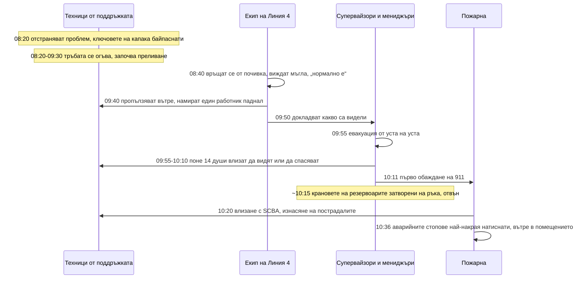
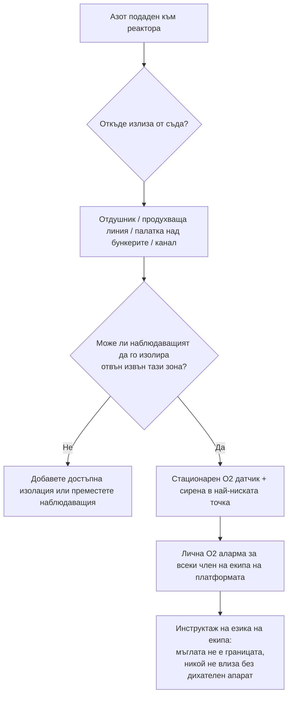

*Изображение: генерирана илюстрация (Flux.1), не е снимка от мястото на инцидента.*

Около 8:40 сутринта на 28 януари 2021 г. екипът на опаковъчната линия в птицепреработвателен завод в Гейнсвил, Джорджия, се връща от 20-минутна почивка и вижда бяла мъгла, която излиза от помещението с фризера. Не правят нищо. Един от тях по-късно обяснява на разследващите защо: от това помещение постоянно излизала бяла мъгла. Било нормално.

Час по-късно една работничка тръгва да търси супервайзора, който не се е върнал. Пропълзява през отвора за конвейера в помещението и намира облак азот, дълбок над метър, и колега от поддръжката, легнал на пода, без да мърда.

До 11:00 същата сутрин шестима души са мъртви. Двама са техниците от поддръжката, които са отстранявали проблем по фризера. Останалите четирима са влезли в помещението или в съседните стаи, за да помогнат.

Американският Съвет по химическа безопасност (CSB, федералната агенция, която разследва химически аварии) публикува пълния си доклад през декември 2023 г. като Investigation Report No. 2021-03-I-GA. На 25 август 2026 г. CSB пусна и [видео за безопасност](https://www.csb.gov/csb-releases-foundation-food-group-safety-video/) по същия случай, озаглавено „Fatal Fog“ („Смъртоносна мъгла“), и затова докладът отново е на бюрото ни тази седмица. Това не е история от рафинерия. Но ако работата ви е да стоите до реактор, пълен с азот, по време на смяна на катализатор, това е вашата история.

## Какво казва докладът на CSB

Foundation Food Group нарязва и готви пилешко месо. През декември 2020 г. заводът пуска нова линия за замразяване, Линия 4: конвейерна лента прекарва пилешкото през вана с течен азот при около минус 196 °C, а после през спирален фризер. Доставчикът на газ, Messer, е проектирал и притежава фризера и резервоарите отвън и ги е отдал под наем на завода.

Течният азот не е токсичен и не гори. Точно това е проблемът. Един литър течност се превръща в около 696 литра газ при стайна температура. Газът избутва въздуха от мястото, където попадне. Под около 10 процента кислород, казва докладът, „експозицията може да доведе до бърза загуба на съзнание без предупреждение, което може да се случи само за едно или две вдишвания“. Няма миризма, няма кашлица, няма парене в очите. Просто спираш.

Фризерът измерва нивото на азота с барботажна тръба: тънка тръбичка, насочена надолу във ваната, от чийто край излиза тънка струйка газ. Противоналягането показва на контролера колко дълбока е течността. И регулиращият клапан, и защитата от високо ниво разчитат на тази една тръба.

Един сензор. Две задачи. Ако сензорът лъже, и двете се провалят едновременно.

Някъде между 8:20 и 9:30 същата сутрин, докато двама техници от поддръжката търсят защо пилешкото излиза меко, тръбата се огъва. CSB не успява да установи как. Но установява какво следва, като напълва ваната с вода след инцидента: с връх, огънат над линията на преливане, контролерът отчита „празно“, дава максимален дебит, а защитата никога не се задейства. Течният азот прелива през ръба на пода и продължава да тече.

Помещението няма механична вентилация. Две от четирите му стени са със стъпало от метър и половина надолу спрямо съседните стаи, така че под нивото на главата то е почти затворена кутия. Студеният азот е по-тежък от въздуха. Кутията се пълни от пода нагоре.

## Мъглата, която всички се бяха научили да пренебрегват

Ето частта, на която докладът не се спира дълго, но ръководителят на екип трябва.

Линия 4 се бори с проблеми от пускането си шест седмици по-рано: натоварване на лентата, показания за нивото, които не съвпадат с настройката, полузамразено пилешко. Messer идва на място многократно. Пет дни преди инцидента сменя регулиращия клапан и преобразувателя за нивото. Ден преди това дава на завода потребителско име и парола, за да вдигнат сами настройката за нивото.

Така че сутринта на 28-и азотната мъгла, която се стеле от помещението с фризера, не е предупредителен знак. Просто е вторник. Техниците от поддръжката са вътре с умишлено байпаснати предпазни ключове на капака, за да гледат ваната при работещ фризер. Никой в завода няма кислороден детектор. В помещението няма стационарен датчик, няма аларма, няма табела на вратата. Опаковъчният екип няма причина да мисли, че този облак е различен от миналоседмичния.

Различен е. Това е вана, преливаща при пълен дебит в яма.

CSB го казва ясно в ключовите си поуки: „Незапалими, нетоксични химикали като азота могат погрешно да бъдат приети за безопасни без подходящо обучение и информиране за опасностите.“

Това изречение е насочено към птицекланица. Отнася се за всеки ремонт, при който реакторът е под азотна възглавница, а на екипа на платформата е казано „то е само азот“.

## Часът след това: четиринайсет души влизат

Помещението с фризера не е затворено пространство в правния смисъл. Хора влизат и излизат от него цяла смяна. Няма разрешително, няма наблюдаващ, няма план за спасяване, защото нито един от документите, които задействат тези неща, не важи за стая с врата.

Точно затова втората половина на този инцидент протича така.

Около 9:40 работничката, тръгнала да търси супервайзора, намира облака и тялото. Излиза, казва на останалите, връща се с колега да потвърди, излиза отново. В 9:55 супервайзор от съседната линия започва да извежда хората. Около 130 души се евакуират, от уста на уста. Никой не дърпа пожарната аларма до 10:11, същата минута, в която някой най-накрая се обажда на 911.

В 30-те минути преди пристигането на пожарната CSB преброява поне 14 служители, тръгнали към помещението с фризера, за да видят какво става или да извадят някого. Около един на всеки десет души на обекта.

- Мениджър по логистиката намира супервайзора на Линия 4 в безсъзнание в експедицията до помещението с фризера, опитва да го извлече до товарната рампа, завива му се свят, отстъпва в съседната чиста стая и припада до стената.
- Мениджърът по поддръжката намира работничка от Линия 4 в безсъзнание на пода на чистата стая, навежда се да я вдигне, почти припада и излиза, залитайки. След това прави най-полезното нещо, което някой прави тази сутрин: излиза навън до резервоарите в другия край на сградата и затваря на ръка спирателните кранове.
- Началникът на завода казва на директор, че „отива да провери какво става“. Пожарникарите го намират в помещението с фризера.
- Още трима мениджъри изтеглят мениджъра по логистиката от чистата стая. Той оцелява след два дни в болница.

Четирима от четиринайсетте загиват. Трима са тежко пострадали. Пожарникари с автономни дихателни апарати (SCBA, бутилката на гърба, която носи собствен въздух) влизат около 10:20 и изнасят останалите. Температурата на пода е под минус 73 °C. Четирима от петимата пожарникари, които влизат, по-късно също са откарани в болница.

Една от шестимата загинали е още жива, когато пожарникарите я изнасят в 10:36. Обявена е за мъртва в 11:00. Първото обаждане на 911 идва 16 минути след началото на евакуацията.

## Десет аварийни стопа, всичките на грешното място

*Снимка: Hans Westbeek в Unsplash.*

Фризерът на Линия 4 има десет бутона за аварийно спиране. Всеки от тях би спрял фризерите и би затворил клапаните за подаване на азот. И десетте са вътре в помещението с фризера: по два в двата края на всеки фризер и по един на всеки контролен екран.

Прочетете това отново от гледната точка на наблюдаващия. Единственото действие, което спира изтичането, изисква да влезеш в изтичането. Заключението на CSB е директно: разположението „изисквало реагиращ служител или човек, който иначе не е в помещението с фризера, да влезе в атмосфера с недостиг на кислород по време на изтичане на течен азот, за да задейства аварийния стоп. Този проект е бил небезопасен.“

Първият авариен стоп е натиснат в 10:36 от пожарникар с дихателен апарат, около час и половина след началото на преливането. Изтичането е спряло 20 минути по-рано само защото мениджър, който току-що едва не е умрял, отива в другия край на сградата и затваря резервоарите на ръка.

Докладът цитира ISO 13850, стандарта за аварийно спиране на машини, който изисква устройствата за спиране да са „на входовете и изходите“ и „да могат да се задействат без опасност“. Решението на CSB е чертеж на същото помещение с бутони отвън до вратите и при резервоарите. Не е екзотично инженерство. Това е въпросът, зададен преди първата капка азот: „Къде ще стои човекът, който трябва да спре това, и може ли да стигне до бутона оттам?“

## Това, което на никого не беше казано

CSB интервюира хора на всички нива в компанията. Таблицата с отговорите в раздел 4.4 е най-трудното за четене нещо в доклада. Мениджърът по околна среда, здраве и безопасност, попитан дали е знаел за някакви опасности от новите фризери: „Абсолютно не. Нямах представа.“ Корпоративен мениджър по поддръжката: „Знам само, че се разширява, когато се нагрее. Това е горе-долу всичко.“ Работник от Линия 4: „Никой не ни каза, че работи с химикал или нещо такова. Научих за азота от новините, след инцидента.“

Планът за действие при извънредни ситуации на завода е презентация от 46 слайда, на английски, показвана при назначаване. По-голямата част от персонала, включително петима от шестимата загинали, не говори английски като първи език. Планът не споменава азота. В него пише, че „определени служители“ ще извършват спасяване и първа помощ. Когато CSB пита кои са те, компанията отговаря писмено: „FFG няма служители, обучени или квалифицирани за спасителни дейности или първа помощ. При нужда бихме се обадили на 911.“

Никой не е казал на хората да не влизат. Затова влизат.

Една правна бележка. Азотът не попада под правилата на OSHA за управление на безопасността на процесите, така че нещата, които една рафинерия приема за даденост (анализ на опасностите преди пускане, писмени процедури, управление на промените, обучение за опасността), не са били задължителни по закон, и заводът не ги е правил. CSB е поискал от OSHA да затвори тази празнина. Дотогава единственото, което стои между един обект и този изход, е дали някой е решил да третира азота като опасен така или иначе.

## Защо това е важно от стола на изпълнителя

Смяната на катализатор в реактор върви на азот. Съдът се поставя под азот нарочно, за да не се самозапали пирофорният катализатор при среща с въздух, а екипите за влизане работят с дихателни апарати, защото вътре няма кислород по проект. Тази част всички разбират. Разрешителното, наблюдаващият и планът за спасяване я покриват.

Помещението във Foundation Food Group е за всичко, което разрешителното не покрива, защото не е съдът.

**Платформата, полата на реактора, каналът, палатката.** Реактор под азот отдушва някъде. Продухващите линии водят някъде. Ако азотът идва от цистерна с течен азот през изпарител, той излиза студен и плътен и тече надолу: в тръбния канал под реактора, в шахтата, под брезента на временното заграждение, което някой е вдигнал, за да пази бункерите с катализатор от дъжда. Нито едно от тези места не е затворено пространство в разрешителното. Помещението с фризера също не беше. Беше стая с врата, която случайно беше метър и половина по-ниско от стаите до нея.

**Мъглата не е границата на опасността.** Белият облак е вода, кондензираща от въздуха. Той отбелязва студената част на азота, а не края му. Топлият азот е невидим и също толкова смъртоносен. И обратното: обект, където азотната мъгла е ежедневна гледка, има екип, обучен да я пренебрегва. Работниците в завода „редовно наблюдавали бяла мъгла“, и това е изречението, което уби часа, който можеха да използват.

**Лични кислородни детектори за целия екип, не само за влизащите.** Влизащият с дихателен апарат има въздух. Такелажникът на платформата, операторът на вакуумната машина в основата на полата, скелетаджията под брезента: това са хората, които умират в Гейнсвил. Кислородна аларма на китката, настроена на 19,5 процента, струва по-малко от час работа на кран.

**Попитайте къде е стоп-кранът и застанете до него.** Преди азотът да бъде подаден, обходете изолацията с оператора. Кой клапан го спира? Къде е? Може ли наблюдаващият да стигне до него, без да пресича платформата, върху която азотът отдушва? Ако честният отговор е „резервоарът в другия край на инсталацията“, то това е позицията на наблюдаващия, или ви трябва втора изолация, до която той може да стигне.

**Стационарен датчик в най-ниската точка, със сирена.** Един кислороден датчик на нивото на пода до отдушника и канала, свързан със светлина и сирена, която всички чуват над вакуумната машина. Заводът нямаше нито един. Втората ключова поука на CSB е стационарна система за следене на атмосферата и алармиране „въз основа на правилно направена оценка на риска“. При смяна на катализатор оценката на риска е десетминутна обиколка със скица на това къде отива азотът, когато излезе от съда.

**Кажете го на езика на екипа.** Планът за извънредни ситуации беше на английски в завод с испаноговорещ персонал. Български екип на холандски или финландски обект работи по авариен план на обекта, написан за някой друг. Това е наред, стига инструктажът същата сутрин да казва на български три неща: тук има азот, той ще те повали за две вдишвания, и ако някой падне, ти не влизаш, обаждаш се на номера от разрешителното и чакаш.

**Без спасяване без въздух. Нито веднъж.** Четиринайсет души реагираха. Четирима загинаха. Докладът казва, че заводът „не е обучил служителите си да не реагират при извънредни ситуации“. Екипите със SCC/VCA обучение тренират това правило на всеки опреснителен курс; този доклад е това, което се случва на обект, където никой не го е чувал. Трябва да се казва на глас, да се повтаря, докато не започне да звучи глупаво, защото поривът да сграбчиш колега, когото виждаш легнал на пода, е по-силен от всичко, което една презентация слага в главата ти.

## Поуката

Азотът не уби шестима души. Уби двама. Останалите четирима бяха убити от помещение, което никой не смяташе за опасно, от аларма, която не съществуваше, от стоп бутони от грешната страна на вратата и от персонал, на който никога не е било казано: „Ако някой е паднал вътре, ти не влизаш.“

За младия техник на първата си смяна на катализатор: азотът е единственият газ, който не можеш да помиришеш, не можеш да видиш, когато е топъл, и не можеш да преодолееш. Ако детекторът ти се задейства, излизаш. Ако някой друг е паднал, излизаш и викаш. Само човекът с дихателен апарат се връща.

За ръководителя на екипа: разрешителното защитава влизащия вътре в съда. Твоята работа са всички отвън. Обходи пътя на азота, преди да е подаден, намери ниските точки, сложи датчик в най-ниската и се увери, че кранът, който спира потока, е някъде, където можеш да стоиш и да дишаш.

## Източници и допълнително четене

- U.S. Chemical Safety and Hazard Investigation Board, *Fatal Liquid Nitrogen Release at Foundation Food Group*, Investigation Report No. 2021-03-I-GA, публикуван декември 2023 г. [Пълен доклад (PDF)](https://www.csb.gov/assets/1/20/ffg_investigation_report_publication_copy.pdf) и [видеото „Fatal Fog“, публикувано на 25 август 2026 г.](https://www.csb.gov/csb-releases-foundation-food-group-safety-video/).
- CSB Safety Bulletin No. 2003-10-B, *Hazards of Nitrogen Asphyxiation*. Бюлетинът от 2003 г., който CSB продължава да цитира 20 години по-късно.
- Compressed Gas Association, CGA P-76 *Hazards of Oxygen-Deficient Atmospheres*, указанията за табели и ограничен достъп, които нито една от двете компании не приложи за помещението с фризера.
- ISO 13850, *Safety of machinery – Emergency stop function – Principles for design*, стандартът зад констатацията на CSB за разположението на аварийните стопове.
- HSE UK, *Reduced oxygen environments (hypoxic environments)*, кратката страница с указания на британския регулатор за същата опасност.
- Предишните ни публикации за [задушаването с аргон в яма в Bacchus](/bg/blog/argon-pit-asphyxiation-bacchus-csb), където по-тежък от въздуха инертен газ се събра в яма, и за [изтичането на H2S в Catalyst Refiners](/bg/blog/catalyst-refiners-h2s-decommissioning-csb), друг случай, в който смъртоносната атмосфера беше извън съда.
