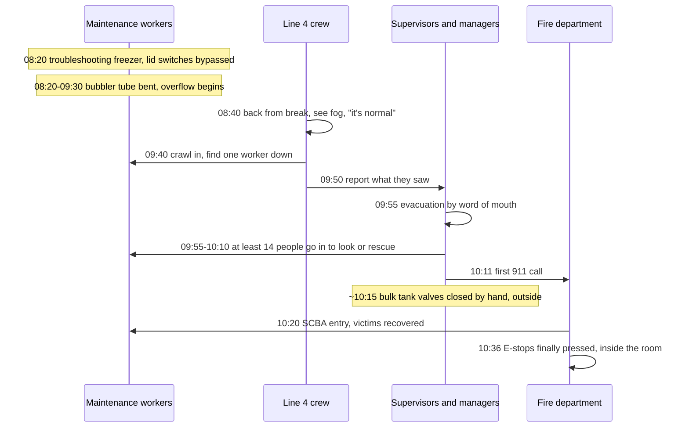
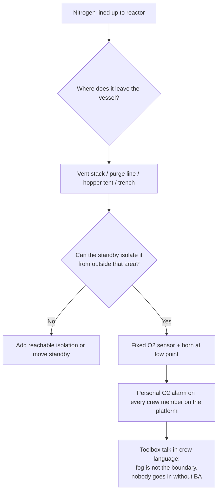

*Image: generated illustration (Flux.1), not a photo of the incident site.*

At about 8:40 on the morning of 28 January 2021, a packing crew at a poultry plant in Gainesville, Georgia, came back from a 20-minute break and saw white fog drifting out of the freezer room. They didn't do anything about it. One of them later told investigators why: they saw white fog coming out of that room all the time. It was normal.

An hour later, one worker went to find the supervisor who hadn't come back. She crawled through a conveyor opening into the room and found a four-foot-deep cloud of nitrogen and a maintenance colleague lying on the floor, not moving.

By 11:00 that morning six people were dead. Two were the maintenance workers who'd been troubleshooting the freezer. The other four walked into the room, or the rooms next to it, trying to help.

The U.S. Chemical Safety Board (the CSB, the federal agency that investigates chemical accidents) published its full report in December 2023 as Investigation Report No. 2021-03-I-GA. On 25 August 2026 it released the [safety video](https://www.csb.gov/csb-releases-foundation-food-group-safety-video/) of the same case, called "Fatal Fog", which is why the report is back on our desk this week. It's not a refinery story. But if your job involves standing next to a reactor full of nitrogen during a catalyst changeout, it's your story.

## What the CSB Report Says

Foundation Food Group diced and cooked chicken. In December 2020 it commissioned a new freezing line, Line 4: a conveyor belt running the chicken through a tub of liquid nitrogen at roughly minus 196 °C, then into a spiral freezer. The gas supplier, Messer, designed and owned the freezer and the bulk tanks outside, and leased them to the plant.

Liquid nitrogen is not toxic and not flammable. That's the problem. One litre of liquid becomes about 696 litres of gas at room temperature. The gas pushes the air out of wherever it lands. Below about 10 percent oxygen, the report says, "exposure may result in the rapid loss of consciousness without warning, which can occur in as few as one or two breaths." There's no smell, no cough, no burning eyes. You just stop.

The freezer measured its own nitrogen level with a bubbler tube: a thin pipe pointing down into the bath with a trickle of gas bubbling out of the end. The back-pressure tells the controller how deep the liquid is. The feed valve and the high-level safety trip both relied on that one tube.

One sensor. Two jobs. If the sensor lies, both jobs fail at once.

Somewhere between 8:20 and 9:30 that morning, while two maintenance workers were troubleshooting why the chicken was coming out soft, the tube got bent. The CSB couldn't establish how. It did establish what happens next, by refilling the tub with water: with the tip bent above the overflow line, the controller reads "empty", calls for maximum flow, and the trip never fires. Liquid nitrogen poured over the lip onto the floor, and kept pouring.

The room had no mechanical ventilation. Two of its four walls were a five-foot step down from the rooms next door, so below head height it was very nearly a closed box. Cold nitrogen is heavier than air. The box filled from the floor up.

## The Fog Everyone Had Learned to Ignore

Here's the part the report doesn't dwell on but a crew lead should.

Line 4 had been fighting problems since it started up six weeks earlier: belt loading, level readings that didn't match the setpoint, chicken coming out half-frozen. Messer was on site repeatedly. Five days before the incident it replaced the level control valve and transducer. The day before, it gave the plant the username and password to raise the level setpoint themselves.

So by the morning of the 28th, nitrogen fog rolling out of the freezer room was not a warning sign. It was Tuesday. The maintenance workers were in there with the lid safety switches deliberately bypassed so they could watch the bath with the freezer running. Nobody in the plant had an oxygen monitor. There was no fixed detector in the room, no alarm, no sign on the door. The packing crew had no reason to think this cloud was different from last week's cloud.

It was different. It was a bath overflowing at full feed rate into a pit.

The CSB puts it plainly in its key lessons: "Non-flammable, non-toxic chemicals, such as nitrogen, can be incorrectly assumed to be non-hazardous without proper training and hazard communication."

That sentence is aimed at a chicken plant. It applies to every turnaround where a reactor is under nitrogen blanket and the crew on the platform has been told "it's only nitrogen".

## The Hour After: Fourteen People Went In

The freezer room wasn't a confined space in the legal sense. People walked in and out of it all shift. No permit, no attendant, no rescue plan, because none of the paperwork that triggers those things applied to a room with a doorway.

That's exactly why the second half of this incident went the way it did.

At about 9:40 the worker who went looking for her supervisor found the cloud and the body. She went out, told the others, went back in with a colleague to confirm, came out again. At 9:55 a supervisor from the neighbouring line started walking people out. Roughly 130 people evacuated, by word of mouth. Nobody pulled the fire alarm until 10:11, the same minute someone finally called 911.

In the 30 minutes before the fire department arrived, the CSB counts at least 14 employees who went towards the freezer room to see what was wrong or to pull someone out. About one in ten people on site.

- A logistics manager found the Line 4 supervisor unconscious in the shipping area beside the freezer room, tried to drag him to the loading dock, got dizzy, backed into the adjacent clean room and passed out against the wall.
- The maintenance manager found a Line 4 worker unconscious on the clean room floor, bent down to lift her, nearly fainted, and stumbled out. He then did the single most useful thing anyone did that morning: he went outside to the bulk tanks at the far end of the building and closed the discharge valves by hand.
- The plant superintendent told a director he was "going to go check it out". He was found in the freezer room by firefighters.
- Three more managers pulled the logistics manager out of the clean room. He survived after two days in hospital.

Four of the fourteen died. Three were seriously hurt. Firefighters in self-contained breathing apparatus (SCBA, the tank-on-your-back kit that carries its own air) went in at about 10:20 and pulled out the rest. Floor temperatures were below minus 73 °C. Four of the five firefighters who entered were later taken to hospital themselves.

One of the six who died was still alive when firefighters carried her out at 10:36. She was pronounced dead at 11:00. The first 911 call had come 16 minutes after the evacuation began.

## Ten Emergency Stops, All in the Wrong Place

*Image: Hans Westbeek on Unsplash.*

The Line 4 freezer had ten emergency stop buttons. Any one of them would have shut the freezers down and closed the nitrogen supply valves. All ten were inside the freezer room: two at each end of each freezer, and one on each control screen.

Read that again from the standby's point of view. The one action that stops the release requires you to walk into the release. The CSB's conclusion is blunt: the placement "required a responding employee or person not otherwise in the freezer room to enter an oxygen-deficient atmosphere during a release of liquid nitrogen to activate an E-stop. This design was unsafe."

The first E-stop was pressed at 10:36, by a firefighter on air, roughly an hour and a half after the overflow started. The release had only stopped 20 minutes earlier because a manager who'd just nearly died walked to the other end of the building and shut the tanks by hand.

The report cites ISO 13850, the machinery E-stop standard, which wants stop devices "at entrance and exit locations" and "capable of non-hazardous actuation". The CSB's fix is a drawing of the same room with buttons outside the doorways and at the bulk tanks. It isn't exotic engineering. It's asking, before the first drop of nitrogen arrives, "where will the person who needs to stop this be standing, and can they reach it from there?"

## What Nobody Had Been Told

The CSB interviewed people up and down the company. The transcript table in section 4.4 is the hardest thing in the report to read. The environmental, health and safety manager, asked whether he knew of any hazards from the new freezers: "Absolutely not. I had no clue." A corporate maintenance manager: "I just know that it expands when it's heated. That's pretty much it." A Line 4 worker: "Nobody told us that it was working with a chemical or anything. I just learned about the nitrogen in the news, after the accident."

The plant's emergency action plan was a 46-page slideshow, in English, shown at hiring. Most of the workforce, including five of the six who died, did not speak English as a first language. The plan didn't mention nitrogen. It said "designated personnel" would perform rescue and first aid. When the CSB asked who those were, the company wrote back: "FFG has no employees trained or qualified to perform rescue duties nor first aid duties. When the need arises we would call 911."

No one had been told not to go in. So they went in.

One legal footnote. Nitrogen isn't covered by OSHA's process safety management rule, so the things a refinery takes for granted (a hazard analysis before start-up, written procedures, management of change, training on the hazard) weren't required by law, and the plant didn't do them. The CSB has asked OSHA to close that gap. Until then, the only thing between a site and this outcome is whether somebody decided to treat nitrogen as dangerous anyway.

## Why This Matters From a Contractor's Chair

Reactor catalyst changeouts run on nitrogen. The vessel goes under it on purpose, to keep pyrophoric catalyst from lighting up when it meets air, and entry crews go in on breathing apparatus because there's no oxygen inside by design. That part everyone understands. The permit, the attendant and the rescue plan all cover it.

The Foundation Food Group room is about everything the permit doesn't cover, because it isn't the vessel.

**The platform, the skirt, the trench, the tent.** A reactor under nitrogen vents somewhere. Purge lines go somewhere. If the nitrogen is coming from a liquid tanker through a vaporiser, it comes out cold and dense and it flows downhill: into the pipe trench under the reactor, into the sump, under the tarp of the temporary enclosure someone put up to keep the rain off the catalyst hoppers. None of those places is a confined space on the permit. The freezer room wasn't either. It was a room with a doorway that happened to be five feet lower than the rooms beside it.

**The fog is not the hazard boundary.** The white cloud is water condensing out of the air. It marks the cold part of the nitrogen, not the edge of it. Warm nitrogen is invisible and just as deadly. And the reverse: a site where nitrogen fog is a routine sight has a crew that's been trained to ignore it. The plant workers "regularly observed white fog", and that's the sentence that killed the hour they could have used.

**Personal oxygen monitors for the whole crew, not just the entrants.** The entrant on BA has air. The rigger on the platform, the vac-truck operator at the bottom of the skirt, the scaffolder under the tarp: they're the people who die at Gainesville. A wrist-mounted oxygen alarm set at 19.5 percent costs less than an hour of crane time.

**Ask where the kill switch is, and stand next to it.** Before nitrogen is lined up, walk the isolation with the operator. Which valve stops it? Where is it? Can the standby reach it without crossing the platform the nitrogen is venting onto? If the honest answer is "the tank at the other end of the unit", then that's your standby position, or you need a second isolation the standby can reach.

**Fixed detection at the low point, with a horn.** One oxygen sensor at floor level near the vent and the trench, wired to a light and a horn everyone can hear over the vac truck. The plant had none. The CSB's second key lesson is a fixed atmospheric monitoring and alarm system "based on a properly conducted risk assessment". For a changeout, the risk assessment is a ten-minute walk with a sketch of where the nitrogen goes when it leaves the vessel.

**Say it in the crew's language.** The emergency plan was in English at a Spanish-speaking plant. A Bulgarian crew on a Dutch or Finnish site is working under a site emergency plan written for someone else. That's fine, as long as the toolbox talk that morning says, in Bulgarian, three things: nitrogen is here, it will drop you in two breaths, and if someone goes down you do not go in, you call the number on the permit and you wait.

**No rescue without air. Not once.** Fourteen people responded. Four died. The report says the plant "did not train its employees not to respond to emergencies". Crews with SCC/VCA training drill that rule at every refresher; this report is what happens at a site where nobody had heard it. It has to be said out loud, repeated until it feels silly, because the pull to grab a colleague you can see lying on the floor is stronger than anything a slideshow puts in your head.

## The Lesson

The nitrogen didn't kill six people. It killed two. What killed the other four was a room nobody thought of as dangerous, an alarm that didn't exist, stop buttons on the wrong side of the door, and a workforce that had never once been told "if someone is down in there, you do not go in."

For the young tech on a first changeout: nitrogen is the one gas you can't smell, can't see when it's warm, and can't fight through. If your monitor goes off, you leave. If someone else is down, you leave and shout. The person on breathing apparatus is the only one who goes back.

For the crew lead: the permit protects the entrant inside the vessel. Your job is everyone outside it. Walk the nitrogen path before it's lined up, find the low points, put a sensor in the lowest one, and make sure the switch that stops the flow is somewhere you can stand and breathe.

## Credit and Further Reading

- U.S. Chemical Safety and Hazard Investigation Board, *Fatal Liquid Nitrogen Release at Foundation Food Group*, Investigation Report No. 2021-03-I-GA, published December 2023. [Full report (PDF)](https://www.csb.gov/assets/1/20/ffg_investigation_report_publication_copy.pdf) and the [safety video "Fatal Fog", released 25 August 2026](https://www.csb.gov/csb-releases-foundation-food-group-safety-video/).
- CSB Safety Bulletin No. 2003-10-B, *Hazards of Nitrogen Asphyxiation*. The 2003 bulletin the CSB was still citing 20 years later.
- Compressed Gas Association, CGA P-76 *Hazards of Oxygen-Deficient Atmospheres*, the guidance on signage and restricted access that neither company applied to the freezer room.
- ISO 13850, *Safety of machinery – Emergency stop function – Principles for design*, the standard behind the CSB's E-stop placement finding.
- HSE UK, *Reduced oxygen environments (hypoxic environments)*, the UK regulator's short guidance page on the same hazard.
- Our earlier posts on the [argon pit asphyxiation at Bacchus](/en/blog/argon-pit-asphyxiation-bacchus-csb), where a heavier-than-air inert gas pooled in a pit, and on the [Catalyst Refiners H2S release](/en/blog/catalyst-refiners-h2s-decommissioning-csb), another case where the deadly atmosphere was outside the vessel.
