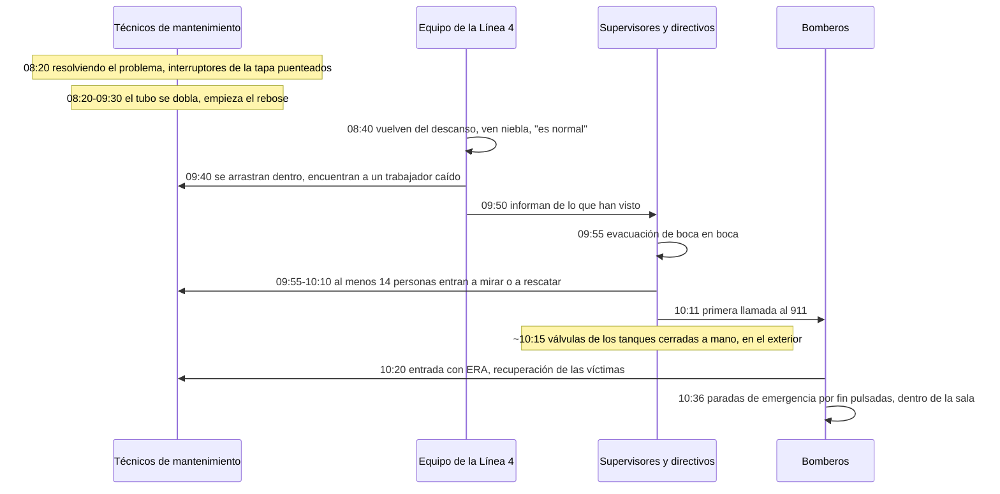
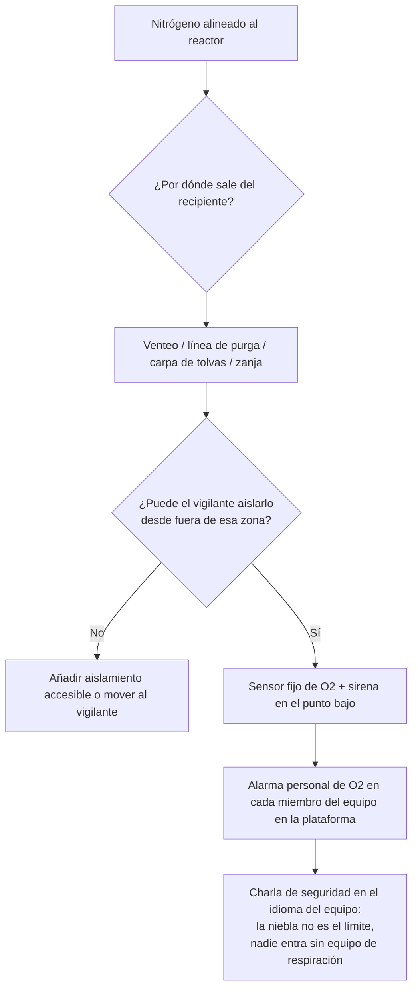

*Imagen: ilustración generada (Flux.1), no es una foto del lugar del incidente.*

Hacia las 8:40 de la mañana del 28 de enero de 2021, el equipo de envasado de una planta avícola en Gainesville, Georgia, volvió de un descanso de 20 minutos y vio niebla blanca saliendo de la sala del congelador. No hicieron nada. Uno de ellos explicó después a los investigadores por qué: de esa sala salía niebla blanca todo el tiempo. Era normal.

Una hora más tarde, una trabajadora fue a buscar al supervisor que no había vuelto. Se arrastró por la abertura de la cinta transportadora hasta la sala y encontró una nube de nitrógeno de más de un metro de profundidad y a un compañero de mantenimiento tendido en el suelo, sin moverse.

A las 11:00 de esa mañana había seis muertos. Dos eran los técnicos de mantenimiento que estaban resolviendo un problema del congelador. Los otros cuatro entraron en la sala, o en las salas contiguas, para ayudar.

La Junta de Seguridad Química de Estados Unidos (la CSB, la agencia federal que investiga accidentes químicos) publicó su informe completo en diciembre de 2023 como Investigation Report No. 2021-03-I-GA. El 25 de agosto de 2026 publicó el [vídeo de seguridad](https://www.csb.gov/csb-releases-foundation-food-group-safety-video/) sobre el mismo caso, titulado "Fatal Fog" ("Niebla mortal"), y por eso el informe vuelve a estar sobre nuestra mesa esta semana. No es una historia de refinería. Pero si tu trabajo consiste en estar junto a un reactor lleno de nitrógeno durante un cambio de catalizador, es tu historia.

## Lo que dice el informe de la CSB

Foundation Food Group troceaba y cocinaba pollo. En diciembre de 2020 puso en marcha una nueva línea de congelación, la Línea 4: una cinta transportadora que pasaba el pollo por una cubeta de nitrógeno líquido a unos 196 °C bajo cero y luego por un congelador en espiral. El proveedor de gas, Messer, diseñó y era propietario del congelador y de los tanques exteriores, y los alquilaba a la planta.

El nitrógeno líquido no es tóxico ni inflamable. Ese es el problema. Un litro de líquido se convierte en unos 696 litros de gas a temperatura ambiente. El gas empuja el aire fuera de donde cae. Por debajo de un 10 por ciento de oxígeno, dice el informe, "la exposición puede provocar la pérdida rápida del conocimiento sin previo aviso, lo que puede ocurrir en apenas una o dos respiraciones". No hay olor, ni tos, ni escozor en los ojos. Simplemente te apagas.

El congelador medía su propio nivel de nitrógeno con un tubo burbujeador: un tubo fino que apunta hacia abajo dentro de la cubeta y por cuyo extremo sale un hilo de gas. La contrapresión le dice al controlador qué profundidad tiene el líquido. La válvula de alimentación y el disparo de seguridad por nivel alto dependían los dos de ese único tubo.

Un sensor. Dos tareas. Si el sensor miente, las dos fallan a la vez.

En algún momento entre las 8:20 y las 9:30 de esa mañana, mientras dos técnicos de mantenimiento buscaban por qué el pollo salía blando, el tubo se dobló. La CSB no pudo establecer cómo. Sí estableció lo que pasa después, llenando la cubeta con agua: con la punta doblada por encima de la línea de rebose, el controlador lee "vacío", pide caudal máximo y el disparo nunca actúa. El nitrógeno líquido rebosó por el borde hasta el suelo y siguió cayendo.

La sala no tenía ventilación mecánica. Dos de sus cuatro paredes quedaban un metro y medio por debajo de las salas contiguas, así que por debajo de la altura de la cabeza era casi una caja cerrada. El nitrógeno frío es más pesado que el aire. La caja se llenó desde el suelo hacia arriba.

## La niebla que todos habían aprendido a ignorar

Aquí está la parte en la que el informe no se detiene mucho, pero un jefe de equipo sí debería.

La Línea 4 llevaba seis semanas con problemas desde su arranque: carga de la cinta, lecturas de nivel que no coincidían con la consigna, pollo que salía medio congelado. Messer estuvo en la planta repetidas veces. Cinco días antes del incidente sustituyó la válvula de control de nivel y el transductor. El día anterior le dio a la planta el usuario y la contraseña para subir ellos mismos la consigna de nivel.

Así que la mañana del 28, la niebla de nitrógeno que salía de la sala del congelador no era una señal de alarma. Era martes. Los técnicos de mantenimiento estaban dentro con los interruptores de seguridad de la tapa puenteados a propósito para poder observar la cubeta con el congelador en marcha. Nadie en la planta tenía un detector de oxígeno. No había detector fijo en la sala, ni alarma, ni cartel en la puerta. El equipo de envasado no tenía motivo para pensar que esa nube fuera distinta de la de la semana anterior.

Era distinta. Era una cubeta rebosando a caudal máximo dentro de un foso.

La CSB lo dice sin rodeos en sus lecciones clave: "Los productos químicos no inflamables y no tóxicos, como el nitrógeno, pueden asumirse erróneamente como no peligrosos sin la formación y la comunicación de riesgos adecuadas".

Esa frase va dirigida a una planta de pollo. Se aplica a cada parada en la que un reactor está bajo manta de nitrógeno y al equipo de la plataforma le han dicho "solo es nitrógeno".

## La hora siguiente: catorce personas entraron

La sala del congelador no era un espacio confinado en el sentido legal. La gente entraba y salía de ella durante todo el turno. Sin permiso, sin vigilante, sin plan de rescate, porque ninguno de los papeles que activan esas cosas se aplicaba a una sala con una puerta.

Precisamente por eso la segunda mitad de este incidente fue como fue.

Hacia las 9:40 la trabajadora que fue a buscar a su supervisor encontró la nube y el cuerpo. Salió, avisó a los demás, volvió a entrar con un compañero para confirmarlo, salió otra vez. A las 9:55 un supervisor de la línea vecina empezó a sacar a la gente. Unas 130 personas evacuaron, de boca en boca. Nadie accionó la alarma de incendios hasta las 10:11, el mismo minuto en que alguien por fin llamó al 911.

En los 30 minutos antes de que llegaran los bomberos, la CSB cuenta al menos 14 empleados que se dirigieron a la sala del congelador para ver qué pasaba o para sacar a alguien. Alrededor de uno de cada diez en la planta.

- Un responsable de logística encontró al supervisor de la Línea 4 inconsciente en la zona de expedición junto a la sala del congelador, intentó arrastrarlo hasta el muelle de carga, se mareó, retrocedió a la sala limpia contigua y se desmayó contra la pared.
- El responsable de mantenimiento encontró a una trabajadora de la Línea 4 inconsciente en el suelo de la sala limpia, se agachó para levantarla, estuvo a punto de desmayarse y salió tambaleándose. Después hizo lo más útil que hizo nadie esa mañana: salió al exterior, fue hasta los tanques en el extremo opuesto del edificio y cerró a mano las válvulas de descarga.
- El superintendente de la planta le dijo a un director que "iba a ver qué pasaba". Los bomberos lo encontraron en la sala del congelador.
- Otros tres directivos sacaron al responsable de logística de la sala limpia. Sobrevivió tras dos días en el hospital.

Cuatro de los catorce murieron. Tres resultaron heridos graves. Los bomberos con equipo de respiración autónoma (ERA, la botella a la espalda que lleva su propio aire) entraron hacia las 10:20 y sacaron al resto. La temperatura del suelo estaba por debajo de 73 °C bajo cero. Cuatro de los cinco bomberos que entraron fueron trasladados después al hospital.

Una de las seis personas fallecidas seguía viva cuando los bomberos la sacaron a las 10:36. Fue declarada muerta a las 11:00. La primera llamada al 911 se había hecho 16 minutos después de iniciarse la evacuación.

## Diez paradas de emergencia, todas en el sitio equivocado

*Imagen: Hans Westbeek en Unsplash.*

El congelador de la Línea 4 tenía diez botones de parada de emergencia. Cualquiera de ellos habría parado los congeladores y cerrado las válvulas de suministro de nitrógeno. Los diez estaban dentro de la sala del congelador: dos en cada extremo de cada congelador y uno en cada pantalla de control.

Léelo otra vez desde el punto de vista del vigilante. La única acción que detiene la fuga exige entrar en la fuga. La conclusión de la CSB es contundente: la ubicación "requería que un empleado que respondiera, o una persona que no estuviera ya en la sala del congelador, entrara en una atmósfera deficiente en oxígeno durante una fuga de nitrógeno líquido para accionar una parada de emergencia. Este diseño era inseguro".

La primera parada de emergencia se pulsó a las 10:36, por un bombero con aire, aproximadamente hora y media después de que empezara el rebose. La fuga solo se había detenido 20 minutos antes porque un directivo que acababa de estar a punto de morir caminó hasta el otro extremo del edificio y cerró los tanques a mano.

El informe cita la ISO 13850, la norma de parada de emergencia en máquinas, que pide dispositivos de parada "en los lugares de entrada y salida" y "capaces de un accionamiento no peligroso". La solución de la CSB es un dibujo de la misma sala con botones fuera de las puertas y en los tanques. No es ingeniería exótica. Es preguntar, antes de que llegue la primera gota de nitrógeno: "¿Dónde va a estar la persona que tiene que parar esto, y puede alcanzar el botón desde ahí?"

## Lo que nadie les había dicho

La CSB entrevistó a gente de arriba abajo en la empresa. La tabla de respuestas de la sección 4.4 es lo más duro de leer del informe. El responsable de medio ambiente, salud y seguridad, preguntado si conocía algún peligro de los nuevos congeladores: "En absoluto. No tenía ni idea". Un responsable corporativo de mantenimiento: "Solo sé que se expande cuando se calienta. Eso es prácticamente todo". Un trabajador de la Línea 4: "Nadie nos dijo que funcionaba con un producto químico ni nada. Me enteré del nitrógeno por las noticias, después del accidente".

El plan de actuación ante emergencias de la planta era una presentación de 46 diapositivas, en inglés, que se mostraba al contratar. La mayoría de la plantilla, incluidos cinco de los seis fallecidos, no tenía el inglés como primera lengua. El plan no mencionaba el nitrógeno. Decía que "personal designado" se encargaría del rescate y los primeros auxilios. Cuando la CSB preguntó quiénes eran, la empresa respondió por escrito: "FFG no tiene empleados formados ni cualificados para tareas de rescate ni de primeros auxilios. Cuando surge la necesidad llamamos al 911".

Nadie les había dicho que no entraran. Así que entraron.

Una nota legal. El nitrógeno no está cubierto por la norma de gestión de seguridad de procesos de OSHA, así que lo que una refinería da por hecho (un análisis de riesgos antes del arranque, procedimientos escritos, gestión del cambio, formación sobre el peligro) no era obligatorio por ley, y la planta no lo hizo. La CSB ha pedido a OSHA que cierre esa brecha. Hasta entonces, lo único que separa a una instalación de este desenlace es que alguien decida tratar el nitrógeno como peligroso de todos modos.

## Por qué importa desde la silla del contratista

Los cambios de catalizador en reactores funcionan con nitrógeno. El recipiente se pone bajo nitrógeno a propósito, para que el catalizador pirofórico no se encienda al encontrarse con el aire, y los equipos de entrada trabajan con equipo de respiración porque dentro no hay oxígeno por diseño. Esa parte la entiende todo el mundo. El permiso, el vigilante y el plan de rescate la cubren.

La sala de Foundation Food Group trata de todo lo que el permiso no cubre, porque no es el recipiente.

**La plataforma, el faldón, la zanja, la carpa.** Un reactor bajo nitrógeno ventea a algún sitio. Las líneas de purga van a algún sitio. Si el nitrógeno viene de una cisterna de líquido a través de un vaporizador, sale frío y denso y fluye cuesta abajo: a la zanja de tuberías bajo el reactor, al sumidero, bajo la lona del cerramiento provisional que alguien montó para proteger de la lluvia las tolvas de catalizador. Ninguno de esos sitios es un espacio confinado en el permiso. La sala del congelador tampoco lo era. Era una sala con una puerta que casualmente estaba un metro y medio más baja que las salas de al lado.

**La niebla no es el límite del peligro.** La nube blanca es agua que condensa del aire. Marca la parte fría del nitrógeno, no su borde. El nitrógeno templado es invisible e igual de mortal. Y al revés: una instalación donde la niebla de nitrógeno es una imagen habitual tiene un equipo entrenado para ignorarla. Los trabajadores de la planta "observaban regularmente niebla blanca", y esa es la frase que mató la hora que podrían haber aprovechado.

**Detectores personales de oxígeno para todo el equipo, no solo para los que entran.** El que entra con equipo de respiración tiene aire. El aparejador en la plataforma, el operador del camión de vacío en la base del faldón, el andamiero bajo la lona: esas son las personas que mueren en Gainesville. Una alarma de oxígeno de muñeca ajustada al 19,5 por ciento cuesta menos que una hora de grúa.

**Pregunta dónde está el corte, y ponte a su lado.** Antes de alinear el nitrógeno, recorre el aislamiento con el operador. ¿Qué válvula lo detiene? ¿Dónde está? ¿Puede el vigilante llegar sin cruzar la plataforma sobre la que ventea el nitrógeno? Si la respuesta honesta es "el tanque al otro extremo de la unidad", entonces esa es la posición del vigilante, o necesitas un segundo aislamiento al que el vigilante pueda llegar.

**Detección fija en el punto bajo, con sirena.** Un sensor de oxígeno a ras de suelo junto al venteo y la zanja, conectado a una luz y una sirena que todos oigan por encima del camión de vacío. La planta no tenía ninguno. La segunda lección clave de la CSB es un sistema fijo de vigilancia de la atmósfera y alarma "basado en una evaluación de riesgos correctamente realizada". Para un cambio de catalizador, la evaluación de riesgos es un paseo de diez minutos con un croquis de adónde va el nitrógeno cuando sale del recipiente.

**Dilo en el idioma del equipo.** El plan de emergencia estaba en inglés en una planta de habla hispana. Un equipo búlgaro en una instalación holandesa o finlandesa trabaja con un plan de emergencia escrito para otros. No pasa nada, siempre que la charla de seguridad de esa mañana diga, en búlgaro, tres cosas: aquí hay nitrógeno, te tumba en dos respiraciones, y si alguien cae tú no entras, llamas al número del permiso y esperas.

**Sin rescate sin aire. Ni una vez.** Catorce personas respondieron. Cuatro murieron. El informe dice que la planta "no formó a sus empleados para no responder a las emergencias". Los equipos con formación SCC/VCA practican esa regla en cada curso de refresco; este informe es lo que pasa en una instalación donde nadie la había oído. Hay que decirla en voz alta, repetirla hasta que suene ridícula, porque el impulso de agarrar a un compañero que ves tendido en el suelo es más fuerte que cualquier cosa que una presentación te meta en la cabeza.

## La lección

El nitrógeno no mató a seis personas. Mató a dos. A las otras cuatro las mató una sala que nadie consideraba peligrosa, una alarma que no existía, botones de parada al lado equivocado de la puerta y una plantilla a la que nunca se le había dicho: "Si alguien está caído ahí dentro, tú no entras".

Para el técnico joven en su primer cambio de catalizador: el nitrógeno es el único gas que no puedes oler, que no puedes ver cuando está templado y que no puedes atravesar. Si tu detector suena, te vas. Si otro está caído, te vas y gritas. Solo vuelve la persona con equipo de respiración.

Para el jefe de equipo: el permiso protege al que entra dentro del recipiente. Tu trabajo es todo el que está fuera. Recorre el camino del nitrógeno antes de alinearlo, encuentra los puntos bajos, pon un sensor en el más bajo y asegúrate de que el corte que detiene el flujo está en un sitio donde puedas estar de pie y respirar.

## Créditos y lecturas adicionales

- U.S. Chemical Safety and Hazard Investigation Board, *Fatal Liquid Nitrogen Release at Foundation Food Group*, Investigation Report No. 2021-03-I-GA, publicado en diciembre de 2023. [Informe completo (PDF)](https://www.csb.gov/assets/1/20/ffg_investigation_report_publication_copy.pdf) y el [vídeo "Fatal Fog", publicado el 25 de agosto de 2026](https://www.csb.gov/csb-releases-foundation-food-group-safety-video/).
- CSB Safety Bulletin No. 2003-10-B, *Hazards of Nitrogen Asphyxiation*. El boletín de 2003 que la CSB seguía citando 20 años después.
- Compressed Gas Association, CGA P-76 *Hazards of Oxygen-Deficient Atmospheres*, la guía sobre señalización y acceso restringido que ninguna de las dos empresas aplicó a la sala del congelador.
- ISO 13850, *Safety of machinery – Emergency stop function – Principles for design*, la norma detrás de la conclusión de la CSB sobre la ubicación de las paradas de emergencia.
- HSE UK, *Reduced oxygen environments (hypoxic environments)*, la breve página de orientación del regulador británico sobre el mismo peligro.
- Nuestros artículos anteriores sobre la [asfixia por argón en un foso en Bacchus](/es/blog/argon-pit-asphyxiation-bacchus-csb), donde un gas inerte más pesado que el aire se acumuló en un foso, y sobre la [fuga de H2S en Catalyst Refiners](/es/blog/catalyst-refiners-h2s-decommissioning-csb), otro caso en el que la atmósfera mortal estaba fuera del recipiente.
