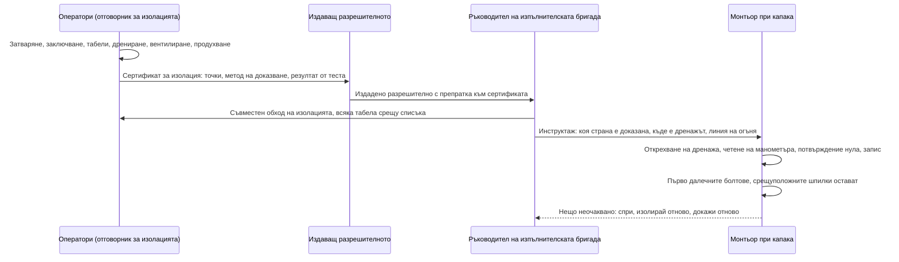

*Снимка: Christian Harb, Unsplash.*

Около единадесет сутринта в петък, 9 октомври 2026 г., бригада на външен изпълнител работи по топлообменници в рафинерията на Motor Oil в Агии Теодори, на Коринтския залив, на около 70 километра западно от Атина. Работата е планирана. Рафинерията е по средата на това, което самата компания нарича „обширна превантивна поддръжка“. И тогава нещо поддава. Метален капак излита под налягане и удря двама от мъжете.

Няма пожар. Рафинерията продължава да работи. Първото изявление на компанията казва точно това, почти на един дъх с новината, че двама работници са тежко ранени.

Единият, на 43 години, умира същия следобед. Другият, на 50, умира в неделя в атинска болница с тежки травми на главата. В рамките на 48 часа гръцката полиция арестува ръководителя на обекта от страна на изпълнителя и трима служители на рафинерията. Синдикатите обявяват 24-часова стачка в цяла Коринтия.

Още не знаем какво точно се е случило. Никой извън разследването не знае. Но ние работим като изпълнителска бригада по чужди инсталации, често точно до оборудване, което още е под продукт, а капак, който напуска топлообменник по време на ремонт, е един от най-старите начини, по които тази професия убива хора. Затова тази седмица постът е от Клъстер 3: какво е публично, как изглежда от стола на изпълнителя и какво бихме променили в понеделник.

## Какво знаем и какво не знаем

Нека разделим внимателно двете купчини, защото историята е на четири дни и официална картина още няма.

**Официално.** Заводът се управлява от Motor Oil Hellas. Това е втората по големина рафинерия в Гърция и поема над една трета от преработвателния капацитет на страната. Изявлението на компанията в деня на инцидента, цитирано от гръцките медии, гласи: „Днес в 11 ч., по време на обширна превантивна поддръжка в нашата рафинерия, двама работници бяха тежко ранени. Работниците получиха незабавна първа помощ и бяха транспортирани до болница.“ Добавя се, че „от първия момент бяха активирани всички предвидени протоколи за безопасност и процедури за аварийно реагиране“, а по-късно – че инцидентът „не е причинил пожар или значителни щети по производствените съоръжения“. Двамата мъже са работили за външен изпълнител. Още трима работници са леко пострадали, единият с дихателни симптоми, а един човек е лекуван от шок. Гръцката Инспекция по труда (SEPE) е уведомена и е разпоредена аутопсия.

**Съобщено, но непотвърдено.** Гръцки медии, включително държавната телевизия ERT, съобщават, че бригадата е работила по топлообменници в инсталация, обозначена като U-607, и че инцидентът „може да е свързан с разхерметизиране на система под налягане и откъсване на метален капак“. Други репортажи описват внезапно изпускане на газ под налягане, което е хвърлило капака върху работниците. Един гръцки материал казва направо, че „точната техническа причина и последователността на събитията не са потвърдени с официален доклад“. Това е честният статус. Приемайте всичко в този абзац като работна картина, не като констатация.

**Правната реакция.** В петък прокуратурата разпорежда ареста на 59-годишния ръководител на изпълнителската бригада. В събота полицията арестува трима служители на Motor Oil: бригадир, ръководителя на отдела по здраве и безопасност и ръководител на проект. Издирва се четвърти човек. Обвиненията, както са съобщени, са за причиняване на експлозия и за щети, застрашили обществената безопасност. Според репортажите разследващите проверяват дали са издадени правилните разрешителни за работа и как оборудването е било изолирано и разхерметизирано. Арестът не е присъда и ние няма да спекулираме за никого от четиримата.

**Контекстът.** Това е същата рафинерия, в която през септември 2024 г. пожар в инсталация за атмосферна дестилация рани няколко души, и в която според гръцки и австралийски медии експлозия през 2020 г. уби един работник и рани трима. След втората смърт в неделя Панелинският синдикат на енергетиците заяви: „Не можем и не бива да приемаме такива инциденти като неизбежна цена на труда.“ Той подчерта, че изпълнителските бригади заслужават същата защита като постоянния персонал и че ремонтните работи текат на непрекъснати смени, докато инсталациите наоколо продължават да работят. Браншовият синдикат на енергетиката отиде по-далеч и го нарече „престъпление на работодателя“. Не е нужно да приемате езика на синдиката, за да забележите, че двамата загинали не са били във ведомостта на компанията.

## Защо „няма пожар“ не е добра новина

Прочетете пак изявлението на компанията. Няма пожар. Няма значителни щети. Производството продължава. За пресцентъра на една рафинерия това е добрата версия на лош ден.

От мястото, на което стои един монтьор, е обратното. Пожар означава, че нещо е изтекло и е намерило източник на запалване. Капак, който излита *без* пожар, означава, че енергията, убила двама души, е било обикновено складирано налягане. Нищо екзотично. Газ или пари, хванати зад болтово съединение, освободени наведнъж, когато болтовете вече не могат да ги удържат.

Ето простата версия, ако никога не сте отваряли такъв апарат. Кожухотръбният топлообменник е стоманен цилиндър със сноп тръби вътре. Един флуид минава през тръбите, друг минава около тях в кожуха, и топлината се прехвърля между двата. Във всеки край има камера с болтов капак – понякога плоска плоча с десетки шпилки, понякога бомбе. За да почисти или инспектира снопа, бригадата развива този капак и го изважда. Капакът на рафинериен топлообменник може да тежи от няколкостотин килограма до два тона.

Всичко в тази работа предполага, че вътре налягането е атмосферно. Нула. Ако не е, капакът се превръща в бутало. Проучването на CSB за разкъсването в Goodyear в Хюстън през 2008 г. описва топлообменник, при който спирателен кран е бил затворен между апарата и предпазния му клапан, пара е загряла останалия вътре амоняк, и капакът е излетял и убил работник наблизо. През 2013 г. в Мериленд бригада започва да сваля глух фланец от климатична линия, в която все още има около 100 psi, и фланецът излита като снаряд и убива един от тях. През 1992 г. в рафинерия в Содегаура, Япония, капак на топлообменник с байонетно затваряне поддава и загиват десет души.

Различни заводи, различни флуиди, една и съща физика. Болтово съединение плюс налягане, за което някой е вярвал, че го няма.

Не знаем, че това се е случило в Агии Теодори. Знаем, че „разхерметизиране“ и „капак“ са двете думи, които гръцките репортери повтарят, и че според съобщенията разследващите гледат точно въпросите за изолацията и разрешителните, които бихте очаквали.

## Защо това е важно от стола на изпълнителя

Ето нещо, което хората извън индустрията не виждат. При ремонтна работа изпълнителската бригада не притежава изолацията. Заводът я притежава.

Последователността обикновено е тази. Операторите подготвят оборудването: затварят крановете, дренират, вентилират, може би продухват с пара или азот, и слагат катинарите и табелите. Някой от страна на завода подписва сертификат за изолация. Издава се разрешително. Ръководителят на бригадата подписва разрешителното, извежда бригадата до топлообменника и монтьорите слагат ключовете на болтовете.

Всяко звено в тази верига е предаване на доверие. Монтьорът вярва на ръководителя на бригадата. Ръководителят вярва на разрешителното. Разрешителното вярва на сертификата за изолация. Сертификатът вярва на този, който е затворил крановете, а крановете вярват на собствените си седла. Ако някое звено е грешно, първият, който ще разбере, е този с ключа в ръка. Това е структурният факт под всеки един от тези инциденти, и затова двама изпълнителски работници са мъртви, а четиримата арестувани включват хора и от двете страни на оградата.

Ръководството на британския регулатор по темата е HSG253, *The safe isolation of plant and equipment* (Безопасната изолация на инсталации и оборудване). То е старо, безплатно и директно. Параграф 165 казва: „Докажете целостта на всички точки на изолация от една изолационна схема, преди да пристъпите към интрузивна работа.“ Параграф 168 казва какво да правите, ако не можете: „Не разчитайте на изолация, която не е доказана, защото липсват съоръженията за това или защото нямате доверие в теста. Разширете границата на изолацията или отложете работата до спиране.“

И после параграф 173, който бихме сложили на стената на изпълнителския фургон: „Непосредствено преди отваряне на оборудването компетентно лице трябва да докаже, че няма теч и натрупване на налягане в изолационния обхват, чрез подходящ метод. Това трябва да бъде записано в сертификата за изолация, за да демонстрира резултатите от теста на тези, които ще извършват работата.“

Забележете израза *непосредствено преди*. Не когато сертификатът е бил подписан в шест сутринта. Не когато разрешителното е издадено на портала. При топлообменника, с още стегнати болтове, мигове преди първият да бъде отвит. Животоспасяващите правила на IOGP казват същото с шест думи: „Проверете изолацията и нулевата енергия преди започване на работа.“

В добре управляван завод тази проверка е открехнат дренажен кран на камерата, манометър в полезрението и нищо не излиза. В завод, който бърза, тя е разговор: „Операторите казват, че е разхерметизирано.“ Този разговор е нещото, което трябва да можете да откажете.

*Снимка: Sylvain Miklaszewski, Unsplash.*

## Минутата преди болтовете да паднат

Причината налягането да преживее една изолация обикновено не е, че никой не е затворил кран. Причината е, че налягането има повече начини да бъде там, отколкото хората имат в главите си. Няколко от тези, които се появяват отново и отново в докладите за инциденти и в инструктажите:

- **Пропускащ кран.** Спирателният кран е затворен, табелата е на него, а той пропуска. HSG253 дори дефинира „доказана изолация“ като такава, при която пропускането през крана е измерено спрямо критерий. Ако никой не е измерил, никой не знае.
- **Хваната течност, която се затопля.** Топлообменникът е стоял пълен с нещо, дренажът е запушен от котлен камък или парафин, и слънцето е изгряло. Течност, която се нагрява в затворен обем, вдига налягане бързо. Топлообменникът в Goodyear е христоматийният случай.
- **Запушен вентил.** Дренажът е отворен, нищо не излиза, и всички са прочели това като „празно“. Всъщност е било „запушено“.
- **Продухване, което никога не е било изпуснато.** Азот или пара са влезли, за да изчистят въглеводородите, и системата е била затворена след тях.
- **Грешната страна.** Кожуховата страна е доказана. Тръбната не е. Или съседният топлообменник, който дели същия колектор, е този, който е под продукт.

Нищо от това не се покрива от „операторите потвърдиха изолацията“. Всичко се покрива от човека при капака, който открехва вентил, гледа манометър и чак тогава разхлабва първата шпилка – от страната, обърната далеч от тялото му, с капак, все още държан от оставащите шпилки.

Горе-долу така трябва да изглежда предаването, когато работи. Всяка стрелка е точка, в която някой може да каже „не“.

Стъпката, която докладите за инциденти най-често намират за липсваща, е четвъртата – съвместният обход. Сертификатът е списък с това, което някой е имал намерение да направи. Обходът е това, което съществува.

Бригади със сертификация SCC/VCA, холандско-германската схема за безопасност на изпълнителите, която нашите хора държат чрез TÜV Rheinland, тренират проверка на изолацията по време на опреснителните курсове. Това, което курсът не може да ви даде, е смелостта да спрете работа в обекта на клиент, в прозореца на ремонта на завода, с бригадира на завода до вас, защото дренажният кран, който сте открехнали, е съскал една секунда по-дълго, отколкото ви харесва. Това е цялото умение. То не е техническо.

## Какво се променя за бригадите другата седмица

Няколко неща, които бихме взели оттук, ако съобщената картина се потвърди. Ако официалните констатации кажат друго, ще актуализираме.

**Ако сте ръководител на изпълнителска бригада:** разрешителното не е доказателството. Поискайте да видите сертификата за изолация, не само номера на разрешителното. Попитайте как е доказана всяка точка и кога. Ако отговорът е „тази сутрин“, той е остарял, докато стигнете до топлообменника. Докажете го пак при фланеца. HSG253 казва, че компетентно лице трябва да направи това *непосредствено преди отваряне*, и нищо в него не казва, че това лице трябва да е служител на завода, а не ваш.

**Ако сте монтьорът:** линията на огъня е ваша. Стойте отстрани на капака, никога пред него. Разхлабете първо болтовете от далечната страна, така че ако нещо изхвърчи, капакът да се отвори като панта далеч от вас. Дръжте срещуположните шпилки стегнати, докато не видите пролуката и не помиришете нищо. Ако чуете съскане, спрете и се отдръпнете. Никой няма да помни, че сте им стрували десет минути. Другия изход ще го помнят.

**Ако сте заводът:** думите на синдиката за изпълнители, които правят ремонт на непрекъснати смени, докато инсталациите наоколо работят, не са политически лозунг, а запис в регистъра на опасностите. Общи колектори, съседи под продукт и бригада, която не познава особеностите на завода, са комбинация, която изисква човек от завода при фланеца, а не само подпис в офиса.

**Ако планирате ремонт в Европа:** забележете колко бързо се задвижи наказателният процес. Четири ареста за два дни, обвинения и срещу ръководителя на изпълнителя, и срещу шефа по безопасност на клиента. Това все повече е моделът в европейските юрисдикции. Практическата последица за една бригада е проста. Разрешителното, сертификатът и дневникът на газовите измервания са документите, които ще бъдат четени в съдебна зала. Попълвайте ги така, сякаш отиват там, защото понякога отиват.

Двама мъже отидоха на работа в петък сутринта, на планирана задача в тиха инсталация, без пожар и без гръм, достатъчно силен, за да се чуе от портала. Още не знаем кой от петте начина, по които налягането се крие, ги е намерил. Знаем, че който и да е бил, последният шанс да бъде хванат е била минутата преди първият болт да падне. Тази минута принадлежи на бригадата.

## Източници и допълнително четене

- Reuters чрез Hydrocarbon Processing, 9 октомври 2026 г.: [Two seriously injured in incident at oil refinery near Athens](https://www.hydrocarbonprocessing.com/news/2026/10/two-seriously-injured-in-incident-at-oil-refinery-near-athens/)
- The Press Project, 12 октомври 2026 г.: [Motor Oil explosion claims second worker's life](https://thepressproject.gr/motor-oil-explosion-claims-second-workers-life)
- News247 (на английски), 9 октомври 2026 г.: [Explosion at Motor Oil: one of two injured workers dies](https://www.news247.gr/en/explosion-at-motor-oil-one-of-two-injured-workers-dies/)
- Efsyn, 12 октомври 2026 г. (на гръцки): [24-часова стачка заради инцидента в Motor Oil](https://www.efsyn.gr/oikonomia/1486175/dystyhima-sti-motor-oil-24ori-apergia-gia-tis-eythynes-kai-ta-metra-asfaleias/)
- HSE UK, HSG253: [The safe isolation of plant and equipment](https://www.hse.gov.uk/pubns/priced/hsg253.pdf) — параграфи 156 до 183 покриват вентилиране, дрениране и доказване на изолации.
- Животоспасяващи правила на IOGP, Изолация на енергия: [Verify isolation and zero energy before work begins](https://www.iogp.org/wp-content/uploads/2018/11/05EnergyIsolation_IOGP577version1.2.pdf)
- Проучване на CSB: [Heat exchanger rupture and ammonia release in Houston, Texas](https://www.csb.gov/file.aspx?DocumentId=5674) (Goodyear, 2008 г.)
- Свързано четене в този блог: [Експлозията в Shell Monaca: една цифра, два отворени клапана](/bg/blog/shell-monaca-furnace-backflow-explosion-csb) и [Грешен фланец, правилно звено: прочит на доклада от PEMEX Deer Park](/bg/blog/pemex-deer-park-flange-misidentification)

*По правило в този пост не се назовават лица. Фактите за инцидента са взети от публикуваните изявления на компанията и от гръцки и международни медии към 13 октомври 2026 г. Официалното разследване още не е докладвало. Ще ревизираме поста, ако констатациите променят картината.*
