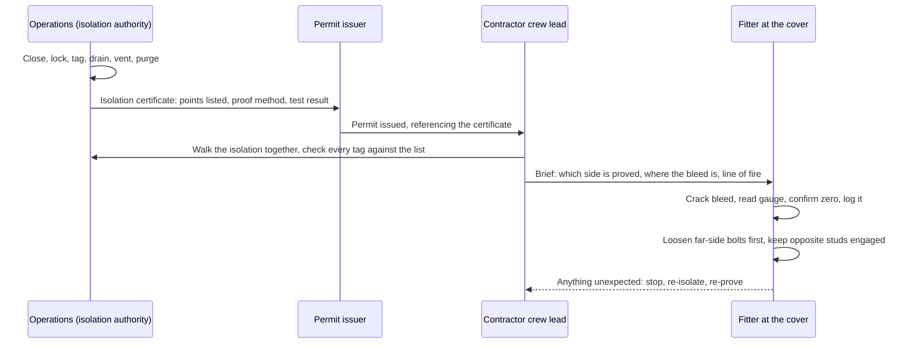

*Image: Christian Harb on Unsplash.*

At about eleven on the morning of Friday 9 October 2026, a contractor crew was working on heat exchangers at the Motor Oil refinery in Agioi Theodoroi, on the Gulf of Corinth about 70 kilometres west of Athens. It was a planned job. The refinery was in the middle of what the company itself called "extensive preventive maintenance." Then something let go. A metal cover came off under pressure and hit two of the men.

There was no fire. The refinery kept running. The company's first statement said so, almost in the same breath as it said two workers were seriously hurt.

One of them, a 43-year-old, died that afternoon. The other, 50, died on the Sunday in an Athens hospital with severe head injuries. Within 48 hours, Greek police had arrested the contractor's site supervisor and three refinery employees. Unions called a 24-hour strike across Corinthia.

We don't know yet exactly what happened. Nobody outside the investigation does. But we work as a contractor crew on other people's units, often right next to equipment that is still live, and a cover leaving a heat exchanger during maintenance is one of the oldest ways this job kills people. So this week is a Cluster 3 post: what is public, what it looks like from a contractor's chair, and what we'd change on Monday.

## What We Know, and What We Don't

Let's separate the two piles carefully, because this story is four days old and the official picture doesn't exist yet.

**On the record.** Motor Oil Hellas runs the plant. It's Greece's second-largest refinery and handles more than a third of the country's refining capacity. The company's statement on the day, as reported by Greek media, said: "Today, at 11am, during extensive preventive maintenance at our refinery two employees were seriously injured. The employees received immediate first aid and were transported to the hospital." It added that "from the first moment all prescribed safety protocols and emergency response procedures were activated," and later that the accident "did not cause a fire or significant damage to production facilities." The two men worked for an outside contractor. Three other workers were lightly injured, one of them with respiratory symptoms, and one person was treated for shock. The Greek Labour Inspectorate (SEPE) was called in and an autopsy was ordered.

**Reported but not confirmed.** Greek outlets, including the state broadcaster ERT, reported that the crew was working on heat exchangers in a unit identified as U-607, and that the incident "may have been related to the depressurization of the system under pressure and the detachment of a metal cover." Other reports describe a sudden release of pressurised gas that threw the cover into the workers. One Greek report said plainly that "the exact technical cause and sequence of events have not been confirmed with an official report." That's the honest status. Treat everything in this paragraph as a working picture, not a finding.

**The legal response.** On the Friday, prosecutors ordered the arrest of the 59-year-old supervisor of the contractor crew. On the Saturday, police arrested three Motor Oil employees: a foreman, the head of the health and safety department, and a project manager. A fourth man was being sought. The charges, as reported, are causing an explosion and causing damage that endangered public safety. Investigators are reported to be examining whether the correct work permits were issued and how the equipment was isolated and depressurised. An arrest is not a finding of guilt, and we're not going to speculate about any of those four people.

**The context.** This is the same refinery where a September 2024 fire in a crude distillation unit injured several people, and where, according to Greek and Australian press reports, a 2020 explosion killed one worker and injured three. The Panhellenic Energy Union said after Sunday's second death: "We cannot and should not treat such incidents as an inevitable cost of work." It pointed out that contractor crews deserve the same protection as permanent staff, and that maintenance work goes on in continuous shifts while the units around it keep operating. The sectoral energy union went further and called it an "employer crime." You don't have to adopt the union's language to notice that the two men who died were not on the company's payroll.

## Why "No Fire" Is Not Good News

Read the company statement again. No fire. No significant damage. Production continued. For a refinery's press office that is the good version of a bad day.

From where a fitter stands, it's the opposite. A fire means something leaked and found ignition. A cover coming off *without* a fire means the energy that killed two people was simple stored pressure. Nothing exotic. Gas or vapour, trapped behind a bolted closure, released all at once when the bolts could no longer hold it.

Here's the plain-language version if you've never opened one of these. A shell-and-tube heat exchanger is a steel cylinder with a bundle of tubes inside. One fluid runs through the tubes, another runs around them in the shell, and heat moves between the two. At each end there's a channel with a bolted cover, sometimes a flat plate with dozens of studs, sometimes a bonnet. To clean or inspect the bundle, a crew unbolts that cover and pulls it. The cover on a refinery exchanger can weigh anywhere from a few hundred kilos to a couple of tonnes.

Everything about that job assumes the inside is at atmospheric pressure. Zero. If it isn't, the cover becomes a piston. The CSB's case study on the 2008 Goodyear rupture in Houston describes a heat exchanger where an isolation valve had been closed between the exchanger and its relief device, steam heated the ammonia left inside, and the head blew off and killed a worker nearby. In 2013, in Maryland, a crew began removing a blank flange from an HVAC line still holding roughly 100 psi, and the flange left as a projectile and killed one of them. In 1992, at a refinery in Sodegaura, Japan, a breech-lock exchanger cover let go and ten people died.

Different plants, different fluids, same physics. A bolted closure plus pressure that someone believed was gone.

We don't know that this is what happened at Agioi Theodoroi. We do know that "depressurisation" and "cover" are the two words Greek reporters keep using, and that investigators are reported to be looking at exactly the isolation and permit questions you'd expect.

## Why It Matters From a Contractor's Chair

Here's the thing people outside the industry don't see. On a maintenance job, the contractor crew doesn't own the isolation. The plant does.

The sequence is usually this. Operations prepares the equipment: shuts the valves, drains, vents, maybe steams or purges with nitrogen, and hangs the locks and tags. Someone on the plant side signs an isolation certificate. A permit is issued. The crew lead signs the permit, walks the crew out to the exchanger, and the fitters put spanners on the bolts.

Every link in that chain is a handover of trust. The fitter trusts the crew lead. The crew lead trusts the permit. The permit trusts the isolation certificate. The certificate trusts whoever closed the valves, and the valves trust their own seats. If any link is wrong, the first person to find out is the one with the spanner. That's the structural fact under every one of these incidents, and it's why two contract workers are dead and the four people arrested include staff on both sides of the fence.

The British regulator's guidance on this is HSG253, *The safe isolation of plant and equipment*. It's old, it's free, and it's blunt. Paragraph 165 says: "Prove the integrity of all isolation points of an isolation scheme before proceeding with intrusive work." Paragraph 168 says what to do if you can't: "Do not rely on an isolation that is unproved because the facilities are not present, or where you lack confidence in the test. Extend the isolation boundary or defer the work until shutdown."

And then paragraph 173, which is the one we'd put on the wall of the contractor cabin: "Immediately prior to breaking containment, a competent person should prove that there is no leakage and pressure build-up within the isolation envelope, using an appropriate method. This should be recorded on the isolation certificate to demonstrate the test results to those undertaking the work."

Notice the phrase *immediately prior*. Not when the certificate was signed at six in the morning. Not when the permit was issued at the gate. At the exchanger, with the bolts still tight, moments before the first one comes off. The IOGP Life-Saving Rules say the same thing in six words: "Verify isolation and zero energy before work begins."

On a well-run site, that check is a bleed valve cracked open on the channel with the gauge in sight and nothing coming out. On a site that's rushing, it's a conversation: "Ops says it's depressured." That conversation is the thing you need to be able to refuse.

*Image: Sylvain Miklaszewski on Unsplash.*

## The Minute Before the Bolts Come Off

The reason pressure survives an isolation isn't usually that nobody closed a valve. It's that pressure has more ways to be there than people have in their heads. A few of the ones that come up, over and over, in incident reports and in toolbox talks:

- **A passing valve.** The block valve is shut, the tag is on it, and it's letting through. HSG253 even defines "proved isolation" as one where leakage past the valve has been measured against a criterion. If nobody measured, nobody knows.
- **Trapped liquid that warms up.** The exchanger sat full of something, the drain plugged with scale or wax, and the sun came out. Liquid heating in a closed volume builds pressure fast. The Goodyear exchanger is the textbook case.
- **A blocked vent.** The bleed was opened, nothing came out, and everyone read that as "empty." It was actually "blocked."
- **A purge that was never relieved.** Nitrogen or steam went in to clear the hydrocarbon and the system was closed up behind it.
- **The wrong side.** The shell side was proved. The tube side wasn't. Or the exchanger next to it, sharing the same header, is the one that's live.

None of this is covered by "operations confirmed the isolation." All of it is covered by the person at the cover cracking a vent, watching a gauge, and only then loosening the first stud, on the side away from their body, with the cover still held by the studs that remain.

This is roughly how the handover should look when it works. Each arrow is a point where somebody can say no.

The step that incident reports most often find missing is the fourth one, the joint walk-down. The certificate is a list of what someone intended. The walk-down is what exists.

Crews with SCC/VCA certification, the Dutch-German contractor safety scheme that our people hold through TÜV Rheinland, drill isolation verification during refreshers. What the refresher can't give you is the nerve to stop a job on a client's site, in a plant's turnaround window, with the plant's own foreman standing next to you, because the bleed valve you cracked hissed for a second longer than you liked. That's the whole skill. It isn't technical.

## What Changes for Crews Next Week

A few things we'd take from this, assuming the reported picture holds up. If the official findings say otherwise, we'll update.

**If you're a contractor crew lead:** the permit is not the proof. Ask to see the isolation certificate, not just the permit number. Ask how each point was proved, and when. If the answer is "this morning," it's stale by the time you reach the exchanger. Prove it again at the flange. HSG253 says a competent person should do this *immediately prior to breaking containment*, and nothing in it says that person has to be the plant's employee rather than yours.

**If you're the fitter:** you own the line of fire. Stand to the side of the cover, never in front of it. Loosen the bolts on the far side first, so if anything blows, the cover hinges away from you. Keep opposite studs engaged until you've seen the gap and smelled nothing. If you hear a hiss, stop and back off. Nobody will remember that you cost them ten minutes. They will remember the other outcome.

**If you're the plant:** the union's point about contractors doing maintenance in continuous shifts while units around them keep running is not a political slogan, it's a hazard register entry. Shared headers, live neighbours, and a crew that doesn't know the plant's quirks are a combination that needs a plant person at the flange, not just a signature in the office.

**If you're planning a turnaround in Europe:** notice how fast the criminal process moved. Four arrests inside two days, charges against both the contractor's supervisor and the client's safety head. That's increasingly the pattern across European jurisdictions. The practical consequence for a crew is simple. The permit, the certificate, and the gas-test log are the documents that will be read in a courtroom. Fill them in as if that's where they're going, because sometimes it is.

Two men went to work on a Friday morning on a planned job on a quiet unit, with no fire and no bang loud enough to be heard from the gate. We don't yet know which of the five ways pressure hides is the one that found them. We do know that whichever it was, the last chance to catch it was the minute before the first bolt came off. That minute belongs to the crew.

## Credit and Further Reading

- Reuters via Hydrocarbon Processing, 9 October 2026: [Two seriously injured in incident at oil refinery near Athens](https://www.hydrocarbonprocessing.com/news/2026/10/two-seriously-injured-in-incident-at-oil-refinery-near-athens/)
- The Press Project, 12 October 2026: [Motor Oil explosion claims second worker's life](https://thepressproject.gr/motor-oil-explosion-claims-second-workers-life)
- News247 (English), 9 October 2026: [Explosion at Motor Oil: one of two injured workers dies](https://www.news247.gr/en/explosion-at-motor-oil-one-of-two-injured-workers-dies/)
- Efsyn, 12 October 2026 (Greek): [24-hour strike over the Motor Oil accident](https://www.efsyn.gr/oikonomia/1486175/dystyhima-sti-motor-oil-24ori-apergia-gia-tis-eythynes-kai-ta-metra-asfaleias/)
- HSE UK, HSG253: [The safe isolation of plant and equipment](https://www.hse.gov.uk/pubns/priced/hsg253.pdf) — paragraphs 156 to 183 cover venting, draining and proving isolations.
- IOGP Life-Saving Rules, Energy Isolation: [Verify isolation and zero energy before work begins](https://www.iogp.org/wp-content/uploads/2018/11/05EnergyIsolation_IOGP577version1.2.pdf)
- CSB case study: [Heat exchanger rupture and ammonia release in Houston, Texas](https://www.csb.gov/file.aspx?DocumentId=5674) (Goodyear, 2008)
- Related reading on this blog: [Shell Monaca furnace explosion: one digit, two open valves](/en/blog/shell-monaca-furnace-backflow-explosion-csb) and [Wrong flange, right unit: reading the PEMEX Deer Park report](/en/blog/pemex-deer-park-flange-misidentification)

*Individuals are not named in this post, by policy. Facts about the incident are taken from the company's published statements and Greek and international press reports as of 13 October 2026. The official investigation has not reported. We'll revise this post if the findings change the picture.*
