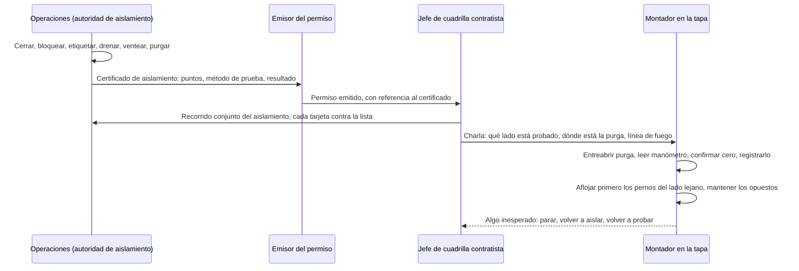

*Imagen: Christian Harb en Unsplash.*

Hacia las once de la mañana del viernes 9 de octubre de 2026, una cuadrilla de un contratista externo trabajaba en intercambiadores de calor en la refinería de Motor Oil en Agioi Theodoroi, en el golfo de Corinto, a unos 70 kilómetros al oeste de Atenas. Era un trabajo planificado. La refinería estaba en medio de lo que la propia empresa llamó "un extenso mantenimiento preventivo". Entonces algo cedió. Una tapa metálica salió despedida bajo presión y golpeó a dos de los hombres.

No hubo incendio. La refinería siguió operando. El primer comunicado de la empresa lo decía así, casi en la misma frase en que decía que dos trabajadores estaban gravemente heridos.

Uno de ellos, de 43 años, murió esa misma tarde. El otro, de 50, murió el domingo en un hospital de Atenas con graves lesiones en la cabeza. En menos de 48 horas, la policía griega había detenido al supervisor de obra del contratista y a tres empleados de la refinería. Los sindicatos convocaron una huelga de 24 horas en toda Corintia.

Todavía no sabemos exactamente qué pasó. Nadie fuera de la investigación lo sabe. Pero nosotros trabajamos como cuadrilla contratista en unidades ajenas, muchas veces justo al lado de equipos que siguen en servicio, y una tapa que sale de un intercambiador durante el mantenimiento es una de las formas más antiguas en que este oficio mata gente. Así que esta semana toca un post de Clúster 3: qué es público, cómo se ve desde la silla del contratista y qué cambiaríamos el lunes.

## Lo que sabemos y lo que no

Separemos con cuidado los dos montones, porque esta historia tiene cuatro días y la versión oficial todavía no existe.

**Lo que consta.** Motor Oil Hellas opera la planta. Es la segunda refinería más grande de Grecia y concentra más de un tercio de la capacidad de refino del país. El comunicado de la empresa del mismo día, según lo recogieron los medios griegos, decía: "Hoy, a las 11 de la mañana, durante un extenso mantenimiento preventivo en nuestra refinería dos trabajadores resultaron gravemente heridos. Los trabajadores recibieron primeros auxilios de inmediato y fueron trasladados al hospital." Añadía que "desde el primer momento se activaron todos los protocolos de seguridad y procedimientos de emergencia previstos", y más tarde que el accidente "no causó incendio ni daños significativos en las instalaciones de producción". Los dos hombres trabajaban para un contratista externo. Otros tres trabajadores sufrieron heridas leves, uno de ellos con síntomas respiratorios, y una persona fue atendida por shock. Se avisó a la Inspección de Trabajo griega (SEPE) y se ordenó una autopsia.

**Lo publicado pero no confirmado.** Medios griegos, incluida la televisión pública ERT, informaron de que la cuadrilla trabajaba en intercambiadores de calor de una unidad identificada como U-607, y de que el incidente "podría estar relacionado con la despresurización de un sistema bajo presión y el desprendimiento de una tapa metálica". Otras crónicas describen una liberación repentina de gas a presión que lanzó la tapa contra los trabajadores. Un medio griego lo dijo sin rodeos: "la causa técnica exacta y la secuencia de los hechos no han sido confirmadas con un informe oficial". Ese es el estado honesto. Tomen todo lo de este párrafo como una imagen de trabajo, no como una conclusión.

**La respuesta judicial.** El viernes, la fiscalía ordenó la detención del supervisor de la cuadrilla contratista, de 59 años. El sábado, la policía detuvo a tres empleados de Motor Oil: un capataz, el jefe del departamento de salud y seguridad y un jefe de proyecto. Se buscaba a un cuarto hombre. Los cargos, según se ha informado, son causar una explosión y causar daños que pusieron en peligro la seguridad pública. Los investigadores, según las crónicas, examinan si se emitieron los permisos de trabajo correctos y cómo se aisló y despresurizó el equipo. Una detención no es una condena, y no vamos a especular sobre ninguna de esas cuatro personas.

**El contexto.** Es la misma refinería donde un incendio en una unidad de destilación de crudo hirió a varias personas en septiembre de 2024 y donde, según la prensa griega y australiana, una explosión en 2020 mató a un trabajador e hirió a tres. Tras la segunda muerte del domingo, el Sindicato Panhelénico de la Energía declaró: "No podemos ni debemos tratar estos incidentes como un coste inevitable del trabajo." Señaló que las cuadrillas contratistas merecen la misma protección que la plantilla fija, y que el mantenimiento se hace en turnos continuos mientras las unidades de alrededor siguen operando. El sindicato sectorial de la energía fue más lejos y lo llamó "crimen patronal". No hace falta adoptar el lenguaje sindical para darse cuenta de que los dos hombres que murieron no estaban en la nómina de la empresa.

## Por qué "sin incendio" no es una buena noticia

Vuelvan a leer el comunicado de la empresa. Sin incendio. Sin daños significativos. La producción continuó. Para el gabinete de prensa de una refinería, esa es la versión buena de un mal día.

Desde donde está un montador, es lo contrario. Un incendio significa que algo fugó y encontró una fuente de ignición. Una tapa que sale *sin* incendio significa que la energía que mató a dos personas era simple presión almacenada. Nada exótico. Gas o vapor, atrapado detrás de un cierre embridado, liberado de golpe cuando los pernos ya no pudieron contenerlo.

Aquí va la versión en lenguaje llano, por si nunca han abierto uno. Un intercambiador de carcasa y tubos es un cilindro de acero con un haz de tubos dentro. Un fluido circula por los tubos, otro circula alrededor de ellos por la carcasa, y el calor pasa de uno a otro. En cada extremo hay un cabezal con una tapa embridada, a veces una placa plana con decenas de espárragos, a veces una tapa abombada. Para limpiar o inspeccionar el haz, la cuadrilla desatornilla esa tapa y la retira. La tapa de un intercambiador de refinería puede pesar desde unos cientos de kilos hasta un par de toneladas.

Todo en ese trabajo da por hecho que el interior está a presión atmosférica. Cero. Si no lo está, la tapa se convierte en un pistón. El estudio de caso de la CSB sobre la rotura en Goodyear, Houston, en 2008, describe un intercambiador en el que se había cerrado una válvula de aislamiento entre el equipo y su dispositivo de alivio; el vapor calentó el amoníaco que quedaba dentro, el cabezal salió despedido y mató a un trabajador cercano. En 2013, en Maryland, una cuadrilla empezó a retirar una brida ciega de una línea de climatización que todavía tenía unas 100 psi; la brida salió como un proyectil y mató a uno de ellos. En 1992, en una refinería de Sodegaura, Japón, cedió la tapa de un intercambiador de cierre tipo bayoneta y murieron diez personas.

Plantas distintas, fluidos distintos, la misma física. Un cierre embridado más una presión que alguien creía que ya no estaba.

No sabemos que eso sea lo que pasó en Agioi Theodoroi. Sí sabemos que "despresurización" y "tapa" son las dos palabras que los periodistas griegos repiten, y que, según las crónicas, los investigadores miran exactamente las cuestiones de aislamiento y permisos que uno esperaría.

## Por qué importa desde la silla del contratista

Aquí hay algo que la gente de fuera del sector no ve. En un trabajo de mantenimiento, la cuadrilla contratista no es dueña del aislamiento. La planta lo es.

La secuencia suele ser esta. Operaciones prepara el equipo: cierra las válvulas, drena, ventea, quizá vaporiza o purga con nitrógeno, y cuelga los candados y las tarjetas. Alguien del lado de la planta firma un certificado de aislamiento. Se emite un permiso. El jefe de cuadrilla firma el permiso, lleva a la cuadrilla hasta el intercambiador y los montadores ponen las llaves en los pernos.

Cada eslabón de esa cadena es una transferencia de confianza. El montador confía en el jefe de cuadrilla. El jefe de cuadrilla confía en el permiso. El permiso confía en el certificado de aislamiento. El certificado confía en quien cerró las válvulas, y las válvulas confían en sus propios asientos. Si un eslabón falla, el primero en enterarse es el que tiene la llave en la mano. Ese es el hecho estructural que hay debajo de cada uno de estos incidentes, y por eso dos trabajadores contratistas están muertos y entre los cuatro detenidos hay personal de los dos lados de la valla.

La guía del regulador británico sobre esto es la HSG253, *The safe isolation of plant and equipment* (El aislamiento seguro de plantas y equipos). Es antigua, es gratuita y es directa. El párrafo 165 dice: "Pruebe la integridad de todos los puntos de aislamiento de un esquema de aislamiento antes de proceder con trabajos intrusivos." El párrafo 168 dice qué hacer si no se puede: "No confíe en un aislamiento no probado porque no existan los medios para ello, o porque no tenga confianza en la prueba. Amplíe el límite del aislamiento o posponga el trabajo hasta la parada."

Y luego el párrafo 173, el que pondríamos en la pared de la caseta del contratista: "Inmediatamente antes de abrir el equipo, una persona competente debe probar que no hay fuga ni acumulación de presión dentro del perímetro de aislamiento, usando un método apropiado. Esto debe registrarse en el certificado de aislamiento para demostrar los resultados de la prueba a quienes realizan el trabajo."

Fíjense en la expresión *inmediatamente antes*. No cuando se firmó el certificado a las seis de la mañana. No cuando se emitió el permiso en la portería. En el intercambiador, con los pernos todavía apretados, momentos antes de que salga el primero. Las Reglas que Salvan Vidas de la IOGP dicen lo mismo en pocas palabras: "Verifique el aislamiento y la energía cero antes de empezar el trabajo."

En una planta bien llevada, esa comprobación es una válvula de purga entreabierta en el cabezal, con el manómetro a la vista y sin que salga nada. En una planta con prisa, es una conversación: "Operaciones dice que está despresurizado." Esa conversación es lo que tienen que poder rechazar.

*Imagen: Sylvain Miklaszewski en Unsplash.*

## El minuto antes de que salgan los pernos

La razón por la que la presión sobrevive a un aislamiento no suele ser que nadie cerró una válvula. Es que la presión tiene más formas de estar ahí de las que la gente tiene en la cabeza. Algunas de las que aparecen una y otra vez en informes de incidentes y en charlas de seguridad:

- **Una válvula que pasa.** La válvula de bloqueo está cerrada, la tarjeta está puesta, y deja pasar. La HSG253 incluso define "aislamiento probado" como aquel en que la fuga a través de la válvula se ha medido contra un criterio. Si nadie midió, nadie sabe.
- **Líquido atrapado que se calienta.** El intercambiador quedó lleno de algo, el drenaje se tapó con incrustaciones o parafina, y salió el sol. Un líquido calentándose en un volumen cerrado sube la presión rápido. El intercambiador de Goodyear es el caso de manual.
- **Un venteo obstruido.** Se abrió la purga, no salió nada, y todos lo leyeron como "vacío". En realidad era "tapado".
- **Una purga que nunca se alivió.** Entró nitrógeno o vapor para limpiar el hidrocarburo y el sistema se cerró detrás.
- **El lado equivocado.** Se probó el lado de carcasa. El lado de tubos no. O el intercambiador de al lado, que comparte el mismo colector, es el que está en servicio.

Nada de esto lo cubre "operaciones confirmó el aislamiento". Todo lo cubre la persona que está en la tapa, que entreabre un venteo, mira un manómetro y solo entonces afloja el primer espárrago, por el lado alejado de su cuerpo, con la tapa todavía sujeta por los espárragos que quedan.

Así debería verse, más o menos, la transferencia cuando funciona. Cada flecha es un punto donde alguien puede decir que no.

El paso que los informes de incidentes encuentran ausente con más frecuencia es el cuarto, el recorrido conjunto. El certificado es una lista de lo que alguien pretendía. El recorrido es lo que existe.

Las cuadrillas con certificación SCC/VCA, el esquema neerlandés-alemán de seguridad para contratistas que nuestra gente tiene a través de TÜV Rheinland, practican la verificación de aislamientos en los cursos de refresco. Lo que el curso no puede darte es el valor de parar un trabajo en la planta de un cliente, en la ventana de su parada, con el capataz de la planta a tu lado, porque la purga que entreabriste silbó un segundo más de lo que te gustó. Esa es toda la habilidad. No es técnica.

## Qué cambia para las cuadrillas la semana que viene

Algunas cosas que nos llevaríamos de aquí, suponiendo que la imagen publicada se confirme. Si las conclusiones oficiales dicen otra cosa, actualizaremos.

**Si eres jefe de cuadrilla contratista:** el permiso no es la prueba. Pide ver el certificado de aislamiento, no solo el número del permiso. Pregunta cómo se probó cada punto, y cuándo. Si la respuesta es "esta mañana", ya está caducada cuando llegas al intercambiador. Pruébalo otra vez en la brida. La HSG253 dice que una persona competente debe hacerlo *inmediatamente antes de abrir el equipo*, y nada en ella dice que esa persona tenga que ser un empleado de la planta y no uno tuyo.

**Si eres el montador:** la línea de fuego es tuya. Ponte a un lado de la tapa, nunca delante. Afloja primero los pernos del lado lejano, para que si algo sale, la tapa gire como una bisagra lejos de ti. Mantén los espárragos opuestos apretados hasta que hayas visto la holgura y no huelas nada. Si oyes un silbido, para y aléjate. Nadie recordará que les costaste diez minutos. El otro desenlace sí lo recordarán.

**Si eres la planta:** lo que dice el sindicato sobre contratistas haciendo mantenimiento en turnos continuos mientras las unidades de alrededor siguen operando no es un eslogan político, es una entrada del registro de peligros. Colectores compartidos, vecinos en servicio y una cuadrilla que no conoce las manías de la planta son una combinación que necesita a alguien de la planta en la brida, no solo una firma en la oficina.

**Si estás planificando una parada en Europa:** fíjate en lo rápido que se movió el proceso penal. Cuatro detenciones en dos días, cargos tanto contra el supervisor del contratista como contra el jefe de seguridad del cliente. Cada vez más, ese es el patrón en las jurisdicciones europeas. La consecuencia práctica para una cuadrilla es sencilla. El permiso, el certificado y el registro de medición de gases son los documentos que se leerán en una sala de juicio. Rellénalos como si fueran a acabar ahí, porque a veces acaban.

Dos hombres fueron a trabajar un viernes por la mañana a un trabajo planificado en una unidad tranquila, sin incendio y sin un estruendo lo bastante fuerte para oírse desde la portería. Todavía no sabemos cuál de las cinco formas en que la presión se esconde fue la que los encontró. Sí sabemos que, fuera cual fuera, la última oportunidad de atraparla fue el minuto antes de que saliera el primer perno. Ese minuto es de la cuadrilla.

## Créditos y lecturas adicionales

- Reuters vía Hydrocarbon Processing, 9 de octubre de 2026: [Two seriously injured in incident at oil refinery near Athens](https://www.hydrocarbonprocessing.com/news/2026/10/two-seriously-injured-in-incident-at-oil-refinery-near-athens/)
- The Press Project, 12 de octubre de 2026: [Motor Oil explosion claims second worker's life](https://thepressproject.gr/motor-oil-explosion-claims-second-workers-life)
- News247 (en inglés), 9 de octubre de 2026: [Explosion at Motor Oil: one of two injured workers dies](https://www.news247.gr/en/explosion-at-motor-oil-one-of-two-injured-workers-dies/)
- Efsyn, 12 de octubre de 2026 (en griego): [Huelga de 24 horas por el accidente de Motor Oil](https://www.efsyn.gr/oikonomia/1486175/dystyhima-sti-motor-oil-24ori-apergia-gia-tis-eythynes-kai-ta-metra-asfaleias/)
- HSE UK, HSG253: [The safe isolation of plant and equipment](https://www.hse.gov.uk/pubns/priced/hsg253.pdf) — los párrafos 156 a 183 cubren venteo, drenaje y prueba de aislamientos.
- Reglas que Salvan Vidas de la IOGP, Aislamiento de energía: [Verify isolation and zero energy before work begins](https://www.iogp.org/wp-content/uploads/2018/11/05EnergyIsolation_IOGP577version1.2.pdf)
- Estudio de caso de la CSB: [Heat exchanger rupture and ammonia release in Houston, Texas](https://www.csb.gov/file.aspx?DocumentId=5674) (Goodyear, 2008)
- Lecturas relacionadas en este blog: [Explosión en Shell Monaca: un dígito, dos válvulas abiertas](/es/blog/shell-monaca-furnace-backflow-explosion-csb) y [Brida equivocada, unidad correcta: lectura del informe de PEMEX Deer Park](/es/blog/pemex-deer-park-flange-misidentification)

*Por norma, en este post no se nombra a ninguna persona. Los hechos del incidente proceden de los comunicados publicados por la empresa y de la prensa griega e internacional a 13 de octubre de 2026. La investigación oficial no ha emitido conclusiones. Revisaremos este post si las conclusiones cambian la imagen.*
