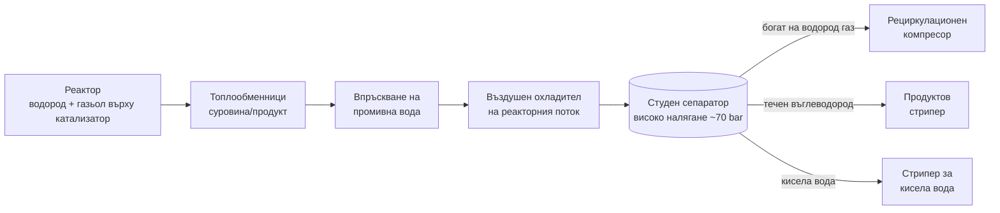

*Снимка: Red Shuheart, Unsplash.*

Около дванадесет и двадесет на обяд в сряда, 30 септември 2026 г., един съд в блока за хидроочистка на коксов газьол в рафинерията MRPL край Мангалуру, на западния бряг на Индия, се разцепва. Съдът е студеният сепаратор на блока. Местната преса посочва работно налягане от около 70 bar. Навън излиза смес от водород и леки въглеводороди, която почти веднага намира източник на запалване. Гърмежът се чува близо до летището, на няколко километра. В сградите около завода се пръскат стъкла.

Тридесетгодишен електротехник на изпълнител, с около година стаж на обекта, е вътре в блока. Тялото му е намерено, след като пожарът е потушен. Втори работник, дългогодишен служител на изпълнител на около четиридесет години, е изведен с изгаряния по около една трета от тялото. Умира в болница на 17 октомври.

А после идват и останалите. Между осем и дванадесет души са пострадали, в зависимост от това кой брой четеш. Повечето от тях изобщо не са били близо до съда. Били са в офис до блока. Жалбата, по която полицията образува наказателно производство срещу ръководството на рафинерията, е подадена от служител на кетъринг фирмата.

Още никой не знае защо сепараторът е отказал. Компанията казва, че подробно разследване ще установи това. Но студеният сепаратор е съд, в който и около който нашите бригади работят на всеки ремонт на хидротритер, а хората, които този тук уби и нарани, в по-голямата си част изобщо не са работили по него. Точно това заслужава публикация тази седмица: какво е публично известно, какво представлява студеният сепаратор и какво трябва да си вземе една изпълнителска бригада от завод, в който обедната почивка тръгна накриво.

## Какво се е случило, доколкото някой е казал

MRPL, Mangalore Refinery and Petrochemicals Limited, е рафинерия с капацитет 300 000 барела на ден, собственост на ONGC. Блокът, който е отказал, е в частта Фаза III на площадката, край селата Джокате и Кутетур северно от Мангалуру. Официалното му име е блок за хидроочистка на тежък коксов газьол, накратко CHTU. [Oil & Gas Journal съобщава за пускането му](https://www.ogj.com/refining-processing/refining/operations/article/17272344/mrpl-commissions-hydrotreater-at-mangalore-refinery) на 10 май 2014 г.: 650 000 тона коксов газьол годишно, построен от Tecnimont ICB по процеса Unionfining на UOP. Тоест съдът, който е отказал, е бил на около дванадесет години експлоатация.

Съобщението на компанията до фондовата борса, цитирано от [Hydrocarbon Processing](https://www.hydrocarbonprocessing.com/news/2026/09/indias-mrpl-cancels-fuel-export-tenders-after-fire-at-refinery/), се побира в едно изречение:

> „В MRPL възникна инцидент, свързан с разкъсване на студения сепаратор, работещ при високо налягане, в блока за хидроочистка на коксов газьол."

Останалата част от публичната картина идва от регионалната и браншовата преса и се подрежда така:

- Разкъсването и пожарът започват около 12:20 местно време. Границите на блока са изолирани и блокът е евакуиран. Пожарни коли пристигат от рафинерията, от пристанищната администрация на Ню Мангалор и от щатската пожарна служба. [HazardEx](https://www.hazardexonthenet.net/article/224281/India-MRPL-refinery-explosion-kills-one-and-injures-nine-after-separator-rupture.aspx) съобщава, че пожарът е напълно потушен в 14:47. Това са 147 минути.
- Първото съобщение на компанията говори за един леко ранен. Тялото на електротехника на изпълнител е намерено по-късно, по време на това, което второто съобщение нарича „претърсване и инспекция".
- Останалата част от рафинерията продължава да работи. MRPL отменя три спот търга за износ и казва на борсата, че не вижда съществено въздействие върху операциите.
- Полицията в Сураткал образува наказателно производство по жалба на служител на кетъринг фирма. Ръководителят на блока и ръководството на рафинерията са привлечени за небрежно боравене с машини, застрашаване на живот и причиняване на смърт по небрежност. Привличането не е присъда. Означава, че полицията смята, че има какво да се разследва.
- MRPL обявява обезщетение от 1,2 крора рупии, приблизително 125 000 евро, за семейството на първия загинал. В същото съобщение казва, че всеки служител на изпълнител и семейството му вече ще имат здравна застраховка от 5 лакха рупии, около 5 200 евро.

Това е публичната картина към 20 октомври. Причината за разкъсването, както пише във всеки репортаж с леко различни думи, „предстои да бъде установена".

## Какво е студен сепаратор и защо 70 bar имат значение

Ако никога не си бил на хидротритер, ето блока на един дъх. Мръсен газьол от коксовата инсталация, пълен със сяра и азот, се смесва с водород, загрява се и се прекарва през реактор, пълен с катализатор. Катализаторът изважда сярата като сероводород, а азота като амоняк. Чистото масло, остатъчният водород и тези два газа излизат от реактора заедно, горещи и при почти пълно налягане.

Всичко след реактора е за това тези фази отново да се разделят. Потокът се охлажда, първо срещу постъпващата суровина, после във въздушен охладител. Някъде преди въздушния охладител се впръсква промивна вода, защото когато амонякът и сероводородът се охладят, те се свързват в сол амониев бисулфид, която запушва тръбите. Водата разтваря солта и при това се превръща в корозивен поток кисела вода.

После идва студеният сепаратор за високо налягане. Това е обикновен дебелостенен барабан, обикновено от въглеродна стомана, понякога с облицовка отвътре. Вътре в него се утаяват три неща: богат на водород газ отгоре, който се връща към рециркулационния компресор; течен въглеводород от средата, който отива към стрипер; и кисела вода от долния джоб.

Смисълът на диаграмата е къде е налягането. Сепараторът е студен, което звучи безобидно, но е при почти реакторно налягане. Седемдесет bar са седемдесет пъти атмосферното. Барабанът съдържа голям обем течен въглеводород под водородна възглавница при това налягане. Ако корпусът се отвори, водородът излиза пръв, бързо, а течността се изпарява след него. Водородът се запалва от почти нищо и гори с пламък, който на дневна светлина едва се вижда. Резултатът е експлозия на газов облак, последвана от пожар, който трае, докато инвентарът свърши, което в MRPL отне два часа и половина.

Какво кара един студен сепаратор да откаже? Никой не е казал какво е станало тук, затова ще се придържаме към това, което стандартите казват, че може да се случи. API RP 571, каталогът на рафинерийната индустрия за механизмите на повреда, изброява няколко, които живеят точно в този съд:

- **Повреди от мокър H2S.** Атомарен водород от корозионната реакция влиза в стоманата и се събира при включенията, образувайки мехури и пластови пукнатини. Индустрията ги нарича HIC, водородно индуцирано напукване, и SOHIC, ориентираната по напрежението разновидност, която се трупа при заварките. Бавно е, невидимо отвън и е класическият механизъм на повреда при сепаратори и абсорбери в кисела водородна среда. Разкъсването на аминов абсорбер в Лемонт, Илинойс, през 1984 г., при което загиват 17 души, е случаят, от който всеки инспектор го учи.
- **Корозия от амониев бисулфид.** За това е написан [API RP 932-B](https://standards.globalspec.com/std/13344610/api-rp-932-b). Атакува главно въздушния охладител и изходните му тръби, но входният щуцер на сепаратора е на същия поток.
- **Дефекти от производство и ремонт.** Пукнатина в заварка, която е ремонтирана лошо или никога не е проверена след ремонта, чака.

Кой от тях, ако изобщо някой, стои зад разкъсването в Мангалуру, е работа на разследването. Важното тук е, че всеки от тях се открива, или се пропуска, по време на инспекционен ремонт, а хората, които правят почистването, влизането и скелето за тази инспекция, обикновено са изпълнители.

*Снимка: Jakub Pabis, Unsplash.*

## Защо има значение от стола на изпълнителя

### Хората, които не са работили по него

Прочети отново списъка на пострадалите. Един електротехник на изпълнител вътре в блока. Един дългогодишен работник на изпълнител. Седем или осем офис служители в съседство с порязвания и леки изгаряния. Служител на кетъринг, пострадал достатъчно тежко, или достатъчно ядосан, за да отиде в полицията.

Никой от тези хора не е имал разрешително за работа по студения сепаратор. Никой от тях не е бил в неговата линия на огъня в какъвто и да е смисъл, който една система за разрешителни признава. Били са там, защото рафинерията е работно място, а работните места имат офиси, столове и електротехници. Работата със съд на 70 bar е, че когато откаже, не проверява кой е бил на смяна.

Това не е нов урок. Разследването на CSB за експлозията от 2005 г. в рафинерията на BP в Тексас Сити установява, че всичките 15 загинали са били във или около фургони на изпълнители, паркирани до блока за изомеризация, някои на едва 121 фута от продухвателния барабан, който е прелял. От това излиза спешна препоръка към Американския петролен институт, а от нея излиза API RP 753, стандартът за това къде могат и къде не могат да стоят преместваеми сгради спрямо технологичните блокове. API RP 752 върши същата работа за постоянните сгради.

Не знаем колко далеч е бил офисът в MRPL от сепаратора, от какво е бил построен и дали някой е правил оценка на разположението му. Знаем, че е бил достатъчно близо, за да нарани взривът хората вътре. За една изпълнителска бригада практическият въпрос е прост и леко неудобен: къде са *твоите* хора, когато не са на работа? Фургонът за почивка, контейнерът с инструменти, офисът на обекта, мястото, където паркира бусът на кетъринга. Ако честният отговор е „където клиентът имаше място", това е разговор, който трябва да се проведе преди следващата мобилизация, а не след нея.

### Електротехник в работещ блок по обед

Електротехникът на изпълнител е бил на обекта от около година. Не знаем какво е правил в този ден, само че е бил в блока, когато е гръмнало. Електрическата поддръжка в работещ хидротритер е най-рутинната работа, която съществува. Никой не пише разрешително за огневи работи за проверка на двигател. Няма газов тест за минаване покрай барабан, който стои на 70 bar от дванадесет години.

Това е тихата част на този инцидент. Изпълнителят на обекта на клиента наследява програмата за цялост на клиента, без изобщо да я види. Той не знае кога този съд е бил последно инспектиран отвътре, дали проверката за HIC е открила нещо, дали последната ремонтна заварка е била термообработена. Не се и очаква да знае. Но стои до него.

Бригадите не могат да одитират механичната цялост на една рафинерия. Това, което могат, е да третират инструктажа за блока като информация, а не като документ. Кои съдове са при най-високо налягане. Къде е водородът. Накъде обикновено духа вятърът и къде е сборният пункт спрямо него. Как изглежда водороден пожар, тоест почти никак: трептене във въздуха и звук. Инструктаж, който покрива всичко това, отнема двадесет минути. Онзи, който само пуска видеото с евакуационния маршрут, отнема пет.

### Дванадесет години е малко за един съд, и достатъчно

Сепаратор, пуснат през 2014 г., вече трябва да е минал през два или три големи инспекционни ремонта. Въглеродната стомана в среда с мокър H2S трябва да е по програма: мокра флуоресцентна магнитно-прахова проверка на вътрешните заварки, ултразвуково сканиране на корпуса за мехури и разслоявания, с интервали, определени по API 510 и логиката на инспекция по риск. Целият смисъл е пукнатините да се хванат, докато са още малки.

Ето къде изпълнителят наистина влиза в историята. Тази инспекция се случва само ако съдът бъде отворен, пропарен, почистен и обезопасен, за да влезе инспекторът. Това е нашата част от работата: влизането, дихателните апарати, дежурният, осветлението, бригадата за почистване. А ето и натискът, който всеки ремонт оказва върху нея. Студеният сепаратор е на критичния път. Почистването се проточва, защото в джоба има повече утайка, отколкото някой е планирал. Прозорецът за инспекция се свива от две смени на една. Инспекторът проверява заварките, до които стига, и пише „ограничен достъп" в протокола.

Този ред, „ограничен достъп", е мястото, където една пукнатина получава четири години преднина.

Бригадите със SCC/VCA сертификат, холандско-германската схема за безопасност на изпълнители, която нашите хора държат чрез TÜV Rheinland, са обучени да спират работа, когато условията за влизане не са наред. Това, което сертификатът не може да ти даде, е позицията да кажеш на ръководител на ремонт, който вече изостава с два дни, че инспекторът има нужда от втора смяна. Това не е умение по безопасност. Това е спор за графика, който се печели или губи в планиращите срещи месеци преди съдът да бъде отворен.

### Работниците на изпълнител и това, което идва след това

Последното, което си струва да се забележи, е какво MRPL обявява заедно с обезщетението: здравна застраховка за всеки служител на изпълнител и семейството му. Обявена е след взрива. Сам си направи извода какво е имало преди.

Ако си български или румънски член на бригада, който тръгва към ремонт в Ротердам, Антверпен или Порво, тази част от историята е твоя. Не предполагай, че застраховката на клиента те покрива. Не предполагай, че тази на агенцията те покрива. Поискай да я видиш, на език, който четеш, преди да се качиш на самолета. Ако отговорът е мъгляв, отговорът е не.

## Какво се променя за бригадите следващата седмица

Няколко неща, които бихме взели от това, при условие че докладваната картина се потвърди. Ако разследването каже друго, ще обновим.

**Ако си ръководител на изпълнителска бригада:** питай къде седят, ядат и се подслоняват хората ти, и какво казва оценката на разположението на обекта за това място. Ако такава няма, или никой не може да я намери, това е отговорът ти. Настоявай фургонът да е извън границите на най-близкия блок с високо налягане. Това не струва на клиента нищо освен по-дълга разходка.

**Ако си младият техник на първия си хидротритер:** научи къде са сепараторите и на какво налягане работят. Минавай покрай тях, не под щуцерите. Ако някога видиш въздухът да трепти над фланец без видим теч, това е водороден пожар. Не се приближавай да гледаш. Вдигни тревога и тръгвай.

**Ако планираш ремонт:** пази прозореца за инспекция на съдовете в кисела среда като регулаторна контролна точка. Сложи бригадата за почистване на студения сепаратор на първата смяна на ремонта, не на третата. Запиши в обхвата „пълен достъп за WFMT на всички вътрешни заварки" и не позволявай да бъде разменен за един ден от графика. Бележката „ограничен достъп" на инспектора е най-евтиният ред в протокола и най-скъпият четири години по-късно.

**Ако си заводът:** хората, които този инцидент нарани най-много, не бяха на съда. Офисът, столът, договорът за кетъринг, договорът за електрическа поддръжка. Всичко това са решения за разположение и инструктаж, и всички са по-евтини от 1,2 крора рупии.

Един човек отиде на работа в сряда сутрин, година след началото на договора си, в блок, който работеше от дванадесет години. В дванадесет и двадесет барабан, за който почти сигурно никога не се беше замислял, се отвори до него. Разследването ще ни каже защо стоманата е отказала. Няма да ни каже защо офисът е бил там, където е бил, нито защо застраховката дойде след това. Тези два отговора са тези, които един изпълнител реално може да използва.

## Източници и допълнително четене

- Reuters чрез Hydrocarbon Processing, 30 септември 2026 г.: [India's MRPL cancels fuel export tenders after fire at refinery](https://www.hydrocarbonprocessing.com/news/2026/09/indias-mrpl-cancels-fuel-export-tenders-after-fire-at-refinery/)
- Oil & Gas Journal, 1 октомври 2026 г.: [MRPL refinery fire at coker-adjacent plant kills one, injures another](https://www.ogj.com/refining-processing/news/55408956/mrpl-refinery-fire-at-coker-adjacent-plant-kills-one-injures-another)
- HazardEx, 1 октомври 2026 г.: [India MRPL refinery explosion kills one and injures nine after separator rupture](https://www.hazardexonthenet.net/article/224281/India-MRPL-refinery-explosion-kills-one-and-injures-nine-after-separator-rupture.aspx)
- The News Minute, 17 октомври 2026 г.: [Second MRPL contract worker dies of burns suffered in September 30 fire](https://www.thenewsminute.com/karnataka/second-mrpl-contract-worker-dies-of-burns-suffered-in-september-30-fire)
- Vartha Bharati, 1 октомври 2026 г.: [One killed, eight injured in MRPL oil refinery explosion, FIR registered](https://english.varthabharati.in/karavali/one-killed-eight-injured-in-mrpl-oil-refinery-explosion-fir-registered-2279312)
- Oil & Gas Journal, май 2014 г.: [MRPL commissions hydrotreater at Mangalore refinery](https://www.ogj.com/refining-processing/refining/operations/article/17272344/mrpl-commissions-hydrotreater-at-mangalore-refinery)
- API RP 571, Damage Mechanisms Affecting Fixed Equipment in the Refining Industry: разделите за повреди от мокър H2S (мехури, HIC, SOHIC, SSC) и корозия от амониев бисулфид
- API RP 932-B: [Design, materials, fabrication, operation and inspection guidelines for corrosion control in hydroprocessing reactor effluent air cooler systems](https://standards.globalspec.com/std/13344610/api-rp-932-b)
- CSB, обзор на разследването за BP Тексас Сити и спешната препоръка към API за разположението на фургони: [страница на разследването](https://www.csb.gov/bp-america-texas-city-refinery-explosion/)
- Свързано четене в този блог: [Двама изпълнители, един капак: Урокът от Motor Oil в Коринт](/bg/blog/motor-oil-corinth-refinery-cover-explosion-contractors) и [Пет теча, една миризма: Урокът за CUI от Mossmorran](/bg/blog/mossmorran-cui-five-leaks-hse)

*По правило в тази публикация не се назовават лица. Фактите за инцидента са взети от борсовите съобщения на компанията и от индийски и международни медии към 20 октомври 2026 г. Официалното разследване не е приключило. Ще обновим публикацията, ако констатациите променят картината.*
