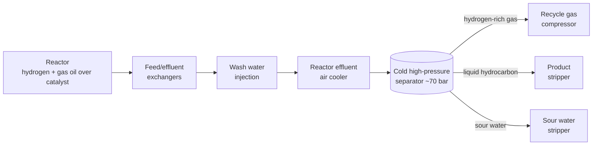

*Image: Red Shuheart on Unsplash.*

At about twenty past twelve on Wednesday 30 September 2026, a vessel in the coker hydrotreater unit at the MRPL refinery near Mangaluru, on India's west coast, split open. The vessel was the unit's cold separator. Local press put its operating pressure at around 70 bar. What came out was a mix of hydrogen and light hydrocarbon, and it found a source of ignition almost at once. People heard the bang near the airport, several kilometres away. Window panes shattered in buildings around the plant.

A 30-year-old contract electrician, about a year into the job, was inside the unit. His body was found after the fire was out. A second worker, a long-serving contract employee in his early forties, was pulled out with burns over roughly a third of his body. He died in hospital on 17 October.

Then there were the others. Between eight and twelve people were hurt, depending on which count you read. Most of them weren't anywhere near the vessel. They were in an office next to the unit. The complaint that led police to register a criminal case against the refinery's management was filed by an employee of the catering company.

Nobody knows yet why the separator failed. The company says a detailed investigation will establish that. But a cold separator is a vessel our crews work in and around on every hydrotreater turnaround, and the people this one killed and injured were, for the most part, not working on it at all. That's the part worth a post this week: what is public, what a cold separator is, and what a contractor crew should take from a plant where lunchtime went sideways.

## What Happened, As Far As Anyone Has Said

MRPL, Mangalore Refinery and Petrochemicals Limited, is a 300,000 barrel-a-day refinery owned by ONGC. The unit that failed sits in the Phase III part of the site, near the villages of Jokatte and Kuthethoor north of Mangaluru. It is officially the coker heavy gas oil hydrotreating unit, CHTU for short. [Oil & Gas Journal reported its start-up](https://www.ogj.com/refining-processing/refining/operations/article/17272344/mrpl-commissions-hydrotreater-at-mangalore-refinery) on 10 May 2014: 650,000 tonnes a year of coker gas oil, built by Tecnimont ICB on UOP's Unionfining process. So the vessel that failed was about twelve years into its service life.

The company's stock-exchange filing, as quoted by [Hydrocarbon Processing](https://www.hydrocarbonprocessing.com/news/2026/09/indias-mrpl-cancels-fuel-export-tenders-after-fire-at-refinery/), kept it to one sentence:

> "An incident involving rupture of the Cold Separator operating at high pressure in the Coker Hydrotreater Unit occurred at MRPL."

The rest of the public record comes from the regional and trade press, and it fits together like this:

- The rupture and fire started at about 12:20 local time. The unit's battery limits were isolated and the unit was evacuated. Fire tenders came from the refinery, the New Mangalore Port Authority and the state fire service. [HazardEx](https://www.hazardexonthenet.net/article/224281/India-MRPL-refinery-explosion-kills-one-and-injures-nine-after-separator-rupture.aspx) reports the fire was fully out at 14:47. That's 147 minutes.
- The company's first filing spoke of one minor injury. The contract electrician's body was found later, during what the second filing called "combing and inspection operations."
- The rest of the refinery kept running. MRPL cancelled three spot export tenders and told the exchange it saw no significant impact on operations.
- Surathkal police registered a criminal case on a complaint from a catering company employee. The unit head and the refinery's management were booked for negligent conduct with machinery, endangering life, and causing death by negligence. A booking is not a finding of guilt. It means the police consider there's a case to investigate.
- MRPL announced compensation of Rs 1.2 crore, roughly €125,000, for the first man's family. In the same announcement it said every contract employee and their family would now have health insurance cover of Rs 5 lakh, about €5,200.

That's the public picture as of 20 October. The cause of the rupture, as every report says in slightly different words, "is yet to be established."

## What a Cold Separator Is, and Why 70 Bar Matters

If you've never been on a hydrotreater, here's the unit in one breath. Dirty gas oil from the coker, full of sulphur and nitrogen, is mixed with hydrogen, heated and pushed through a reactor packed with catalyst. The catalyst strips the sulphur out as hydrogen sulphide and the nitrogen out as ammonia. The clean oil, the leftover hydrogen, and those two gases come out of the reactor together, hot and at nearly full pressure.

Everything downstream of the reactor is about getting those phases apart again. The effluent is cooled, first against the incoming feed, then in an air cooler. Somewhere before the air cooler, wash water is injected, because when ammonia and hydrogen sulphide cool they combine into ammonium bisulphide salt, which plugs tubes. The water dissolves the salt, and in doing so becomes a corrosive sour-water stream.

Then comes the cold high-pressure separator. It's a plain, thick-walled drum, usually carbon steel, sometimes clad on the inside. Inside it, three things settle out: hydrogen-rich gas off the top, which goes back to the recycle compressor; liquid hydrocarbon from the middle, which goes on to a stripper; and sour water from the boot at the bottom.

The point of the diagram is where the pressure is. The separator is cold, which sounds harmless, but it sits at close to reactor pressure. Seventy bar is seventy times atmospheric. The drum holds a large inventory of liquid hydrocarbon under a hydrogen blanket at that pressure. If the shell opens, the hydrogen leaves first, fast, and the liquid flashes behind it. Hydrogen ignites on almost nothing and burns with a flame you can barely see in daylight. The result is a vapour cloud explosion followed by a fire that lasts until the inventory is gone, which at MRPL took two and a half hours.

What makes a cold separator fail? Nobody has said what happened here, so we'll stick to what the standards say can happen. API RP 571, the refining industry's catalogue of damage mechanisms, lists several that live in exactly this piece of equipment:

- **Wet H2S damage.** Atomic hydrogen from the corrosion reaction gets into the steel and collects at inclusions, forming blisters and laminar cracks. The industry calls this HIC, hydrogen-induced cracking, and SOHIC, the stress-oriented variety that stacks up at welds. It is slow, invisible from the outside, and the classic damage mechanism of separators and absorbers in sour hydrogen service. The 1984 rupture of an amine absorber at Lemont, Illinois, which killed 17 people, is the case every inspector learns it from.
- **Ammonium bisulphide corrosion.** This is what [API RP 932-B](https://standards.globalspec.com/std/13344610/api-rp-932-b) was written for. It mostly attacks the air cooler and its outlet piping, but the separator inlet nozzle is on the same stream.
- **Fabrication and repair defects.** A crack in a weld that was repaired badly, or never inspected after the repair, waits.

Which of these, if any, is behind the Mangaluru rupture is for the investigation. What matters here is that every one of them gets found, or missed, during an inspection outage, and the people doing the cleaning, the entry and the scaffolding for that inspection are usually contractors.

*Image: Jakub Pabis on Unsplash.*

## Why It Matters From a Contractor's Chair

### The people who weren't working on it

Read the casualty list again. One contract electrician inside the unit. One long-serving contract worker. Seven or eight office staff next door with cuts and minor burns. A catering employee hurt badly enough, or angry enough, to go to the police.

None of those people had a permit to work on the cold separator. None of them were in its line of fire in any sense a permit system recognises. They were there because a refinery is a workplace, and workplaces have offices, canteens and electricians. The thing about a 70-bar vessel is that when it fails, it doesn't check who was on the job.

This is not a new lesson. The CSB's investigation of the 2005 explosion at BP's Texas City refinery found that all 15 of the dead were in or around contractor trailers parked near the isomerisation unit, some as close as 121 feet from the blowdown drum that overflowed. Out of that came an urgent recommendation to the American Petroleum Institute, and out of that came API RP 753, the standard on where portable buildings can and can't sit relative to process units. API RP 752 does the same job for permanent buildings.

We don't know how far the office at MRPL was from the separator, what it was built of, or whether anyone had done a siting study for it. We do know it was close enough for the blast to injure the people inside. For a contractor crew, the practical question is simple and slightly uncomfortable: where are *your* people when they're not on the job? The break cabin, the tool container, the site office, the place the catering van parks. If the honest answer is "wherever the client had space," that's a conversation to have before the next mobilisation, not after.

### An electrician inside a live unit at lunchtime

The contract electrician had been on site for about a year. We don't know what he was doing that day, only that he was in the unit when it went. Electrical maintenance in a running hydrotreater is as routine as work gets. Nobody writes a hot-work permit for checking a motor. There's no gas test for walking past a drum that's been sitting at 70 bar for twelve years.

That's the quiet part of this incident. A contractor on a client's site inherits the client's integrity programme without ever seeing it. He doesn't know when that vessel was last internally inspected, whether the HIC survey found anything, whether the last repair weld was heat-treated. He's not supposed to know. But he is standing next to it.

Crews can't audit a refinery's mechanical integrity. What they can do is treat the unit induction as information, not paperwork. Which vessels are at the highest pressure. Where the hydrogen is. Which way the wind usually blows and where the muster point is relative to that. What a hydrogen fire looks like, which is to say, almost nothing: a shimmer in the air and a sound. An induction that covers all of that takes twenty minutes. The one that just shows the escape route video takes five.

### Twelve years is young for a vessel, and old enough

A separator commissioned in 2014 should have been through two or three major inspection outages by now. Carbon steel in wet H2S service is supposed to be on a programme: wet fluorescent magnetic particle testing of the internal welds, ultrasonic scanning of the shell for blisters and laminations, with intervals set by API 510 and risk-based inspection logic. The whole point is to catch cracks while they're still small.

Here's where the contractor enters the story for real. That inspection only happens if the vessel is opened, steamed out, cleaned, and made safe for the inspector to go in. That's our side of the job: the entry, the breathing apparatus, the standby, the lighting, the cleaning crew. And here's the pressure every turnaround puts on it. The cold separator is on the critical path. The cleaning runs long because there's more sludge in the boot than anyone planned for. The inspection window gets squeezed from two shifts to one. The inspector does the welds he can reach and writes "limited access" on the report.

That line, "limited access," is where a crack gets a four-year head start.

Crews with SCC/VCA certification, the Dutch-German contractor safety scheme our people hold through TÜV Rheinland, are trained to stop work when entry conditions aren't right. What the certificate can't give you is the standing to tell a turnaround manager who is already two days behind that the inspector needs the second shift. That isn't a safety skill. It's a scheduling argument, won or lost in the planning meetings months before the vessel is opened.

### Contract workers and what arrives afterwards

The last thing worth noticing is what MRPL announced alongside the compensation: health insurance for every contract employee and their family. It was announced after the blast. Draw your own conclusion about what was in place before.

If you're a Bulgarian or Romanian crew member heading to a turnaround in Rotterdam, Antwerp or Porvoo, this part of the story is yours. Don't assume the client's insurance covers you. Don't assume the agency's does. Ask to see it, in a language you read, before you get on the plane. If the answer is vague, the answer is no.

## What Changes for Crews Next Week

A few things we'd take from this, assuming the reported picture holds up. If the investigation says otherwise, we'll update.

**If you're a contractor crew lead:** ask where your people sit, eat and shelter, and what the site's siting study says about that spot. If there isn't one, or nobody can find it, that's your answer. Push for the cabin to be outside the battery limit of the nearest high-pressure unit. It costs the client nothing but a longer walk.

**If you're the young tech on your first hydrotreater:** learn where the separators are and what pressure they run at. Walk past them, not under the nozzles. If you ever see the air shimmer above a flange with no obvious leak, that's a hydrogen fire. Don't go closer to look. Raise the alarm and go.

**If you're planning a turnaround:** protect the inspection window on sour-service vessels like it's a regulatory hold point. Put the cleaning crew for the cold separator on the first shift of the outage, not the third. Write "full access for WFMT of all internal welds" into the scope and don't let it get traded for a day on the schedule. The inspector's "limited access" note is the cheapest line on the report and the most expensive one four years later.

**If you're the plant:** the people this incident hurt most were not on the vessel. The office, the canteen, the catering contract, the electrical maintenance contract. Those are all siting and induction decisions, and they're all cheaper than Rs 1.2 crore.

A man went to work on a Wednesday morning, a year into a contract job, in a unit that had been running for twelve years. At twenty past twelve a drum he almost certainly never thought about opened up next to him. The investigation will tell us why the steel failed. It won't tell us why the office was where it was, or why the insurance arrived afterwards. Those two answers are the ones a contractor can actually use.

## Credit and Further Reading

- Reuters via Hydrocarbon Processing, 30 September 2026: [India's MRPL cancels fuel export tenders after fire at refinery](https://www.hydrocarbonprocessing.com/news/2026/09/indias-mrpl-cancels-fuel-export-tenders-after-fire-at-refinery/)
- Oil & Gas Journal, 1 October 2026: [MRPL refinery fire at coker-adjacent plant kills one, injures another](https://www.ogj.com/refining-processing/news/55408956/mrpl-refinery-fire-at-coker-adjacent-plant-kills-one-injures-another)
- HazardEx, 1 October 2026: [India MRPL refinery explosion kills one and injures nine after separator rupture](https://www.hazardexonthenet.net/article/224281/India-MRPL-refinery-explosion-kills-one-and-injures-nine-after-separator-rupture.aspx)
- The News Minute, 17 October 2026: [Second MRPL contract worker dies of burns suffered in September 30 fire](https://www.thenewsminute.com/karnataka/second-mrpl-contract-worker-dies-of-burns-suffered-in-september-30-fire)
- Vartha Bharati, 1 October 2026: [One killed, eight injured in MRPL oil refinery explosion, FIR registered](https://english.varthabharati.in/karavali/one-killed-eight-injured-in-mrpl-oil-refinery-explosion-fir-registered-2279312)
- Oil & Gas Journal, May 2014: [MRPL commissions hydrotreater at Mangalore refinery](https://www.ogj.com/refining-processing/refining/operations/article/17272344/mrpl-commissions-hydrotreater-at-mangalore-refinery)
- API RP 571, Damage Mechanisms Affecting Fixed Equipment in the Refining Industry: wet H2S damage (blistering, HIC, SOHIC, SSC) and ammonium bisulphide corrosion sections
- API RP 932-B: [Design, materials, fabrication, operation and inspection guidelines for corrosion control in hydroprocessing reactor effluent air cooler systems](https://standards.globalspec.com/std/13344610/api-rp-932-b)
- CSB, BP Texas City investigation digest and the urgent recommendation to API on trailer siting: [CSB investigation page](https://www.csb.gov/bp-america-texas-city-refinery-explosion/)
- Related reading on this blog: [Two contractors, one cover: the Motor Oil Corinth lesson](/en/blog/motor-oil-corinth-refinery-cover-explosion-contractors) and [Five leaks, one smell: Mossmorran's CUI lesson](/en/blog/mossmorran-cui-five-leaks-hse)

*Individuals are not named in this post, by policy. Facts about the incident are taken from the company's exchange filings and from Indian and international press reports as of 20 October 2026. The official investigation has not reported. We'll revise this post if the findings change the picture.*
