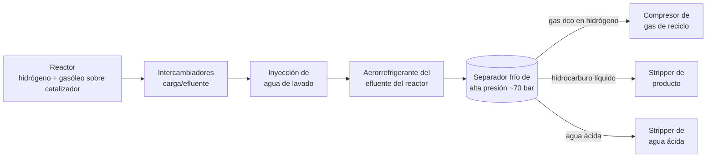

*Imagen: Red Shuheart en Unsplash.*

Hacia las doce y veinte del miércoles 30 de septiembre de 2026, un recipiente de la unidad de hidrotratamiento de gasóleo de coque de la refinería MRPL, cerca de Mangaluru, en la costa oeste de la India, se abrió. El recipiente era el separador frío de la unidad. La prensa local situó su presión de operación en torno a 70 bar. Lo que salió fue una mezcla de hidrógeno e hidrocarburos ligeros, y encontró una fuente de ignición casi al instante. El estallido se oyó cerca del aeropuerto, a varios kilómetros. Se rompieron cristales en los edificios de alrededor de la planta.

Un electricista contratista de 30 años, con cerca de un año en el puesto, estaba dentro de la unidad. Su cuerpo se encontró cuando el incendio ya estaba apagado. Un segundo trabajador, empleado contratista veterano de poco más de cuarenta años, fue sacado con quemaduras en aproximadamente un tercio del cuerpo. Murió en el hospital el 17 de octubre.

Y luego están los demás. Entre ocho y doce personas resultaron heridas, según el recuento que leas. La mayoría no estaba cerca del recipiente. Estaban en una oficina contigua a la unidad. La denuncia que llevó a la policía a abrir una causa penal contra la dirección de la refinería la presentó un empleado de la empresa de catering.

Nadie sabe todavía por qué falló el separador. La empresa dice que una investigación detallada lo establecerá. Pero un separador frío es un recipiente en el que, y alrededor del cual, nuestras cuadrillas trabajan en cada parada de hidrotratador, y las personas a las que este mató e hirió, en su mayoría, no estaban trabajando en él. Eso es lo que merece un artículo esta semana: qué es público, qué es un separador frío y qué debería sacar una cuadrilla contratista de una planta en la que la hora de comer se torció.

## Qué pasó, hasta donde alguien lo ha contado

MRPL, Mangalore Refinery and Petrochemicals Limited, es una refinería de 300.000 barriles al día propiedad de ONGC. La unidad que falló está en la parte de la Fase III del complejo, cerca de los pueblos de Jokatte y Kuthethoor, al norte de Mangaluru. Oficialmente es la unidad de hidrotratamiento de gasóleo pesado de coque, CHTU por sus siglas. [Oil & Gas Journal informó de su arranque](https://www.ogj.com/refining-processing/refining/operations/article/17272344/mrpl-commissions-hydrotreater-at-mangalore-refinery) el 10 de mayo de 2014: 650.000 toneladas al año de gasóleo de coque, construida por Tecnimont ICB con el proceso Unionfining de UOP. Así que el recipiente que falló llevaba unos doce años en servicio.

El comunicado de la empresa a la bolsa, citado por [Hydrocarbon Processing](https://www.hydrocarbonprocessing.com/news/2026/09/indias-mrpl-cancels-fuel-export-tenders-after-fire-at-refinery/), cabe en una frase:

> "Se produjo en MRPL un incidente consistente en la rotura del separador frío, que operaba a alta presión, en la unidad de hidrotratamiento de coque."

El resto del registro público viene de la prensa regional y especializada, y encaja así:

- La rotura y el incendio empezaron hacia las 12:20 hora local. Se aislaron los límites de batería de la unidad y se evacuó. Llegaron camiones de bomberos de la refinería, de la autoridad portuaria de New Mangalore y del servicio estatal de bomberos. [HazardEx](https://www.hazardexonthenet.net/article/224281/India-MRPL-refinery-explosion-kills-one-and-injures-nine-after-separator-rupture.aspx) informa de que el fuego quedó totalmente extinguido a las 14:47. Son 147 minutos.
- El primer comunicado de la empresa hablaba de un herido leve. El cuerpo del electricista contratista se encontró después, durante lo que el segundo comunicado llamó "operaciones de rastreo e inspección".
- El resto de la refinería siguió funcionando. MRPL canceló tres licitaciones spot de exportación y dijo a la bolsa que no veía un impacto significativo en las operaciones.
- La policía de Surathkal abrió una causa penal a raíz de la denuncia de un empleado de una empresa de catering. El jefe de la unidad y la dirección de la refinería fueron imputados por conducta negligente con maquinaria, puesta en peligro de la vida y homicidio por negligencia. Una imputación no es una condena. Significa que la policía considera que hay algo que investigar.
- MRPL anunció una indemnización de 1,2 crore de rupias, unos 125.000 euros, para la familia del primer fallecido. En el mismo anuncio dijo que cada empleado contratista y su familia tendrían a partir de ahora un seguro de salud de 5 lakh de rupias, unos 5.200 euros.

Esa es la imagen pública a 20 de octubre. La causa de la rotura, como dice cada reportaje con palabras ligeramente distintas, "está por establecer".

## Qué es un separador frío y por qué importan 70 bar

Si nunca has estado en un hidrotratador, aquí va la unidad de un tirón. El gasóleo sucio del coquizador, cargado de azufre y nitrógeno, se mezcla con hidrógeno, se calienta y se empuja a través de un reactor lleno de catalizador. El catalizador saca el azufre como sulfuro de hidrógeno y el nitrógeno como amoniaco. El aceite limpio, el hidrógeno sobrante y esos dos gases salen del reactor juntos, calientes y casi a plena presión.

Todo lo que hay aguas abajo del reactor sirve para volver a separar esas fases. El efluente se enfría, primero contra la carga que entra, luego en un aerorrefrigerante. En algún punto antes del aerorrefrigerante se inyecta agua de lavado, porque cuando el amoniaco y el sulfuro de hidrógeno se enfrían se combinan en sal de bisulfuro amónico, que tapona los tubos. El agua disuelve la sal y, al hacerlo, se convierte en una corriente corrosiva de agua ácida.

Después viene el separador frío de alta presión. Es un tambor sencillo de pared gruesa, normalmente de acero al carbono, a veces revestido por dentro. En su interior se separan tres cosas: gas rico en hidrógeno por arriba, que vuelve al compresor de reciclo; hidrocarburo líquido por el medio, que sigue hacia un stripper; y agua ácida por la bota del fondo.

El sentido del diagrama es dónde está la presión. El separador está frío, lo que suena inofensivo, pero se encuentra casi a la presión del reactor. Setenta bar son setenta veces la atmosférica. El tambor contiene un gran inventario de hidrocarburo líquido bajo un colchón de hidrógeno a esa presión. Si la envolvente se abre, el hidrógeno sale primero, rápido, y el líquido se vaporiza detrás. El hidrógeno se enciende casi con nada y arde con una llama que a la luz del día apenas se ve. El resultado es una explosión de nube de vapor seguida de un incendio que dura hasta que se agota el inventario, lo que en MRPL llevó dos horas y media.

¿Qué hace fallar a un separador frío? Nadie ha dicho qué pasó aquí, así que nos ceñimos a lo que las normas dicen que puede pasar. API RP 571, el catálogo de mecanismos de daño de la industria del refino, enumera varios que viven exactamente en este equipo:

- **Daño por H2S húmedo.** El hidrógeno atómico de la reacción de corrosión entra en el acero y se acumula en las inclusiones, formando ampollas y grietas laminares. La industria lo llama HIC, agrietamiento inducido por hidrógeno, y SOHIC, la variante orientada por la tensión que se apila en las soldaduras. Es lento, invisible desde fuera y el mecanismo de daño clásico de separadores y absorbedores en servicio ácido con hidrógeno. La rotura de un absorbedor de aminas en Lemont, Illinois, en 1984, que mató a 17 personas, es el caso con el que lo aprende cada inspector.
- **Corrosión por bisulfuro amónico.** Para esto se escribió [API RP 932-B](https://standards.globalspec.com/std/13344610/api-rp-932-b). Ataca sobre todo al aerorrefrigerante y a su tubería de salida, pero la boquilla de entrada del separador está en la misma corriente.
- **Defectos de fabricación y reparación.** Una grieta en una soldadura mal reparada, o nunca inspeccionada después de la reparación, espera.

Cuál de ellos, si alguno, está detrás de la rotura de Mangaluru es cosa de la investigación. Lo que importa aquí es que cada uno de ellos se encuentra, o se pasa por alto, durante una parada de inspección, y que quienes hacen la limpieza, la entrada y el andamio para esa inspección suelen ser contratistas.

*Imagen: Jakub Pabis en Unsplash.*

## Por qué importa desde la silla del contratista

### Las personas que no estaban trabajando en él

Vuelve a leer la lista de víctimas. Un electricista contratista dentro de la unidad. Un trabajador contratista veterano. Siete u ocho empleados de oficina de al lado con cortes y quemaduras leves. Un empleado de catering herido lo bastante, o enfadado lo bastante, como para ir a la policía.

Ninguna de esas personas tenía un permiso para trabajar en el separador frío. Ninguna estaba en su línea de fuego en ningún sentido que un sistema de permisos reconozca. Estaban allí porque una refinería es un lugar de trabajo, y los lugares de trabajo tienen oficinas, comedores y electricistas. Lo que pasa con un recipiente a 70 bar es que, cuando falla, no comprueba quién estaba de turno.

No es una lección nueva. La investigación de la CSB sobre la explosión de 2005 en la refinería de BP en Texas City concluyó que los 15 muertos estaban dentro o alrededor de casetas de contratistas aparcadas junto a la unidad de isomerización, algunas a apenas 121 pies del tambor de purga que rebosó. De ahí salió una recomendación urgente al American Petroleum Institute, y de ahí salió API RP 753, la norma sobre dónde pueden y no pueden ubicarse los edificios portátiles respecto a las unidades de proceso. API RP 752 hace lo mismo con los edificios permanentes.

No sabemos a qué distancia estaba la oficina de MRPL del separador, de qué estaba construida ni si alguien había hecho un estudio de ubicación. Sí sabemos que estaba lo bastante cerca como para que la explosión hiriera a la gente de dentro. Para una cuadrilla contratista la pregunta práctica es sencilla y algo incómoda: ¿dónde está *tu* gente cuando no está en el tajo? La caseta de descanso, el contenedor de herramientas, la oficina de obra, el sitio donde aparca la furgoneta del catering. Si la respuesta honesta es "donde el cliente tenía sitio", es una conversación que hay que tener antes de la próxima movilización, no después.

### Un electricista dentro de una unidad en marcha a la hora de comer

El electricista contratista llevaba en la planta cerca de un año. No sabemos qué hacía ese día, solo que estaba en la unidad cuando reventó. El mantenimiento eléctrico en un hidrotratador en marcha es el trabajo más rutinario que existe. Nadie emite un permiso de trabajo en caliente para revisar un motor. No hay prueba de gas para pasar junto a un tambor que lleva doce años a 70 bar.

Esa es la parte silenciosa de este incidente. Un contratista en la planta de un cliente hereda el programa de integridad del cliente sin verlo nunca. No sabe cuándo se inspeccionó por dentro ese recipiente por última vez, si el barrido de HIC encontró algo, si la última soldadura de reparación recibió tratamiento térmico. No se espera que lo sepa. Pero está de pie junto a él.

Las cuadrillas no pueden auditar la integridad mecánica de una refinería. Lo que sí pueden hacer es tratar la inducción de la unidad como información, no como papeleo. Qué recipientes están a mayor presión. Dónde está el hidrógeno. Hacia dónde suele soplar el viento y dónde está el punto de reunión respecto a eso. Qué aspecto tiene un fuego de hidrógeno, es decir, casi ninguno: un temblor en el aire y un sonido. Una inducción que cubra todo eso lleva veinte minutos. La que solo pone el vídeo de la ruta de evacuación lleva cinco.

### Doce años es poco para un recipiente, y suficiente

Un separador puesto en marcha en 2014 debería haber pasado ya por dos o tres grandes paradas de inspección. El acero al carbono en servicio con H2S húmedo se supone que sigue un programa: partículas magnéticas fluorescentes por vía húmeda en las soldaduras internas, barrido ultrasónico de la envolvente en busca de ampollas y laminaciones, con intervalos fijados por API 510 y la lógica de inspección basada en riesgo. El sentido de todo es cazar las grietas mientras aún son pequeñas.

Aquí es donde el contratista entra de verdad en la historia. Esa inspección solo ocurre si el recipiente se abre, se vaporiza, se limpia y se deja seguro para que entre el inspector. Esa es nuestra parte del trabajo: la entrada, los equipos de respiración, el vigilante, la iluminación, la cuadrilla de limpieza. Y aquí está la presión que cada parada ejerce sobre ella. El separador frío está en el camino crítico. La limpieza se alarga porque en la bota hay más lodo del que nadie había previsto. La ventana de inspección se estrecha de dos turnos a uno. El inspector revisa las soldaduras a las que llega y escribe "acceso limitado" en el informe.

Esa línea, "acceso limitado", es donde una grieta gana cuatro años de ventaja.

Las cuadrillas con certificación SCC/VCA, el esquema de seguridad de contratistas holandés-alemán que nuestra gente tiene a través de TÜV Rheinland, están formadas para parar el trabajo cuando las condiciones de entrada no son las correctas. Lo que el certificado no puede darte es la autoridad para decirle a un jefe de parada que ya va dos días retrasado que el inspector necesita el segundo turno. Eso no es una habilidad de seguridad. Es una discusión de planificación, que se gana o se pierde en las reuniones de meses antes de que se abra el recipiente.

### Los trabajadores contratistas y lo que llega después

Lo último que merece atención es lo que MRPL anunció junto a la indemnización: seguro de salud para cada empleado contratista y su familia. Se anunció después de la explosión. Saca tu propia conclusión sobre lo que había antes.

Si eres un miembro de cuadrilla búlgaro o rumano que va a una parada en Róterdam, Amberes o Porvoo, esta parte de la historia es tuya. No des por hecho que el seguro del cliente te cubre. No des por hecho que el de la agencia lo hace. Pide verlo, en un idioma que leas, antes de subir al avión. Si la respuesta es vaga, la respuesta es no.

## Qué cambia para las cuadrillas la semana que viene

Algunas cosas que nos llevaríamos de esto, suponiendo que la imagen publicada se sostenga. Si la investigación dice otra cosa, lo actualizaremos.

**Si eres jefe de una cuadrilla contratista:** pregunta dónde se sienta, come y se resguarda tu gente, y qué dice el estudio de ubicación de la planta sobre ese sitio. Si no existe, o nadie lo encuentra, esa es tu respuesta. Insiste en que la caseta esté fuera del límite de batería de la unidad de alta presión más cercana. Al cliente no le cuesta nada salvo un paseo más largo.

**Si eres el técnico joven en tu primer hidrotratador:** aprende dónde están los separadores y a qué presión funcionan. Pasa junto a ellos, no bajo las boquillas. Si alguna vez ves temblar el aire sobre una brida sin una fuga evidente, eso es un fuego de hidrógeno. No te acerques a mirar. Da la alarma y vete.

**Si planificas una parada:** protege la ventana de inspección de los recipientes en servicio ácido como si fuera un punto de espera reglamentario. Pon a la cuadrilla de limpieza del separador frío en el primer turno de la parada, no en el tercero. Escribe en el alcance "acceso completo para WFMT de todas las soldaduras internas" y no dejes que se cambie por un día de cronograma. La nota de "acceso limitado" del inspector es la línea más barata del informe y la más cara cuatro años después.

**Si eres la planta:** las personas a las que más dañó este incidente no estaban en el recipiente. La oficina, el comedor, el contrato de catering, el contrato de mantenimiento eléctrico. Todo eso son decisiones de ubicación e inducción, y todas son más baratas que 1,2 crore de rupias.

Un hombre fue a trabajar un miércoles por la mañana, un año después de empezar su contrato, en una unidad que llevaba doce años funcionando. A las doce y veinte, un tambor en el que casi con seguridad nunca había pensado se abrió a su lado. La investigación nos dirá por qué falló el acero. No nos dirá por qué la oficina estaba donde estaba, ni por qué el seguro llegó después. Esas dos respuestas son las que un contratista puede usar de verdad.

## Créditos y lecturas adicionales

- Reuters vía Hydrocarbon Processing, 30 de septiembre de 2026: [India's MRPL cancels fuel export tenders after fire at refinery](https://www.hydrocarbonprocessing.com/news/2026/09/indias-mrpl-cancels-fuel-export-tenders-after-fire-at-refinery/)
- Oil & Gas Journal, 1 de octubre de 2026: [MRPL refinery fire at coker-adjacent plant kills one, injures another](https://www.ogj.com/refining-processing/news/55408956/mrpl-refinery-fire-at-coker-adjacent-plant-kills-one-injures-another)
- HazardEx, 1 de octubre de 2026: [India MRPL refinery explosion kills one and injures nine after separator rupture](https://www.hazardexonthenet.net/article/224281/India-MRPL-refinery-explosion-kills-one-and-injures-nine-after-separator-rupture.aspx)
- The News Minute, 17 de octubre de 2026: [Second MRPL contract worker dies of burns suffered in September 30 fire](https://www.thenewsminute.com/karnataka/second-mrpl-contract-worker-dies-of-burns-suffered-in-september-30-fire)
- Vartha Bharati, 1 de octubre de 2026: [One killed, eight injured in MRPL oil refinery explosion, FIR registered](https://english.varthabharati.in/karavali/one-killed-eight-injured-in-mrpl-oil-refinery-explosion-fir-registered-2279312)
- Oil & Gas Journal, mayo de 2014: [MRPL commissions hydrotreater at Mangalore refinery](https://www.ogj.com/refining-processing/refining/operations/article/17272344/mrpl-commissions-hydrotreater-at-mangalore-refinery)
- API RP 571, Damage Mechanisms Affecting Fixed Equipment in the Refining Industry: secciones de daño por H2S húmedo (ampollas, HIC, SOHIC, SSC) y corrosión por bisulfuro amónico
- API RP 932-B: [Design, materials, fabrication, operation and inspection guidelines for corrosion control in hydroprocessing reactor effluent air cooler systems](https://standards.globalspec.com/std/13344610/api-rp-932-b)
- CSB, resumen de la investigación de BP Texas City y la recomendación urgente a API sobre la ubicación de casetas: [página de la investigación](https://www.csb.gov/bp-america-texas-city-refinery-explosion/)
- Lecturas relacionadas en este blog: [Dos contratistas, una tapa: la lección de Motor Oil en Corinto](/es/blog/motor-oil-corinth-refinery-cover-explosion-contractors) y [Cinco fugas, un olor: La lección de CUI de Mossmorran](/es/blog/mossmorran-cui-five-leaks-hse)

*Por política, en este artículo no se nombra a ninguna persona. Los hechos sobre el incidente proceden de los comunicados de la empresa a la bolsa y de la prensa india e internacional a 20 de octubre de 2026. La investigación oficial no ha concluido. Revisaremos este artículo si las conclusiones cambian la imagen.*
