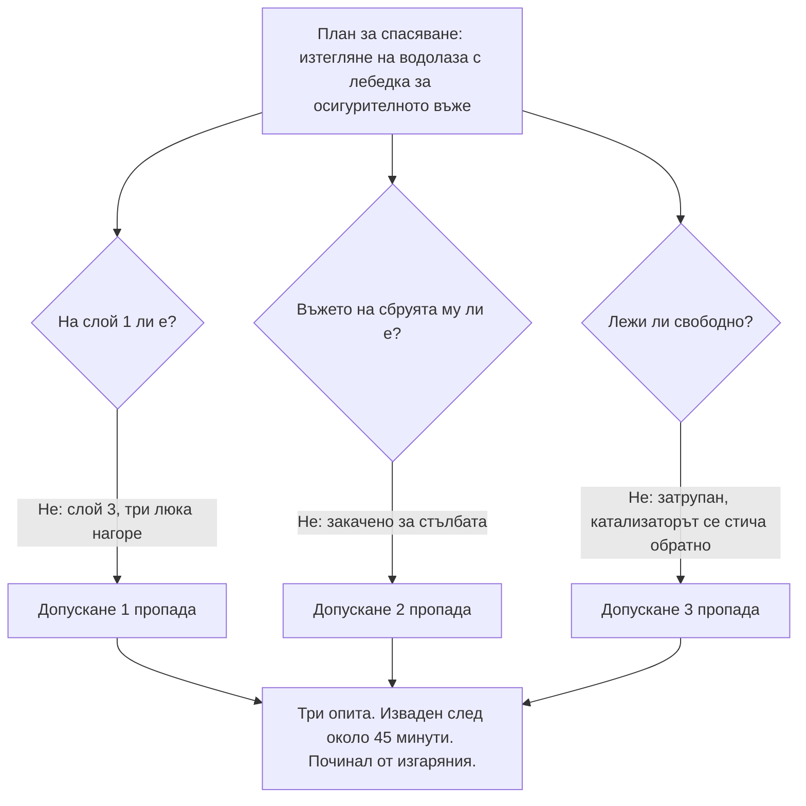

*Снимка: waa towaw в Unsplash.*

Около 11:15 сутринта в петък, 3 февруари 2023 г., човек, работещ на дъното на 30-метров реактор в Zeeland Refinery край Флисинген, Нидерландия, съобщава по радиостанцията, че е затиснат и не може да се движи. Той е „водолаз“: техник по работа с катализатори, който работи вътре в съд, пълен с азот, и диша през затворен шлем, захранван от два въздушни маркуча. Един колега слиза по стълбата да го извади. После втори. И двамата са принудени да се върнат. Третият го изважда около 12:00. Мъртъв.

Холандският съвет за безопасност (Onderzoeksraad voor Veiligheid) публикува разследването си, *Fatal accident in a reactor* („Смъртен случай в реактор“), на 9 април 2025 г. На 14 април 2026 г. публикува и бележка за това какво са направили страните оттогава. Накратко: компанията майка на рафинерията е забранила метода във всички свои рафинерии. Изпълнителят казва, че още не може да спре. Съветът казва, че секторът не се движи достатъчно бързо.

Ако някога сте стояли на върха на реактор по време на смяна на катализатор, или сте млад техник, който се чуди какво всъщност значи „инертно влизане“ в работната заповед, този текст е за вас.

## Какво е инертно влизане и защо съществува

Реакторите за хидроочистка и хидрокракинг са високи стоманени съдове, пълни с катализатор: малки гранули, от няколко милиметра до няколко сантиметра, покрити с метали като никел, кобалт и молибден. На всеки няколко месеца до няколко години отработеният катализатор трябва да излезе и да влезе пресен.

Ето го проблема. Отработеният катализатор е наситен със сулфиди и въглеводороди и когато срещне кислород, сам се нагрява. Дайте му достатъчно въздух и се запалва. Затова реакторът се пълни с азот, който изтласква кислорода (процедурата на рафинерията го държи под 3 процента), а по-голямата част от катализатора просто се оставя да изтече гравитачно през „разтоварните щуцери“ на дъното. Това се нарича свободно изтичане.

Но част от него винаги залепва. Спича се по стените, образува колони, прави мостове през слоя. Изстрелването на патрон Cardox (тръба със сгъстен CO2, която гръмва като пушка вътре в слоя) разбива голяма част. Не всичко. За остатъка отговорът на индустрията от четиридесет години насам е: пращаме човек вътре.

Този човек е водолазът. Той носи шлем с дихателен въздух, с два захранващи маркуча в „пъпна връв“ (умбиликал) и малка аварийна бутилка на колана. Закачен е за осигурително въже, което води до лебедка на върха на реактора. Над него стоят дежурен (стендбай) оператор и отговорник по безопасността на върха; до реактора е Блокът за поддържане на живота (LSU), подвижна контролна стая, в която LSU операторът следи показанията за кислород и температура и картина от камера. Водолазът слиза по стълба, през люковете във всяка разпределителна тава, и къртри спечения катализатор с лопата или пневматичен чук, за да бъде засмукан с вакуум или разтоварен.

Всеки в този екип знае едно правило над всички останали: катализаторът никога не трябва да стига по-високо от кръста ти. Ако стигне и се срути върху теб, си затрупан в материал, който се запалва при среща с въздух. А собственият ти издишан въздух, който излиза от шлема през клапани в долната му част, все още съдържа около 16 процента кислород.

## Какво казва докладът, че се е случило

Реактор 302R03 е реакторът за хидроочистка на хидрокракинг инсталацията на Zeeland Refinery. Вътрешен диаметър 4,1 метра, три каталитични слоя, около 214 тона катализатор, разтоварван за първи път след пуск през 2020 г. Изпълнителят, T.I.M.E. Service Catalyst Handling, работи по него от 30 януари. Слоевете са били „сляпо разтоварени“ (свободно изтичане, без никой вътре и без да се гледа слоят), Cardox е бил изстрелян, а люкът към слой 3, най-долния, е отворен в 01:00 на 3 февруари.

Водолазът от нощната смяна кърти спечения пласт до сутринта и оставя, по думите на екипа си, равен слой на около 4 метра под люка. Дневната смяна идва, прави кратък инструктаж, изчаква разрешителните и сама решава кой какво ще прави. Човекът, който е слизал предния ден, казва, че иска да слезе пак. Супервайзърът се съгласява.

Влиза в 08:45 и стига до спечения материал около 09:00. До 10:00 още 12,6 кубични метра са излезли през щуцерите. Около 10:30 LSU операторът го моли да изравни повърхността, което би означавало да се качи обратно нагоре и да работи отгоре. Докладът не знае защо не го е направил. Отбелязва обаче, че след сляпо разтоварване често изобщо няма равна по-висока повърхност, на която да стъпиш.

Малко преди 11:15 той иска разтоварните щуцери да бъдат отворени, за да излезе разкъртеният катализатор. Работната инструкция казва, че водолазът трябва да е извън реактора, или поне на по-горен слой, когато щуцерите се отварят. Колегите му не знаят на кой слой е. Отварят ги въпреки това. По думите им пред разследващите: той беше много опитен и вероятно можеше да прецени ситуацията по-добре от тях през картина от камера, пълна с прах.

После: отворете щуцерите. Затворете щуцерите. Помощ. Затиснат съм.

## Спасяването, което никога не е било репетирано

Дежурният оператор слиза по стълбата. На дъното намира осигурителното въже на водолаза, закачено за стълбата, а не за водолаза. Копае, намира ръка и умбиликала и започва да изгребва. Ронливият катализатор се стича обратно върху човека всеки път, щом го разчисти. Катализаторен прах влиза в собствения му шлем. Не може да диша нормално, не може да стегне уплътнението и е принуден да се откаже.

Умбиликалът на втория спасител се заплита в другите кабели в люковете на слизане. И той трябва да се върне.

Супервайзърът вика колега от реактор 2, който е от същия район на Германия като водолаза и говори неговия диалект, за да може да говори с него. Водолазът му казва по отворената радиовръзка, че е в беда и че гори. След това нищо.

Третият спасител слиза покрай колона от катализатор, която може да се срути върху него, намира водолаза и заедно с екипа отгоре опитва да го изтегли с лебедката за умбиликала. Невъзможно: твърде много катализатор отгоре му. Накрая използва вакуумния маркуч, за да изсмуче материала, стига до сбруята, закача осигурителното въже и лебедката го изважда около 12:00. Съдебният лекар записва като причина за смъртта изгаряния.

Ето частта от доклада, която трябва да смрази всеки ръководител по ЗБУТ. Планът за спасяване, който според Съвета „не представлява нищо повече от HSE плана“, стъпва на три допускания:

> „1. възможно е водолазът да бъде изтеглен нагоре, независимо на кой слой в реактора се намира; 2. водолазът е закачен за осигурителното си въже; 3. водолазът лежи в „свободно“ положение и не е затрупан от катализатор.“

На 3 февруари 2023 г. нито едно от трите не е вярно. И Съветът отива по-далеч:

> „Реалното изваждане на човек, който не може да се движи (или на манекен), от трети или по-долен слой нито се обучава, нито се изпитва в програмата за обучение на SIR, нито се упражнява при работодателя.“

Експерти от сектора казват пред Съвета, че изтеглянето на изпаднал в безсъзнание водолаз от втория слой е „много трудно“, а от третия или по-долен „на практика невъзможно, ако спасяването трябва да се извърши отгоре“. Пътят за евакуация от слой 3 минава през три люка, един над друг, през които вървят и умбиликалът, и кабелите на камерата, и осигурителното въже.

## Инцидентът, за който никой не беше чувал

*Изображение: генерирана илюстрация (Flux.1), не е снимка от мястото на инцидента.*

Тук ъгълът с обучението захапва.

През 2014 г. водолаз загива в реактор в рафинерия в Линген, Германия. Същият механизъм: затрупан под катализатор, който се запалва при контакт с издишания му въздух. Той е бил закачен за осигурителното си въже през цялото време. Нямало е значение; не е могъл да бъде изтеглен през материала върху него. Подобно затрупване се е случило в Антверпен през 2004 г. Онзи човек се е измъкнал сам, с изгаряния.

Нито Zeeland Refinery, нито T.I.M.E. са знаели за Линген преди 3 февруари 2023 г. Холандската браншова организация за индустриално почистване SIR събира инциденти от Нидерландия и Белгия. Линген е в Германия. Така единственият смъртен случай, който показва точно как загива затрупан водолаз, никога не е бил в регистъра на рисковете. Процедура 740-12 на рафинерията изброява рисковете за всяка задача; „изгаряния при затрупване“ не е сред тях. Мерките срещу затрупване са били една работна инструкция (височина до кръста) и ЛПС. Това е всичко.

Докладът цитира и собствената инструкция на изпълнителя: „Забранено е откачането на осигурителното въже в реактора.“ А после цитира други водолази, които обясняват пред разследващите, че въжето се заплита в кабелите и маркучите, че всеки разбира защо би го откачил за кратко, за да се освободи, и че в някои ситуации откачането е „дори желателно“. Което ви казва колко струва едно правило на хартия на 25 метра дълбочина.

Добавете физическата реалност. Водолазът е вършил тежка, гореща, прашна ръчна работа два часа и половина без ясна отправна точка къде се намира спрямо катализатора. Указанията на холандската инспекция по труда за индустриално почистване казват, че тежката работа трябва да продължава най-много един час без прекъсване и четири часа на ден. В T.I.M.E., според доклада, водолазът сам е решавал колко дълго да остане вътре. Плащали са му допълнително за времето вътре.

## „По същество опасно“

Основното заключение на Съвета е такова, каквото рядко се вижда в официален доклад:

> „Разтоварването на реактори чрез инертно влизане е по същество опасно за работника, който влиза в реактора като „водолаз“. Мерките, въведени, за да гарантират безопасността, не бяха достатъчно устойчиви. Участващите страни погрешно приеха, че въведените мерки могат в достатъчна степен да гарантират безопасността на работника и да сведат риска до приемливо ниво.“

Логиката е проста, щом я видиш. Собствената матрица на риска на рафинерията оценява тежестта като „много сериозна“ и приема, че нищо не може да я намали: в азот, под катализатор, с пожар, изходът е смърт. Така единственият останал лост е вероятността. А вероятността зависи почти изцяло от един уморен човек, който спазва правила в тъмното, наблюдаван от камера, която не вижда през праха. Думите на Съвета: „реактор в инертна атмосфера е животозастрашаваща работна среда“.

Има и констатация за възлагането, която изпълнителите трябва да прочетат два пъти. Тръжната процедура на рафинерията още през 2011 г. изисква конкретно методи, при които реакторът се пълни с азот, за да може да бъде влизано в него. Многогодишният договор после заключва метода. Оставя място за обсъждане на алтернативи, които биха съкратили спирането. Не казва нищо за алтернативи, които биха направили работата по-безопасна. По думите на Съвета договорът „означаваше, че работният метод повече няма да бъде поставян за обсъждане“.

И една подробност в края на глава 2, която никой няма да прочете с удоволствие. След инцидента, с одобрението на инспекцията по труда за метод без влизане от 17 февруари, екипът се връща на реактора. Оказва се, че остатъкът от 302R03 може да бъде изпразнен напълно чрез свободно изтичане и Cardox. Никой не е трябвало да влиза.

## Три години по-късно

Бележката от 14 април 2026 г. оценява всяка препоръка.

**Препоръка 1, към T.I.M.E.: спрете инертното влизане.** Не е изпълнена. Изпълнителят казва, че пълно спиране засега не е възможно, защото не всеки реактор е подходящ за алтернативите; свежда времето вътре до минимум и се стреми да спре в бъдеще. Съветът казва, че разбира търговската преса, в която е компанията, и очаква тя наистина да стигне дотам.

**Препоръки 2 и 3: споделете поуките; водете разработването на по-безопасни методи.** Zeeland Refinery: изпълнени. TotalEnergies, собственик на 55 процента, е забранила инертното влизане във всичките си рафинерии. След инцидента обектът използва мокро разтоварване и разтоварване без влизане, а търговете му вече изрично канят изпълнителите да предлагат и изпитват нови методи. T.I.M.E.: изпълнена по отношение на разработването (участва в работната група на SIR), неизпълнена по отношение на споделянето. От отговора Съветът не е могъл да разбере какво конкретно прави компанията, за да разпространи поуките.

**Препоръка 4, към държавния секретар: накарайте сектора да спре.** Частично изпълнена. Министерството е съгласно със заключенията, възложило е на инспекцията по труда целеви проверки и пита други държави в ЕС как се справят с това. Съветът нарича тази позиция недостатъчно насърчаваща, а член на Съвета заявява пред холандската преса на 15 април 2026 г., че спирането на тази работа „не върви достатъчно бързо за нас“.

NOS съобщава при публикуването, че десетки реактори в Нидерландия все още се почистват по този начин, че 400 до 500 души вършат тази работа в Европа и че над десет водолази по света са загинали така през последните петнадесет години. Льо Авър, 2021 г.: водолаз, спуснат на кабел през люк с диаметър 45 сантиметра в стар реактор; връзката отказва, после отказват и подръпванията „да/не“ по умбиликала, после камерата го показва увиснал неподвижно. Порво, 2010 г.: двама техници влизат в реактор, за който смятат, че е на въздух; бил е на азот; единият умира шест месеца по-късно.

## Защо това има значение от стола на изпълнителя

Нашият екип работи с дихателни апарати в рафинерии. Притежаваме сертификатите SCC/VCA и тренираме нещата, които покрива изпитът на SIR: шлема, двойната въздушна линия, аварийната бутилка, системата срещу падане. Това, което докладът казва на практика, е, че всяка от тези тренировки е за това да опазиш водолаза жив, докато нещата вървят добре. Нито една не е за това как да изтеглиш отпуснато тяло през три люка, когато нещата се объркат. Това не е пропуск в обучението на една компания. Пропуск е в сертификацията, на която разчита целият сектор.

Затова няколко неща, които бихме сложили на масата, преди ръководител на екип да подпише разрешително за инертно влизане където и да било:

**Питайте къде спира да работи спасяването.** Не „имаме ли план за спасяване“, а „от кой слой реално можете да извадите човек в безсъзнание и правили ли сте го някога с манекен?“. Ако отговорът е „от слой 1, на теория“, тогава влизането в слой 3 е влизане без спасяване. Кажете го на глас, на срещата за разрешителното, и нека клиентът го чуе.

**Третирайте правилото за височина до кръста като бариера, която ще пропадне.** Докладът е ясен, че дезориентацията в тъмен, прашен реактор е нормална, а не слабост на характера. Ако планът разчита на това водолазът сам да преценява положението си, планът разчита на късмет. Настоявайте за контролирано разтоварване (камера върху слоя, по метър, водолазът навън) вместо сляпо разтоварване, което оставя колони, по-високи от човек.

**Ограничавайте времето вътре отвън.** Водолазът никога не трябва да е този, който решава кога му стига. Един час без прекъсване е числото на холандската инспекция за тежка почистваща работа. Запишете го в разрешителното и нека LSU операторът го налага.

**Азотът е опасен и от двете страни на люка.** Казусът на CSB за Valero Delaware City (№ 2006-02-I-DE, инцидент от 5 ноември 2005 г.) е огледалният образ на Zeeland: хидрокракинг реактор под азотна продувка по време на смяна на катализатор, котляр, който се навежда вътре за изпусната ролка тиксо, и бригадир, който влиза след него. И двамата умират за около десет минути. Кислородът при люка отчита почти нула. CSB отбелязва, че в едно проучване на 88 смъртни случая в затворени пространства 34 са били неуспели спасители. Дежурният оператор в Zeeland е бил с пълен дихателен апарат и пак е трябвало да се върне. Представете си шансовете на някой, който не е.

**Четете търга.** Ако обхватът на клиента казва „разтоварване под азот с инертно влизане“ и нищо друго, няма търговско пространство да предложите по-безопасен метод, а Съветът току-що каза на целия сектор, че точно оттук започва проблемът. Изпълнител, който предлага в офертата опция за мокро разтоварване или разтоварване без влизане, с разписани време и цена, дава на клиента избора, който договорът в Zeeland никога не е давал.

## Поуката

Всички на този реактор са знаели правилата. Водолазът е бил опитен, сертифициран и е работил на същия слой предния ден. Екипът е имал план за спасяване, лебедка, камера, блок за поддържане на живота и радиостанции. И когато е имало значение, планът е стъпвал на три допускания, които никога не са били проверени срещу истинско тяло под истински катализатор на истински трети слой.

Ако работата ти може да те убие с една грешка, а планът за спасяване е абзац, който никой не е репетирал, планът не е контролна мярка. Той е надежда. Позицията на Холандския съвет за безопасност е, че при инертното влизане единствената истинска контролна мярка е да не влизаш. Докато клиентът ви се съгласи, погрижете се всеки човек на площадката да знае точно къде спира да работи спасяването и че този, който решава колко дълго водолазът остава вътре, не е водолазът.

## Източници и допълнително четене

- Холандски съвет за безопасност (Onderzoeksraad voor Veiligheid), *Fatal accident in a reactor*, Хага, април 2025 г.: [пълен доклад, PDF](https://onderzoeksraad.nl/wp-content/uploads/2025/06/Fatal-accident-in-a-reactor.pdf) и [страница на разследването](https://onderzoeksraad.nl/en/onderzoek/fatal-accident-in-a-reactor-zeeland-refinery/).
- Холандски съвет за безопасност, *Opvolging aanbevelingen: Dodelijk ongeval in een reactor*, бележка за изпълнението на препоръките 26.0000548, 14 април 2026 г.: [PDF, на нидерландски](https://onderzoeksraad.nl/wp-content/uploads/2026/04/notitie-onderzoeksraad-opvolging-aanbevelingen-dodelijk-ongeval-in-een-reactor-zeeland-refinery.pdf).
- NOS, *OVV wil einde aan reiniging brandgevaarlijke tanks zonder zuurstof*, 9 април 2025 г.: [статия, на нидерландски](https://nos.nl/l/2562908).
- ANP чрез Welingelichte Kringen, *Onderzoeksraad wil snel andere werkwijze voor reiniging reactoren*, 15 април 2026 г.: [статия, на нидерландски](https://www.welingelichtekringen.nl/samenleving/onderzoeksraad-wil-snel-andere-werkwijze-voor-reiniging-reactoren).
- Американски съвет за химическа безопасност (CSB), *Confined Space Entry: Worker and Would-be Rescuer Asphyxiated*, казус № 2006-02-I-DE, рафинерия Valero Delaware City, 2 ноември 2006 г.: [PDF](https://www.csb.gov/assets/1/20/Valero_Case_Study.pdf).
- CSB, *Hazards of Nitrogen Asphyxiation*, бюлетин за безопасност № 2003-10-B, юни 2003 г.: [PDF](https://www.csb.gov/assets/1/20/sb-nitrogen-6-11-03.pdf).
- По темата в този блог: [Смъртоносна мъгла: шестима загинаха в стая, която не беше затворено пространство](/bg/blog/foundation-food-group-nitrogen-fatal-fog-csb) и [аргоновата яма в Bacchus](/bg/blog/argon-pit-asphyxiation-bacchus-csb).

Лицата в доклада на Холандския съвет за безопасност са посочени тук само по длъжност.
