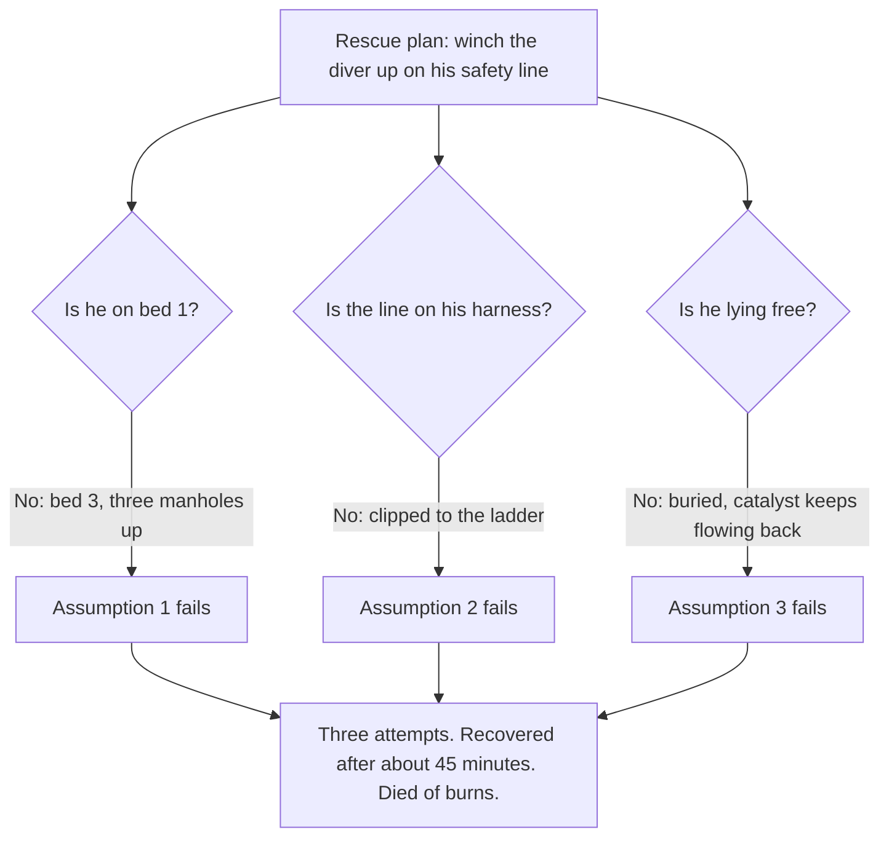

*Image: waa towaw on Unsplash.*

At about 11:15 on the morning of Friday 3 February 2023, a man working at the bottom of a 30-metre reactor at Zeeland Refinery, near Vlissingen in the Netherlands, said over the radio that he was trapped and could not move. He was a "diver": a catalyst-handling technician working inside a vessel full of nitrogen, breathing through a sealed helmet fed by two air hoses. A colleague went down the ladder to get him. Then a second. Both had to turn back. The third got him out at about 12:00. He was dead.

The Dutch Safety Board published its investigation, *Fatal accident in a reactor*, on 9 April 2025. On 14 April 2026 it published a follow-up note on what the parties have done since. Short version: the refinery's parent company has banned the method at every refinery it owns. The contractor says it can't stop yet. The Board says the sector isn't moving fast enough.

If you've ever stood on top of a reactor during a catalyst changeout, or you're a young tech wondering what "inert entry" on a job sheet actually means, this one is for you.

## What Inert Entry Is, and Why It Exists

Hydrotreating and hydrocracking reactors are tall steel vessels packed with catalyst: small pellets, a few millimetres to a few centimetres across, coated with metals like nickel, cobalt and molybdenum. Every few months to every few years, the spent catalyst has to come out and fresh catalyst goes in.

Here's the problem. Spent catalyst is loaded with sulphides and hydrocarbons, and when it meets oxygen it heats up on its own. Give it enough air and it catches fire. So the reactor is filled with nitrogen to push the oxygen out (the refinery's procedure kept it below 3 percent), and most of the catalyst is simply allowed to pour out of the "dump nozzles" at the bottom under gravity. That's called free flow.

But some of it always sticks. It cakes onto the walls, forms pillars, bridges across the bed. Firing a Cardox cartridge (a tube of pressurised CO2 that goes off like a shotgun inside the bed) breaks up a lot of it. Not all. For what's left, the industry's answer for forty years has been to send a person in.

That person is the diver. He wears a breathing-air helmet with two supply hoses in an umbilical and a small emergency bottle on his belt. He's clipped to a safety line that runs to a winch on top of the reactor. Above him stand a stand-by operator and a top safety manager; beside the reactor sits the Life Support Unit, a mobile control room where an LSU operator watches the oxygen and temperature readings and a camera feed. The diver goes down a ladder, through the manholes in each tray, and chips the caked catalyst loose with a shovel or a pneumatic hammer so it can be vacuumed out or dumped.

Everyone on that team knows one rule above all others: the catalyst must never come higher than your hips. If it does, and it collapses on you, you're buried in material that catches fire when it meets air. And your own exhaled breath, which leaves the helmet through valves at the bottom, still has about 16 percent oxygen in it.

## What the Report Says Happened

Reactor 302R03 is the hydrotreating reactor of Zeeland Refinery's hydrocracker. Inner diameter 4.1 metres, three catalyst beds, about 214 tonnes of catalyst, being unloaded for the first time since a 2020 start-up. The contractor, T.I.M.E. Service Catalyst Handling, had been on it since 30 January. The beds had been "blind dumped" (free-flowed without anyone inside and without watching the bed), Cardox had been fired, and the manhole to bed 3, the lowest, was opened at 01:00 on 3 February.

The night shift's diver chipped at the caked layer until morning and left, by his crew's account, a flat bed about 4 metres below the manhole. The day shift came on, held a short toolbox talk, waited for permits, and decided among themselves who would do what. The man who had dived the day before said he wanted to dive again. The supervisor agreed.

He went in at 08:45 and reached the caked material at about 09:00. By 10:00 another 12.6 cubic metres had gone out through the nozzles. At about 10:30 the LSU operator asked him to level the surface, which would have meant climbing back up to work from above. The report doesn't know why he didn't. It does note that after blind dumping there often isn't a flat higher surface to stand on at all.

Shortly before 11:15 he asked for the dump nozzles to be opened so the loosened catalyst could leave. The work instruction says the diver must be out of the reactor, or at least on a higher bed, when the nozzles open. His colleagues didn't know which bed he was on. They opened the nozzles anyway. In their words to investigators: he was very experienced, and he could probably judge the situation better than they could from a camera feed full of dust.

Then: open the nozzles. Close the nozzles. Help. I'm stuck.

## The Rescue That Was Never Rehearsed

The stand-by operator went down the ladder. At the bottom he found the diver's safety line clipped to the ladder, not to the diver. He dug, found a hand and the umbilical, and started shovelling. Loose catalyst kept flowing back over the man each time he cleared it. Catalyst dust got inside his own helmet. He couldn't breathe properly, couldn't tighten the seal, and had to abandon the attempt.

The second rescuer's umbilical tangled with the other cables in the manholes on the way down. He had to come back up too.

The supervisor called over a colleague from reactor 2 who came from the same region of Germany as the diver and spoke his dialect, so he could talk to him. The diver told him over the open radio that he was in trouble and that he was on fire. After that, nothing.

The third rescuer climbed down past a column of catalyst that might collapse on him, found the diver, and with the crew on top tried to winch him up by the umbilical. Impossible: too much catalyst on top of him. He finally used the vacuum hose to suck the material away, reached the harness, clipped the safety line on, and the winch brought the man up at about 12:00. The medical examiner recorded the cause of death as burns.

Here's the part of the report that should stop every HSE lead cold. The rescue plan, which the Board found "amounts to nothing more than the HSE plan", rested on three assumptions:

> "1. it is possible to hoist the diver up, regardless of which bed he is on inside the reactor; 2. the diver is attached to his safety line; 3. the diver is lying in a 'free' position and has not been buried under catalyst."

On 3 February 2023, none of the three was true. And the Board went further:

> "Actually extracting a person who is unable to move (or a dummy casualty) from a third bed or lower is neither trained nor examined as part of the SIR training programme, nor is it practised under the employer."

Sector experts told the Board that hauling an unconscious diver up from the second bed is "very difficult" and from the third or lower "virtually impossible if the rescue has to be carried out from above." The escape route from bed 3 passed through three manholes stacked on top of each other, with the umbilical, the camera cables and the safety line all running through the same holes.

## The Accident Nobody Had Heard Of

*Image: generated illustration (Flux.1), not a photo of the incident site.*

This is where the training angle bites.

In 2014 a diver died in a reactor at a refinery in Lingen, Germany. Same mechanism: buried under catalyst, which ignited on contact with his exhaled air. He was clipped to his safety line the whole time. It didn't matter; he couldn't be hoisted through the material on top of him. A similar burial happened in Antwerp in 2004. That man climbed out himself, burned.

Neither Zeeland Refinery nor T.I.M.E. knew about Lingen before 3 February 2023. The Dutch industrial-cleaning body SIR collects incidents from the Netherlands and Belgium. Lingen is in Germany. So the one fatal case that showed exactly how a buried diver dies was never in the risk register. The refinery's procedure 740-12 lists the risks for each task; "burns if buried" isn't in it. The controls against burial were a work instruction (hip height) and PPE. That was it.

The report also quotes the contractor's own instruction: "It is forbidden to disconnect the safety cable in the reactor." And then it quotes other divers, who explained to investigators that the line tangles in the cables and hoses, that everyone understands why you'd unclip it briefly to free yourself, and that in some situations unclipping is "even desirable." Which tells you how much a rule on paper is worth 25 metres down.

Add the physical reality. The diver had been doing hard, hot, dusty manual work for two and a half hours without a clear reference point for where he was relative to the catalyst. The Dutch labour inspectorate's guidance for industrial cleaning says strenuous work should run at most one hour at a time and four hours a day. At T.I.M.E., the report says, the diver decided for himself how long he stayed in. He was paid extra for the time inside.

## "Inherently Unsafe"

The Board's primary conclusion is one you don't often see in an official report:

> "Unloading reactors by means of inert entry is inherently unsafe for the employee who enters the reactor as a 'diver'. The measures that had been put in place to guarantee safety were not sufficiently robust. The parties involved wrongly assumed that the measures that had been put in place could sufficiently guarantee the safety of the employee and reduce the safety risk to an acceptable level."

The reasoning is simple once you see it. The refinery's own risk matrix rated the severity as "very serious" and accepted that nothing could reduce it: in nitrogen, under catalyst, with a fire, the outcome is death. So the only lever left is likelihood. And likelihood depends almost entirely on one tired man following rules in the dark, watched by a camera that can't see through the dust. The Board's words: "a reactor under an inert atmosphere is a life-threatening work environment."

There's also a procurement finding that contractors should read twice. The refinery's tender, back in 2011, asked specifically for methods in which the reactor would be filled with nitrogen so that it could be entered. The multi-year contract then locked the method in. It left room to discuss alternatives that would shorten the shutdown. It said nothing about alternatives that would make the job safer. In the Board's words, the contract "meant that the working method would no longer be brought up for discussion."

And one detail at the end of chapter 2 that nobody will enjoy reading. After the accident, with the labour inspectorate's approval of a no-entry method on 17 February, the crew went back to the reactor. It turned out the rest of 302R03 could be emptied completely by free flow and Cardox. Nobody had to go in.

## Three Years On

The 14 April 2026 follow-up note scores each recommendation.

**Recommendation 1, to T.I.M.E.: stop inert entry.** Not followed. The contractor says a full stop is not possible at this time because not every reactor is suited to the alternatives; it is minimising time inside and aims to stop in the future. The Board says it understands the commercial squeeze the company is in, and expects it to actually get there.

**Recommendations 2 and 3: share the lessons; lead the development of safer methods.** Zeeland Refinery: followed. TotalEnergies, its 55 percent owner, has banned inert entry at all its refineries. Since the accident the site has used wet unloading and no-entry unloading, and its tenders now explicitly invite contractors to propose and test new methods. T.I.M.E.: followed on development (it sits in the SIR working group), not followed on sharing. The Board couldn't tell from the response what the company was concretely doing to spread the lessons.

**Recommendation 4, to the State Secretary: make the sector stop.** Partly followed. The ministry agrees with the conclusions, has told the labour inspectorate to run targeted inspections, and is asking other EU states how they handle it. The Board calls that stance insufficiently encouraging, and a Board member told the Dutch press on 15 April 2026 that stopping this work "isn't going fast enough for us."

NOS reported at publication that tens of reactors in the Netherlands are still cleaned this way, that 400 to 500 people do this work across Europe, and that more than ten divers worldwide have died doing it in the past fifteen years. Le Havre, 2021: a diver lowered on a cable through a 45-centimetre manhole into an old reactor; comms failed, then the yes/no tugs on the umbilical failed, then the camera showed him hanging motionless. Porvoo, 2010: two technicians entered a reactor they thought was on air; it was on nitrogen; one died six months later.

## Why This Matters From a Contractor's Chair

Our crew does breathing-apparatus work in refineries. We hold the SCC/VCA certificates and we drill the things the SIR exam covers: the helmet, the double air line, the emergency bottle, the fall arrest. What this report says, in effect, is that every one of those drills is about keeping a diver alive while things go right. None of them is about getting a limp body up through three manholes when things go wrong. That isn't a gap in one company's training. It's a gap in the certification the whole sector relies on.

So, a few things we'd put on the table before a crew lead signs an inert-entry permit anywhere:

**Ask where the rescue stops working.** Not "do we have a rescue plan" but "from which bed can you actually get an unconscious man out, and have you ever done it with a dummy?" If the answer is "bed 1, in theory," then an entry to bed 3 is an entry with no rescue. Say so out loud, in the permit meeting, and let the client hear it.

**Treat the hip-height rule as a barrier that will fail.** The report is clear that disorientation in a dark, dusty reactor is normal, not a character flaw. If the plan relies on the diver judging his own position, the plan relies on luck. Push for controlled dumping (camera on the bed, a metre at a time, diver out) instead of blind dumping that leaves pillars taller than a man.

**Limit time inside, from outside.** The diver should never be the one deciding when he's had enough. One hour at a time is the Dutch inspectorate's number for strenuous cleaning work. Write it into the permit and have the LSU operator enforce it.

**Nitrogen is a hazard on both sides of the manway.** The CSB's case study on Valero Delaware City (No. 2006-02-I-DE, incident of 5 November 2005) is the mirror image of Zeeland: a hydrocracker reactor on nitrogen purge during a catalyst change, a boilermaker who leaned in for a dropped roll of tape, and a foreman who went in after him. Both died within about ten minutes. Oxygen at the manway read near zero. The CSB noted that in one study of 88 confined-space fatalities, 34 were would-be rescuers. Zeeland's stand-by operator was wearing full breathing apparatus and still had to turn back. Imagine the odds for someone who isn't.

**Read the tender.** If a client's scope says "unloading under nitrogen with inert entry" and nothing else, there's no commercial room to propose a safer method, and the Board has just told the whole sector that this is where the problem starts. A contractor who offers a wet-unloading or no-entry option in the bid, with the time and cost spelled out, is giving the client the choice the Zeeland contract never did.

## The Lesson

Everybody on that reactor knew the rules. The diver was experienced, certified, and had worked the same bed the day before. The team had a rescue plan, a winch, a camera, a life-support unit and radios. And when it mattered, the plan was built on three assumptions that had never been tested against a real body under real catalyst on a real third bed.

If your job can kill you in one mistake and the rescue plan is a paragraph nobody has rehearsed, the plan isn't a control. It's a hope. The Dutch Safety Board's position is that for inert entry the only real control is not going in. Until your client agrees, make sure every person on the platform knows exactly where the rescue stops working, and that the person deciding how long the diver stays inside is not the diver.

## Credit and Further Reading

- Dutch Safety Board (Onderzoeksraad voor Veiligheid), *Fatal accident in a reactor*, The Hague, April 2025: [full report PDF](https://onderzoeksraad.nl/wp-content/uploads/2025/06/Fatal-accident-in-a-reactor.pdf) and [investigation page](https://onderzoeksraad.nl/en/onderzoek/fatal-accident-in-a-reactor-zeeland-refinery/).
- Dutch Safety Board, *Opvolging aanbevelingen: Dodelijk ongeval in een reactor*, follow-up note 26.0000548, 14 April 2026: [PDF, Dutch](https://onderzoeksraad.nl/wp-content/uploads/2026/04/notitie-onderzoeksraad-opvolging-aanbevelingen-dodelijk-ongeval-in-een-reactor-zeeland-refinery.pdf).
- NOS, *OVV wil einde aan reiniging brandgevaarlijke tanks zonder zuurstof*, 9 April 2025: [article, Dutch](https://nos.nl/l/2562908).
- ANP via Welingelichte Kringen, *Onderzoeksraad wil snel andere werkwijze voor reiniging reactoren*, 15 April 2026: [article, Dutch](https://www.welingelichtekringen.nl/samenleving/onderzoeksraad-wil-snel-andere-werkwijze-voor-reiniging-reactoren).
- U.S. Chemical Safety Board, *Confined Space Entry: Worker and Would-be Rescuer Asphyxiated*, Case Study No. 2006-02-I-DE, Valero Delaware City refinery, 2 November 2006: [PDF](https://www.csb.gov/assets/1/20/Valero_Case_Study.pdf).
- U.S. Chemical Safety Board, *Hazards of Nitrogen Asphyxiation*, Safety Bulletin No. 2003-10-B, June 2003: [PDF](https://www.csb.gov/assets/1/20/sb-nitrogen-6-11-03.pdf).
- Related on this blog: [Fatal Fog: Six Died in a Room That Was Not a Confined Space](/en/blog/foundation-food-group-nitrogen-fatal-fog-csb) and [the Bacchus argon pit asphyxiation](/en/blog/argon-pit-asphyxiation-bacchus-csb).

Individuals in the Dutch Safety Board report are referred to here by role only.
