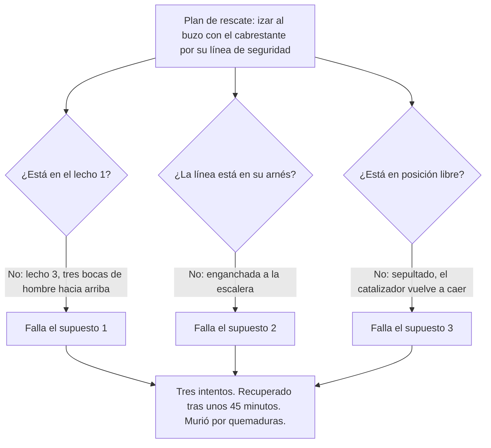

*Imagen: waa towaw en Unsplash.*

Hacia las 11:15 de la mañana del viernes 3 de febrero de 2023, un hombre que trabajaba en el fondo de un reactor de 30 metros en Zeeland Refinery, cerca de Vlissingen (Países Bajos), dijo por radio que estaba atrapado y no podía moverse. Era un «buzo»: un técnico de manejo de catalizador que trabaja dentro de un recipiente lleno de nitrógeno, respirando a través de un casco estanco alimentado por dos mangueras de aire. Un compañero bajó por la escalera a por él. Luego un segundo. Los dos tuvieron que dar marcha atrás. El tercero lo sacó hacia las 12:00. Estaba muerto.

El Consejo de Seguridad neerlandés (Onderzoeksraad voor Veiligheid) publicó su investigación, *Fatal accident in a reactor* («Accidente mortal en un reactor»), el 9 de abril de 2025. El 14 de abril de 2026 publicó una nota de seguimiento sobre lo que las partes han hecho desde entonces. Versión corta: la matriz de la refinería ha prohibido el método en todas las refinerías que posee. El contratista dice que todavía no puede parar. El Consejo dice que el sector no avanza lo bastante rápido.

Si alguna vez has estado de pie sobre un reactor durante un cambio de catalizador, o eres un técnico joven preguntándose qué significa realmente «entrada inerte» en una orden de trabajo, esto es para ti.

## Qué es la entrada inerte y por qué existe

Los reactores de hidrotratamiento e hidrocraqueo son recipientes de acero altos, llenos de catalizador: pequeños gránulos, de unos milímetros a unos centímetros, recubiertos de metales como níquel, cobalto y molibdeno. Cada pocos meses o cada pocos años, el catalizador gastado tiene que salir y entra catalizador fresco.

Aquí está el problema. El catalizador gastado está cargado de sulfuros e hidrocarburos, y cuando encuentra oxígeno se calienta por sí solo. Dale suficiente aire y se incendia. Por eso el reactor se llena de nitrógeno para expulsar el oxígeno (el procedimiento de la refinería lo mantenía por debajo del 3 por ciento), y la mayor parte del catalizador simplemente se deja caer por gravedad a través de las «boquillas de descarga» del fondo. Eso se llama flujo libre.

Pero una parte siempre se queda pegada. Se apelmaza en las paredes, forma columnas, hace puentes a través del lecho. Disparar un cartucho Cardox (un tubo de CO2 a presión que estalla como una escopeta dentro del lecho) rompe buena parte. No todo. Para lo que queda, la respuesta de la industria desde hace cuarenta años ha sido mandar a una persona dentro.

Esa persona es el buzo. Lleva un casco de aire respirable con dos mangueras de suministro en un umbilical y una pequeña botella de emergencia en el cinturón. Va enganchado a una línea de seguridad que llega a un cabrestante en lo alto del reactor. Por encima de él están un operador de reserva (stand-by) y un responsable de seguridad en la boca del reactor; junto al reactor está la Unidad de Soporte Vital (LSU), una sala de control móvil donde un operador de LSU vigila las lecturas de oxígeno y temperatura y la imagen de una cámara. El buzo baja por una escalera, a través de las bocas de hombre de cada bandeja, y pica el catalizador apelmazado con una pala o un martillo neumático para que pueda aspirarse o descargarse.

Todos en ese equipo conocen una regla por encima de las demás: el catalizador nunca debe llegar más arriba de tus caderas. Si llega, y se derrumba sobre ti, quedas sepultado en un material que se incendia al encontrar aire. Y tu propio aire exhalado, que sale del casco por válvulas en la parte inferior, todavía contiene alrededor de un 16 por ciento de oxígeno.

## Lo que el informe dice que ocurrió

El reactor 302R03 es el reactor de hidrotratamiento del hidrocraqueador de Zeeland Refinery. Diámetro interior de 4,1 metros, tres lechos de catalizador, unas 214 toneladas de catalizador, descargado por primera vez desde su arranque en 2020. El contratista, T.I.M.E. Service Catalyst Handling, llevaba en él desde el 30 de enero. Los lechos se habían «descargado a ciegas» (flujo libre sin nadie dentro y sin vigilar el lecho), se había disparado Cardox, y la boca de hombre del lecho 3, el más bajo, se abrió a la 01:00 del 3 de febrero.

El buzo del turno de noche picó la capa apelmazada hasta la mañana y dejó, según su equipo, un lecho plano unos 4 metros por debajo de la boca de hombre. Llegó el turno de día, hizo una breve charla de seguridad, esperó los permisos y decidió entre ellos quién haría qué. El hombre que había bajado el día anterior dijo que quería bajar de nuevo. El supervisor aceptó.

Entró a las 08:45 y llegó al material apelmazado hacia las 09:00. Para las 10:00 habían salido otros 12,6 metros cúbicos por las boquillas. Hacia las 10:30 el operador de LSU le pidió que nivelara la superficie, lo que habría supuesto volver a subir para trabajar desde arriba. El informe no sabe por qué no lo hizo. Sí señala que tras una descarga a ciegas a menudo no hay ninguna superficie plana más alta sobre la que ponerse.

Poco antes de las 11:15 pidió que abrieran las boquillas de descarga para que saliera el catalizador que había soltado. La instrucción de trabajo dice que el buzo debe estar fuera del reactor, o al menos en un lecho superior, cuando se abren las boquillas. Sus compañeros no sabían en qué lecho estaba. Las abrieron igualmente. En sus palabras a los investigadores: tenía mucha experiencia, y probablemente podía juzgar la situación mejor que ellos a través de una imagen de cámara llena de polvo.

Y entonces: abrid las boquillas. Cerrad las boquillas. Ayuda. Estoy atrapado.

## El rescate que nunca se ensayó

El operador de reserva bajó por la escalera. Al pie encontró la línea de seguridad del buzo enganchada a la escalera, no al buzo. Escarbó, encontró una mano y el umbilical, y empezó a palear. El catalizador suelto volvía a caer sobre el hombre cada vez que lo despejaba. El polvo de catalizador entró en su propio casco. No podía respirar bien, no podía apretar el sellado, y tuvo que abandonar el intento.

El umbilical del segundo rescatador se enredó con los otros cables en las bocas de hombre al bajar. También tuvo que volver a subir.

El supervisor llamó a un compañero del reactor 2 que era de la misma región de Alemania que el buzo y hablaba su dialecto, para que pudiera hablar con él. El buzo le dijo por la radio abierta que estaba en apuros y que se estaba quemando. Después de eso, nada.

El tercer rescatador bajó junto a una columna de catalizador que podía desplomarse sobre él, encontró al buzo y, con el equipo de arriba, intentó izarlo por el umbilical con el cabrestante. Imposible: demasiado catalizador encima. Al final usó la manguera de aspiración para retirar el material, llegó al arnés, enganchó la línea de seguridad y el cabrestante subió al hombre hacia las 12:00. El forense registró como causa de la muerte las quemaduras.

Esta es la parte del informe que debería helar a cualquier responsable de HSE. El plan de rescate, que según el Consejo «no es más que el plan de HSE», descansaba sobre tres supuestos:

> «1. es posible izar al buzo, con independencia del lecho del reactor en que se encuentre; 2. el buzo está enganchado a su línea de seguridad; 3. el buzo está en posición "libre" y no ha quedado sepultado bajo catalizador.»

El 3 de febrero de 2023 ninguno de los tres era cierto. Y el Consejo fue más allá:

> «La extracción real de una persona que no puede moverse (o de un maniquí) desde un tercer lecho o inferior no se entrena ni se examina en el programa de formación de SIR, ni se practica en la empresa.»

Expertos del sector dijeron al Consejo que izar a un buzo inconsciente desde el segundo lecho es «muy difícil» y desde el tercero o inferior «prácticamente imposible si el rescate tiene que hacerse desde arriba». La vía de escape desde el lecho 3 pasaba por tres bocas de hombre apiladas una sobre otra, por las que también discurrían el umbilical, los cables de la cámara y la línea de seguridad.

## El accidente del que nadie había oído hablar

*Imagen: ilustración generada (Flux.1), no es una foto del lugar del incidente.*

Aquí es donde muerde el ángulo de la formación.

En 2014 un buzo murió en un reactor de una refinería de Lingen, Alemania. El mismo mecanismo: sepultado bajo catalizador, que se encendió al contacto con su aire exhalado. Estuvo enganchado a su línea de seguridad todo el tiempo. No sirvió; no pudo izarse a través del material que tenía encima. Un sepultamiento parecido ocurrió en Amberes en 2004. Aquel hombre salió por su propio pie, con quemaduras.

Ni Zeeland Refinery ni T.I.M.E. sabían de Lingen antes del 3 de febrero de 2023. El organismo neerlandés de limpieza industrial SIR recoge incidentes de los Países Bajos y Bélgica. Lingen está en Alemania. Así que el único caso mortal que mostraba exactamente cómo muere un buzo sepultado nunca estuvo en el registro de riesgos. El procedimiento 740-12 de la refinería enumera los riesgos de cada tarea; «quemaduras en caso de sepultamiento» no está. Los controles contra el sepultamiento eran una instrucción de trabajo (altura de la cadera) y EPI. Eso era todo.

El informe también cita la propia instrucción del contratista: «Está prohibido desconectar el cable de seguridad en el reactor.» Y luego cita a otros buzos, que explicaron a los investigadores que la línea se enreda en los cables y mangueras, que todos entienden por qué la desengancharías un momento para liberarte, y que en algunas situaciones desengancharla es «incluso deseable». Lo que te dice cuánto vale una regla sobre el papel a 25 metros de profundidad.

Añade la realidad física. El buzo llevaba dos horas y media haciendo trabajo manual duro, caliente y polvoriento sin una referencia clara de dónde estaba respecto al catalizador. La guía de la inspección de trabajo neerlandesa para limpieza industrial dice que el trabajo pesado debe durar como máximo una hora seguida y cuatro horas al día. En T.I.M.E., dice el informe, el buzo decidía por sí mismo cuánto tiempo se quedaba dentro. Le pagaban un plus por el tiempo dentro.

## «Intrínsecamente inseguro»

La conclusión principal del Consejo es de las que no se ven a menudo en un informe oficial:

> «Descargar reactores mediante entrada inerte es intrínsecamente inseguro para el trabajador que entra en el reactor como "buzo". Las medidas que se habían implantado para garantizar la seguridad no eran suficientemente robustas. Las partes implicadas asumieron erróneamente que las medidas implantadas podían garantizar suficientemente la seguridad del trabajador y reducir el riesgo a un nivel aceptable.»

El razonamiento es sencillo una vez lo ves. La propia matriz de riesgos de la refinería calificaba la gravedad como «muy grave» y aceptaba que nada podía reducirla: en nitrógeno, bajo catalizador, con fuego, el resultado es la muerte. Así que la única palanca que queda es la probabilidad. Y la probabilidad depende casi por completo de un hombre cansado siguiendo reglas a oscuras, vigilado por una cámara que no ve a través del polvo. En palabras del Consejo: «un reactor en atmósfera inerte es un entorno de trabajo que amenaza la vida».

Hay también un hallazgo sobre la contratación que los contratistas deberían leer dos veces. La licitación de la refinería, allá por 2011, pedía específicamente métodos en los que el reactor se llenara de nitrógeno para poder entrar en él. El contrato plurianual fijó después el método. Dejaba margen para discutir alternativas que acortaran la parada. No decía nada de alternativas que hicieran el trabajo más seguro. En palabras del Consejo, el contrato «significaba que el método de trabajo ya no se volvería a poner en discusión».

Y un detalle al final del capítulo 2 que nadie disfrutará leyendo. Tras el accidente, con la aprobación por la inspección de trabajo de un método sin entrada el 17 de febrero, el equipo volvió al reactor. Resultó que el resto del 302R03 podía vaciarse por completo con flujo libre y Cardox. Nadie tuvo que entrar.

## Tres años después

La nota de seguimiento del 14 de abril de 2026 puntúa cada recomendación.

**Recomendación 1, a T.I.M.E.: dejar la entrada inerte.** No cumplida. El contratista dice que una parada total no es posible por ahora porque no todos los reactores se prestan a las alternativas; está reduciendo al mínimo el tiempo dentro y aspira a parar en el futuro. El Consejo dice que entiende el aprieto comercial en que está la empresa y espera que de verdad llegue a hacerlo.

**Recomendaciones 2 y 3: compartir las lecciones; liderar el desarrollo de métodos más seguros.** Zeeland Refinery: cumplidas. TotalEnergies, propietaria del 55 por ciento, ha prohibido la entrada inerte en todas sus refinerías. Desde el accidente la planta ha usado descarga húmeda y descarga sin entrada, y sus licitaciones ahora invitan explícitamente a los contratistas a proponer y probar nuevos métodos. T.I.M.E.: cumplida en desarrollo (participa en el grupo de trabajo de SIR), no cumplida en difusión. El Consejo no pudo deducir de la respuesta qué hacía la empresa en concreto para difundir las lecciones.

**Recomendación 4, al secretario de Estado: hacer que el sector pare.** Cumplida en parte. El ministerio comparte las conclusiones, ha encargado a la inspección de trabajo inspecciones específicas y está preguntando a otros Estados de la UE cómo lo gestionan. El Consejo califica esa postura de insuficientemente impulsora, y un miembro del Consejo dijo a la prensa neerlandesa el 15 de abril de 2026 que dejar este trabajo «no va lo bastante rápido para nosotros».

NOS informó al publicarse el informe de que decenas de reactores en los Países Bajos todavía se limpian así, de que entre 400 y 500 personas hacen este trabajo en Europa, y de que más de diez buzos en todo el mundo han muerto así en los últimos quince años. Le Havre, 2021: un buzo descendido con un cable por una boca de hombre de 45 centímetros en un reactor viejo; falló la comunicación, luego fallaron los tirones de sí/no en el umbilical, luego la cámara lo mostró colgando inmóvil. Porvoo, 2010: dos técnicos entraron en un reactor que creían en aire; estaba en nitrógeno; uno murió seis meses después.

## Por qué importa desde la silla del contratista

Nuestro equipo hace trabajos con equipo de respiración en refinerías. Tenemos los certificados SCC/VCA y entrenamos lo que cubre el examen de SIR: el casco, la doble línea de aire, la botella de emergencia, el anticaídas. Lo que este informe dice, en la práctica, es que cada uno de esos ejercicios sirve para mantener vivo a un buzo mientras las cosas van bien. Ninguno sirve para subir un cuerpo inerte por tres bocas de hombre cuando las cosas van mal. Eso no es una laguna en la formación de una empresa. Es una laguna en la certificación de la que depende todo el sector.

Así que, unas cuantas cosas que pondríamos sobre la mesa antes de que un jefe de equipo firme un permiso de entrada inerte en cualquier sitio:

**Pregunta dónde deja de funcionar el rescate.** No «¿tenemos plan de rescate?» sino «¿desde qué lecho podéis sacar de verdad a un hombre inconsciente, y lo habéis hecho alguna vez con un maniquí?». Si la respuesta es «lecho 1, en teoría», entonces una entrada al lecho 3 es una entrada sin rescate. Dilo en voz alta, en la reunión del permiso, y que el cliente lo oiga.

**Trata la regla de la altura de la cadera como una barrera que fallará.** El informe es claro en que la desorientación en un reactor oscuro y polvoriento es normal, no un defecto de carácter. Si el plan depende de que el buzo juzgue su propia posición, el plan depende de la suerte. Empuja hacia una descarga controlada (cámara sobre el lecho, metro a metro, buzo fuera) en vez de una descarga a ciegas que deja columnas más altas que una persona.

**Limita el tiempo dentro desde fuera.** El buzo nunca debería ser quien decide cuándo ha tenido bastante. Una hora seguida es la cifra de la inspección neerlandesa para trabajo pesado de limpieza. Escríbelo en el permiso y que el operador de LSU lo haga cumplir.

**El nitrógeno es un peligro a ambos lados de la boca de hombre.** El estudio de caso de la CSB sobre Valero Delaware City (n.º 2006-02-I-DE, incidente del 5 de noviembre de 2005) es la imagen especular de Zeeland: un reactor de hidrocraqueo en purga de nitrógeno durante un cambio de catalizador, un calderero que se asomó a por un rollo de cinta caído, y un capataz que entró tras él. Los dos murieron en unos diez minutos. El oxígeno en la boca de hombre marcaba casi cero. La CSB señaló que en un estudio de 88 muertes en espacios confinados, 34 eran rescatadores improvisados. El operador de reserva de Zeeland llevaba equipo de respiración completo y aun así tuvo que dar marcha atrás. Imagina las probabilidades de alguien que no lo lleva.

**Lee la licitación.** Si el alcance del cliente dice «descarga bajo nitrógeno con entrada inerte» y nada más, no hay margen comercial para proponer un método más seguro, y el Consejo acaba de decir a todo el sector que ahí es donde empieza el problema. Un contratista que ofrece en la oferta una opción de descarga húmeda o sin entrada, con tiempo y coste detallados, da al cliente la elección que el contrato de Zeeland nunca dio.

## La lección

Todos en ese reactor conocían las reglas. El buzo tenía experiencia, estaba certificado y había trabajado en el mismo lecho el día anterior. El equipo tenía un plan de rescate, un cabrestante, una cámara, una unidad de soporte vital y radios. Y cuando importó, el plan se apoyaba en tres supuestos que nunca se habían puesto a prueba con un cuerpo real bajo catalizador real en un tercer lecho real.

Si tu trabajo puede matarte con un solo error y el plan de rescate es un párrafo que nadie ha ensayado, el plan no es un control. Es una esperanza. La posición del Consejo de Seguridad neerlandés es que, en la entrada inerte, el único control real es no entrar. Hasta que tu cliente esté de acuerdo, asegúrate de que cada persona en la plataforma sabe exactamente dónde deja de funcionar el rescate, y de que quien decide cuánto tiempo se queda dentro el buzo no es el buzo.

## Créditos y lecturas adicionales

- Consejo de Seguridad neerlandés (Onderzoeksraad voor Veiligheid), *Fatal accident in a reactor*, La Haya, abril de 2025: [informe completo en PDF](https://onderzoeksraad.nl/wp-content/uploads/2025/06/Fatal-accident-in-a-reactor.pdf) y [página de la investigación](https://onderzoeksraad.nl/en/onderzoek/fatal-accident-in-a-reactor-zeeland-refinery/).
- Consejo de Seguridad neerlandés, *Opvolging aanbevelingen: Dodelijk ongeval in een reactor*, nota de seguimiento 26.0000548, 14 de abril de 2026: [PDF, en neerlandés](https://onderzoeksraad.nl/wp-content/uploads/2026/04/notitie-onderzoeksraad-opvolging-aanbevelingen-dodelijk-ongeval-in-een-reactor-zeeland-refinery.pdf).
- NOS, *OVV wil einde aan reiniging brandgevaarlijke tanks zonder zuurstof*, 9 de abril de 2025: [artículo, en neerlandés](https://nos.nl/l/2562908).
- ANP vía Welingelichte Kringen, *Onderzoeksraad wil snel andere werkwijze voor reiniging reactoren*, 15 de abril de 2026: [artículo, en neerlandés](https://www.welingelichtekringen.nl/samenleving/onderzoeksraad-wil-snel-andere-werkwijze-voor-reiniging-reactoren).
- Junta de Seguridad Química de EE. UU. (CSB), *Confined Space Entry: Worker and Would-be Rescuer Asphyxiated*, estudio de caso n.º 2006-02-I-DE, refinería Valero Delaware City, 2 de noviembre de 2006: [PDF](https://www.csb.gov/assets/1/20/Valero_Case_Study.pdf).
- CSB, *Hazards of Nitrogen Asphyxiation*, boletín de seguridad n.º 2003-10-B, junio de 2003: [PDF](https://www.csb.gov/assets/1/20/sb-nitrogen-6-11-03.pdf).
- Relacionado en este blog: [Niebla mortal: seis muertos en una sala que no era un espacio confinado](/es/blog/foundation-food-group-nitrogen-fatal-fog-csb) y [el foso de argón de Bacchus](/es/blog/argon-pit-asphyxiation-bacchus-csb).

Las personas que aparecen en el informe del Consejo de Seguridad neerlandés se mencionan aquí solo por su función.
